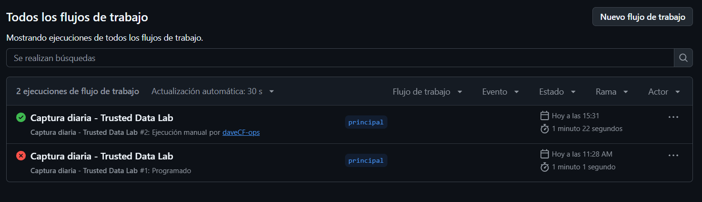
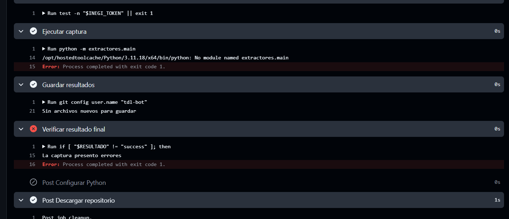
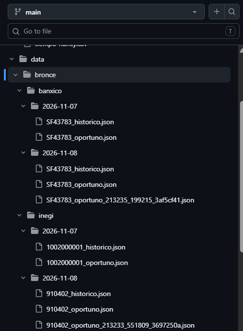
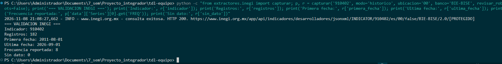
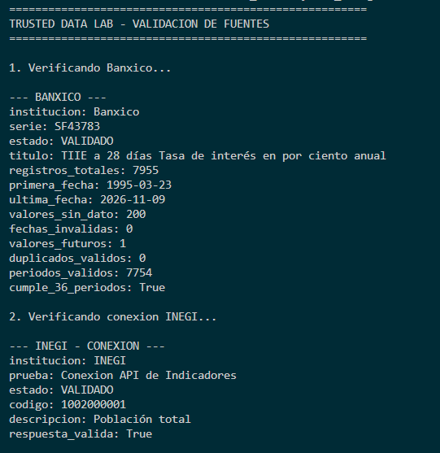
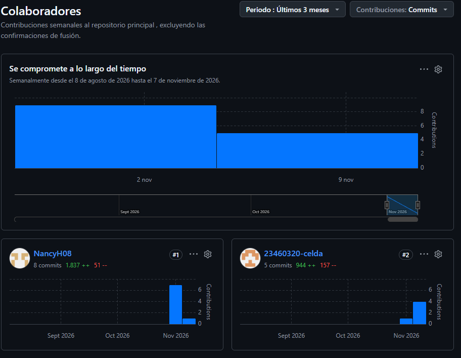

# Relatoría E0 · Observatorio de Vivienda y Costos de Colima

**Equipo:** David Cuevas Farías y Nancy Haide Vázquez Ávalos  
**Periodo de trabajo:** 6 al 8 de noviembre de 2026

## 1. Qué nos propusimos

Definir la pregunta central de nuestro observatorio enfocado en los costos de vivienda en Colima, validar el problema con un actor real del sector inmobiliario, inicializar nuestro repositorio en GitHub y preparar la máquina de captura automática (capa Bronce) utilizando datos oficiales de INEGI y Banco de México.

## 2. Qué hicimos: cronología de trabajo

| Fecha y horario                         | Responsable               | Actividad                                                                                                              | Duración |
| :-------------------------------------- | :------------------------ | :--------------------------------------------------------------------------------------------------------------------- | :------: |
| **Viernes 6 de noviembre, 16:00–19:00** | Ambos                     | Planeación del proyecto, clonación del repositorio y definición de la arquitectura por capas (Bronce, Plata y Oro).    |   3 h    |
| **Viernes 6 de noviembre, 18:30–21:00** | Nancy (Data Engineer)     | Programación de `base.py`, configuración de extractores y obtención/configuración de tokens.                           |  4.5 h   |
| **Sábado 7 de noviembre, 10:00–14:30**  | David (Data Statistician) | Investigación de catálogos de INEGI y Banxico y pruebas de conexión a las API.                                         |  4.5 h   |
| **Sábado 7 de noviembre, 15:00–16:00**  | Ambos                     | Revisión cruzada, atención de errores relacionados con las URL y configuración de archivos de calidad (CSV).           |   1 h    |
| **Domingo 8 de noviembre, 10:00–14:00** | Ambos                     | Configuración del workflow de GitHub Actions, redacción de la propuesta técnica y revisión de la captura automatizada. |   4 h    |

*(Nota: Las actividades simultáneas fueron registradas en los archivos PSP individuales de cada integrante).*

## 3. Qué decidimos y por qué

### Fuente de Banco de México
**Decisión:** Utilizar la serie oficial `SF43783`, correspondiente a la TIIE a 28 días, como indicador financiero de referencia.
**Justificación:** La serie permite incorporar una referencia de condiciones financieras y cuenta con un histórico amplio de 7,955 registros (7,755 valores numéricos y 200 marcados como `N/E`).
**Alcance:** Es una tasa de referencia nacional; no equivale a una tasa hipotecaria específica ni mide directamente el costo de vivienda local.

### Indicador de INEGI
**Decisión:** Utilizar el indicador `910402` (Inflación subyacente de servicios a nivel nacional).
**Justificación:** Durante las pruebas, el indicador de rentas no produjo los resultados históricos esperados (error HTTP 400). El indicador `910402` devolvió 182 periodos mensuales continuos, cumpliendo el requisito de más de 36 periodos.
**Alcance:** Se presenta como contexto de inflación de servicios, no como un índice local de rentas de Colima.

### Alternativas consideradas
Se descartó el scraping de portales inmobiliarios (ej. Inmuebles24) debido a las limitaciones de acceso y a la falta de un histórico público adecuado. Se priorizó el uso de APIs oficiales que garantizan la legalidad y trazabilidad de los datos.

## 4. Qué salió mal y cómo lo corregimos

|  N.º  | Tipo                   | Problema                                                                                                                                                                                                                                                                                                                                       | Corrección                                                                                                                                                                                                                                                                           | Tiempo |
| :---: | :--------------------- | :--------------------------------------------------------------------------------------------------------------------------------------------------------------------------------------------------------------------------------------------------------------------------------------------------------------------------------------------- | :----------------------------------------------------------------------------------------------------------------------------------------------------------------------------------------------------------------------------------------------------------------------------------- | :----: |
| **1** | Sintaxis / Integración | Error de importación al inicio del proyecto.                                                                                                                                                                                                                                                                                                   | Se reestructuró la llamada a `ExtractorEtico`.                                                                                                                                                                                                                                       | 15 min |
| **2** | Datos / API            | Error HTTP 400 al consultar el histórico de INEGI.                                                                                                                                                                                                                                                                                             | Se identificó que el parámetro `?type=json` rompía la URL en modo histórico. Se ajustó la construcción de la URL.                                                                                                                                                                    | 30 min |
| **3** | Datos / Cobertura      | El indicador de INEGI probado inicialmente solo devolvía 16 periodos.                                                                                                                                                                                                                                                                          | Se cambió la consulta al indicador `910402`, obteniendo 182 periodos mensuales.                                                                                                                                                                                                      | 20 min |
| **4** | Git / Archivos         | La configuración de `.gitignore` impedía incluir archivos de `data/bronce`.                                                                                                                                                                                                                                                                    | Se modificó la configuración para permitir versionar los archivos JSON de evidencia.                                                                                                                                                                                                 | 10 min |
| **5** | Automatización()       | La primera ejecución programada de GitHub Actions falló porque Python no encontró el módulo `extractores.main`, mostrando el error `No module named extractores.main`. Esto ocurrió durante la integración del repositorio, cuando los archivos del orquestador todavía no estaban disponibles en la rama principal utilizada por el workflow. | Se integraron los archivos necesarios y se realizó una ejecución manual que finalizó correctamente en 1 minuto y 22 segundos. No fue necesario modificar el funcionamiento del extractor; el problema estaba relacionado con la disponibilidad de los archivos en la rama ejecutada. | 15 min |

## 5. Qué aprendimos

### Ingeniería de Datos
Aprendimos a conectar APIs oficiales mediante extractores en Python, manejar tokens de forma segura sin publicarlos en el repositorio, y automatizar capturas con GitHub Actions. También reforzamos la importancia de conservar los datos crudos en la capa Bronce.

### Análisis Estadístico
Aprendimos a distinguir entre una tasa de referencia nacional (TIIE) y un indicador de inflación (INEGI). Identificamos que la frecuencia, cobertura geográfica y cantidad de periodos deben revisarse antes de utilizar una serie en un pronóstico.

### Calidad en los Sistemas de Información
Aprendimos a registrar tiempos y defectos mediante los archivos PSP, realizar revisiones cruzadas y documentar errores de integración. Los objetivos de disponibilidad y cobertura deben medirse con evidencia real.

## 6. Evidencias

- **Captura automatizada:** [Ejecución exitosa de GitHub Actions](https://github.com/NancyHaideVazquez/trusted-data-lab/actions) (Ejecutada manualmente por David).
- **Datos crudos de INEGI:** `data/bronce/inegi/` (182 registros mensuales).
- **Datos crudos de Banxico:** `data/bronce/banxico/` (7,955 registros históricos).
- **Código de extracción:** `extractores/base.py`, `extractores/inegi.py`, `extractores/banxico.py` y `extractores/main.py`.
- **Propuesta:** `docs/E0/propuesta.md`.
- **Entrega:** `docs/E0/ENTREGA.md`.
- **Calidad:** `calidad/tiempo-david.csv`, `calidad/defectos-david.csv`, `calidad/tiempo-nancy.csv` y `calidad/defectos-nancy.csv`.
- **Entrevista:** Realizada el 08 de noviembre de 2026 vía WhatsApp con el asesor inmobiliario. Los aprendizajes se detallan en la propuesta.

### Evidencias visuales

**Figura 1. Historial de ejecuciones de GitHub Actions.**

Se observa una ejecución programada fallida y una ejecución
manual posterior que finalizó correctamente.

**Figura 2. Error identificado durante la integración.**

La primera ejecución no encontró el módulo `extractores.main`,
debido a que todavía no estaba disponible en la rama principal.

**Figura 3. Almacenamiento de datos en la capa Bronce.**

Archivos JSON generados por los extractores de INEGI y Banxico,
organizados por institución y fecha de captura.

**Figura 4. Validación histórica de INEGI.**

Consulta exitosa del indicador `910402`, con 182 registros,
frecuencia mensual y cobertura de agosto de 2011 a septiembre
de 2026.

**Figura 5. Validación histórica de Banco de México.**

Verificación de la serie `SF43783`, con 7,955 registros recibidos,
200 valores sin dato y 7,754 observaciones válidas en la
validación realizada.

**Figura 6. Participación de los integrantes del equipo.**

Registro de contribuciones y commits de los dos integrantes
durante el desarrollo del proyecto.

## 7. Uso de IA generativa: herramientas y propósito

Se utilizaron ChatGPT y Claude como asistentes de apoyo durante el desarrollo del proyecto. Se emplearon para apoyar la estructuración de la clase `ExtractorEtico`, revisar posibles errores de programación, apoyar la corrección del workflow de GitHub Actions y preparar borradores de documentación. 

Las sugerencias generadas por IA fueron revisadas, probadas y validadas por los integrantes del equipo, quienes conservaron en todo momento la responsabilidad sobre las decisiones técnicas y los resultados entregados.

## 8. Validación antes de entregar

- [x] Fechas, horarios, responsables y duración cotejados con los registros PSP.
- [x] Defectos descritos y correcciones corresponden a los commits reales.
- [x] Conteo y rango de fechas de los datos de INEGI confirmados (182 periodos).
- [x] Conteo de valores de Banxico confirmado (7,955 registros).
- [x] Enlace de GitHub Actions validado.
- [x] Archivos JSON verificados sin tokens ni credenciales.
- [x] Evidencia de la entrevista agregada.
- [x] Nombres y rutas de los archivos coinciden con el repositorio.

---
**Fin de la relatoría E0 — Trusted Data Lab**