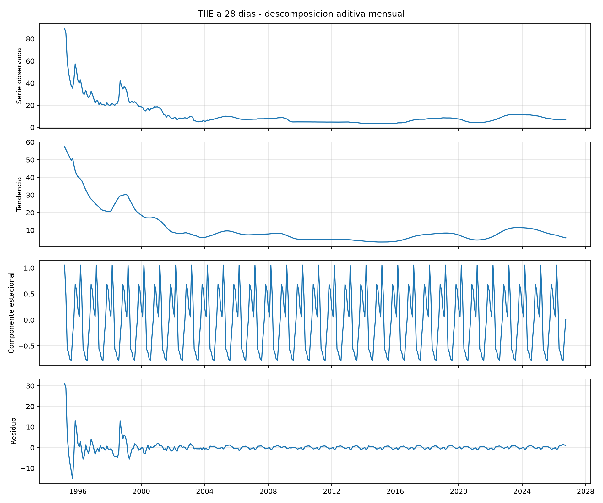
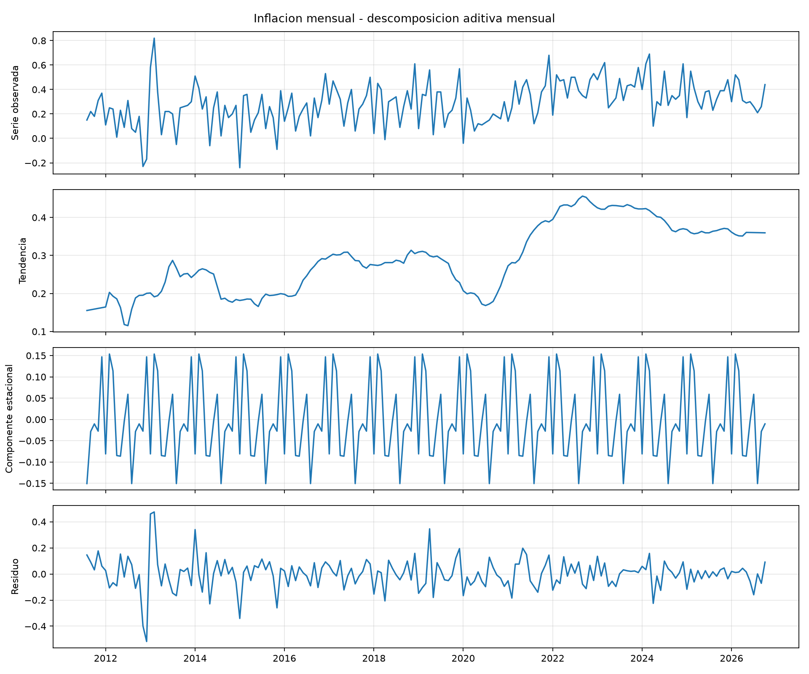
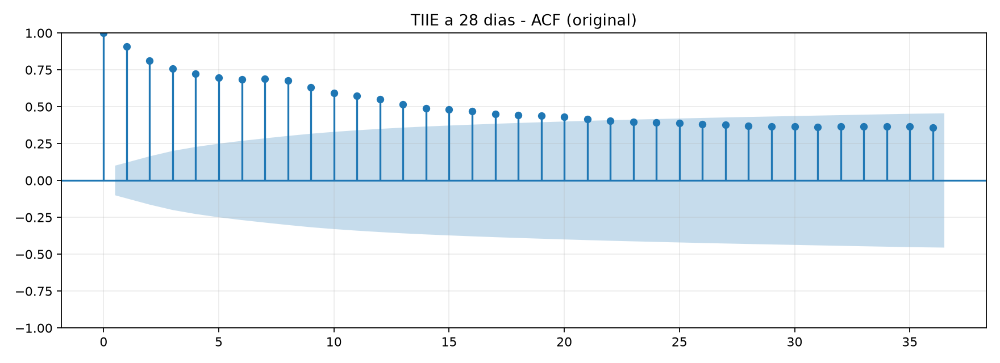
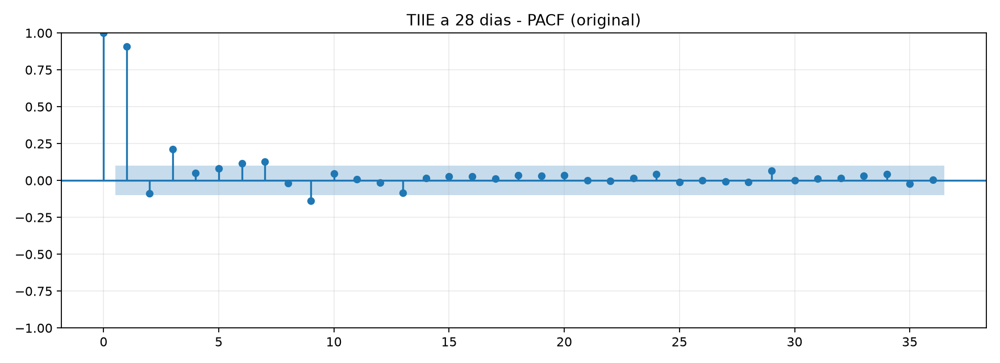
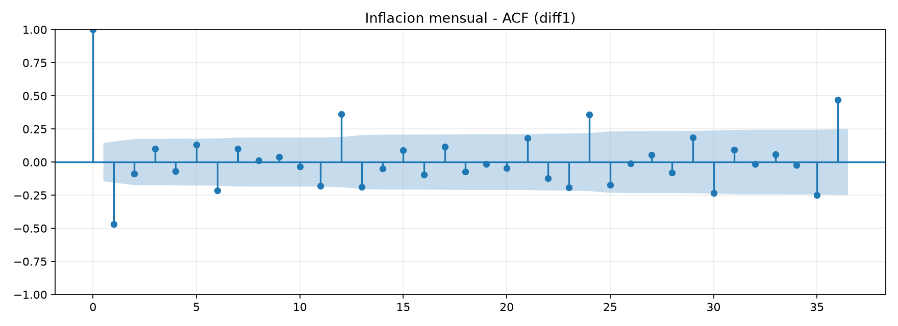
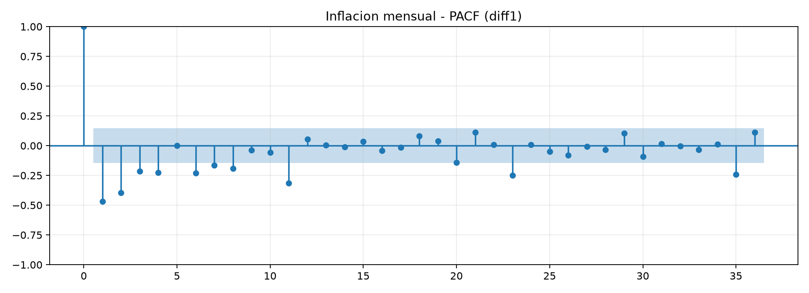
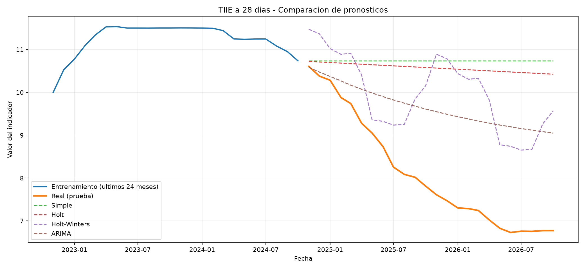
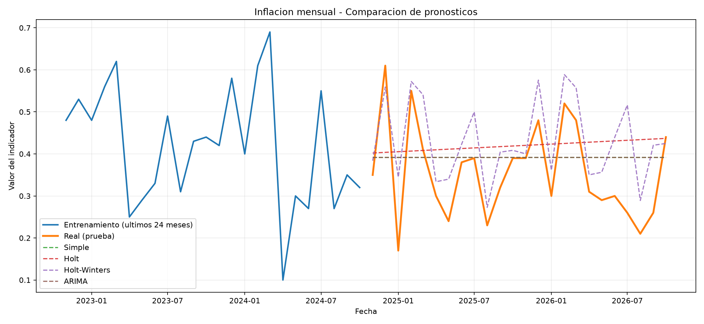
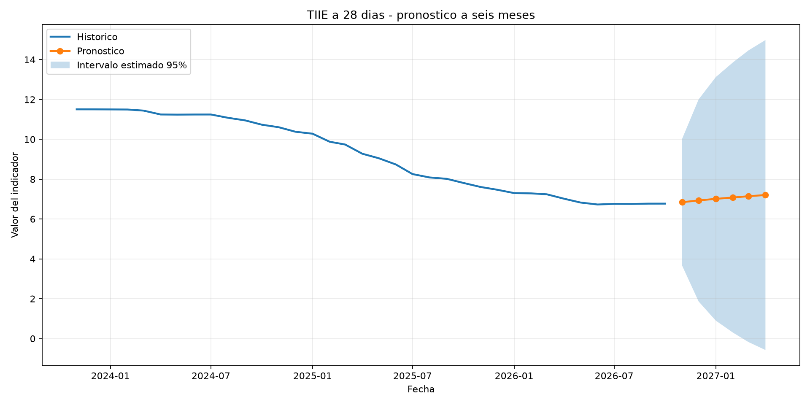
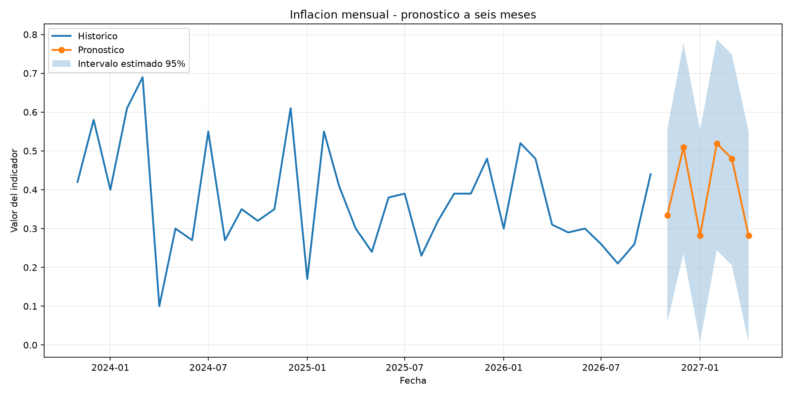

# Análisis estadístico de series temporales — E1

**Proyecto:** Trusted Data Lab

**Observatorio:** Vivienda y Costos de Colima

**Fuentes:** Banco de México (Banxico) e INEGI

**Datos de entrada:** `data/oro/indicadores_mensuales.csv`

## 1. Objetivo

Caracterizar las series históricas del observatorio, identificar sus componentes de tendencia y estacionalidad, evaluar su estacionariedad y estudiar sus patrones de autocorrelación.

Este análisis proporciona una base estadística para seleccionar y comparar modelos de pronóstico.

## 2. Series analizadas

| Indicador | Fuente | Periodo | Observaciones |
|---|---|---|---:|
| TIIE a 28 días | Banxico | Marzo de 1995 a octubre de 2026 | 380 |
| Inflación mensual | INEGI | Agosto de 2011 a octubre de 2026 | 183 |

Se excluyó noviembre de 2026 de la serie Banxico porque el mes todavía no había concluido al realizar el análisis.

Las dos series son mensuales, continuas y no presentan valores nulos ni periodos duplicados en el intervalo utilizado.

## 3. Caracterización y descomposición

Se utilizó una descomposición clásica aditiva con periodicidad de 12 meses.

La elección se justifica porque la inflación mensual contiene valores negativos, lo que impide aplicar directamente una descomposición multiplicativa. En el caso de Banxico, el modelo aditivo permite estudiar la estacionalidad sin suponer que su amplitud sea proporcional al nivel de la tasa.

### 3.1. Banxico — TIIE a 28 días

| Estadístico | Resultado |
|---|---:|
| Media | 11.1211 |
| Desviación estándar | 10.7915 |
| Mínimo | 3.2873 |
| Máximo | 89.4825 |
| Amplitud estacional estimada | 1.8342 |

La TIIE presenta una variabilidad histórica elevada y cambios importantes de nivel. La amplitud del componente estacional estimado es relativamente pequeña frente a la variación global de la serie.

### 3.2. INEGI — Inflación mensual

| Estadístico | Resultado |
|---|---:|
| Media | 0.2915 |
| Desviación estándar | 0.1747 |
| Mínimo | -0.24 |
| Máximo | 0.82 |
| Amplitud estacional estimada | 0.3042 |

La inflación mensual presenta una dispersión menor que la TIIE. Su componente estacional estimado tiene una amplitud apreciable en relación con la escala de la serie.

## 4. Estacionariedad: prueba Dickey-Fuller aumentada

Se aplicó la prueba ADF con selección automática de rezagos mediante AIC.

****Hipótesis nula (H0):**** la serie presenta una raíz unitaria.

Se utilizó un nivel de significancia de 0.05.

| Serie | Estadístico ADF original | Valor p original | Estadístico ADF primera diferencia | Valor p primera diferencia |
|---|---:|---:|---:|---:|
| Banxico | -3.582797 | 0.00609855 | -6.445494 | 1.56966 × 10⁻⁸ |
| INEGI | -1.566062 | 0.500616 | -8.304645 | 3.93355 × 10⁻¹³ |

### Interpretación de Banxico

Como el valor p de la serie original es inferior a 0.05, se rechaza la hipótesis nula de raíz unitaria.

Esto proporciona evidencia favorable a la estacionariedad según ADF, aunque los cambios históricos de nivel requieren precaución.

Se utilizará `d=0` como punto de partida para evaluar modelos ARIMA.

### Interpretación de INEGI

El valor p de la serie original es 0.500616, por lo que no se rechaza la hipótesis nula de raíz unitaria.

Después de aplicar una primera diferencia, el valor p disminuye significativamente y permite rechazar dicha hipótesis.

Por ello, se utilizará `d=1` como punto de partida para evaluar modelos ARIMA.

Los resultados completos se encuentran en `banxico_tiie_adf.txt` e `inegi_inflacion_adf.txt`.

## 5. Autocorrelación y autocorrelación parcial

### 5.1. Banxico — TIIE

La ACF presenta una autocorrelación elevada en el primer rezago, aproximadamente 0.91, y un descenso gradual durante los siguientes rezagos.

Este comportamiento indica una persistencia temporal importante: los valores de la TIIE mantienen una relación fuerte con sus observaciones anteriores.

La PACF presenta un pico dominante en el rezago 1 y otro relevante en el rezago 3.

Se proponen como modelos candidatos iniciales:

- ARIMA(1,0,0).

- ARIMA(3,0,0).

- ARIMA(1,0,1).

Estos modelos deberán compararse con datos de prueba antes de seleccionar uno.

### 5.2. INEGI — Inflación mensual

La ACF de la primera diferencia presenta una correlación negativa importante en el rezago 1, cercana a -0.47.

Además, aparecen picos positivos alrededor de los rezagos 12, 24 y 36. Este patrón sugiere que podría existir dependencia estacional anual que no desaparece por completo al aplicar la primera diferencia.

La PACF presenta correlaciones parciales negativas significativas en varios rezagos iniciales, especialmente en los rezagos 1 y 2.

Estos resultados justifican evaluar modelos ARIMA con `d=1`, comenzando por:

- ARIMA(0,1,1), debido al pico negativo en la ACF del rezago 1.

- ARIMA(1,1,0), como alternativa autorregresiva sencilla.

- ARIMA(2,1,1), para evaluar una estructura de mayor complejidad.

También conviene investigar modelos con componentes estacionales si los modelos no estacionales dejan autocorrelación significativa en sus residuos, especialmente en los rezagos anuales.

## 6. Cuatro modelos y selección mediante datos de prueba

Se reservaron los **últimos 24 meses completos** de cada indicador para evaluar pronósticos fuera de muestra. El entrenamiento concluyó en octubre de 2024 y la prueba abarcó noviembre de 2024 a octubre de 2026. Se compararon cuatro enfoques con el mismo horizonte para cada serie: **suavizamiento exponencial simple** (solo nivel), **Holt** (nivel y tendencia aditiva), **Holt-Winters aditivo** (tendencia y estacionalidad mensual de periodo 12) y **ARIMA** (dependencia temporal). Los parámetros de suavizamiento se estimaron mediante optimización de la biblioteca; los candidatos ARIMA procedieron de los diagnósticos ADF/ACF/PACF y se compararon por AIC únicamente en entrenamiento.

### 6.1. Comparación Banxico — TIIE a 28 días

| Modelo | MAE | RMSE | MAPE |
|---|---:|---:|---:|
| **ARIMA(3,0,0)** | **1.556415** | **1.760392** | **21.137915 %** |
| Holt-Winters | 1.867066 | 2.088813 | 24.822179 % |
| Holt | 2.462101 | 2.736600 | 33.254640 % |
| Simple | 2.624195 | 2.920022 | 35.462872 % |

**Selección predictiva:** ARIMA(3,0,0) presentó el RMSE más bajo en los 24 meses de prueba. La selección por error no equivale a superar el diagnóstico de residuos; la limitación se analiza en la sección 7.

### 6.2. Comparación INEGI — inflación mensual

| Modelo | MAE | RMSE | MAPE |
|---|---:|---:|---:|
| **Holt-Winters aditivo** | **0.079767** | **0.098581** | **27.280283 %** |
| ARIMA(0,1,1) | 0.096652 | 0.116038 | 32.761130 % |
| Simple | 0.096812 | 0.116153 | 32.833889 % |
| Holt | 0.108850 | 0.129351 | 38.178976 % |

**Selección predictiva:** Holt-Winters obtuvo los menores MAE y RMSE en prueba, coherente con los indicios de estacionalidad mensual. **MAPE exige cautela**, ya que los valores reales pueden ser negativos o próximos a cero; por eso RMSE y MAE son la referencia principal para comparar los modelos.

Las tablas completas de métricas, parámetros, candidatos ARIMA y predicciones de prueba están en los archivos CSV y TXT de esta misma carpeta. Esta evaluación utiliza una única partición temporal, no validación de origen móvil repetida.

## 7. Diagnóstico de residuos mediante Ljung-Box

Se aplicó la prueba de Ljung-Box con rezagos 12 y 24 sobre los residuos de los modelos ajustados exclusivamente con el conjunto de entrenamiento.

Para ****Banxico****, el modelo ARIMA(3,0,0) obtuvo valores p de 0.001144 y 0.003294. Ambos son inferiores a 0.05, por lo que se rechaza la hipótesis nula de ausencia de autocorrelación residual.

Se evaluaron posteriormente diez especificaciones ARIMA/SARIMA adicionales. Todas convergieron, pero ninguna presentó valores p superiores a 0.05 en ambos rezagos. Por lo tanto, la independencia residual continúa siendo una limitación del modelado de Banxico.

El modelo ARIMA(3,0,0) se conserva como el mejor de los cuatro enfoques comparados originalmente en el conjunto de prueba, con RMSE de 1.760392 y MAE de 1.556415. Su selección responde al desempeño predictivo observado y no implica que haya superado el diagnóstico Ljung-Box.

Para ****INEGI****, el modelo Holt-Winters aditivo obtuvo valores p de 0.793516 y 0.266108 en los rezagos 12 y 24. Como ambos superan 0.05, no se rechaza la hipótesis de ausencia de autocorrelación residual hasta los rezagos analizados.

Holt-Winters también fue el modelo con menor error de prueba para inflación mensual, con RMSE de 0.098581 y MAE de 0.079767.

****Conclusión:**** INEGI presenta un diagnóstico residual favorable según Ljung-Box, mientras que Banxico conserva autocorrelación residual significativa que debe declararse como limitación del pronóstico.

## 8. Pronósticos finales e interpretación para el usuario

Se generaron pronósticos para noviembre de 2026 a abril de 2027 utilizando los modelos seleccionados mediante comparación de errores en los últimos 24 meses de prueba.

Una vez seleccionadas las especificaciones, los modelos se ajustaron nuevamente utilizando todas las observaciones mensuales completas disponibles hasta octubre de 2026.

### Pronóstico de la TIIE a 28 días — Banxico

Se utilizó ARIMA(3,0,0), seleccionado por presentar el menor RMSE entre los cuatro enfoques evaluados originalmente.

El pronóstico central aumenta gradualmente desde 6.8427% en noviembre de 2026 hasta 7.2046% en abril de 2027.

Los intervalos predictivos del 95% se amplían conforme aumenta el horizonte. Para abril de 2027, el intervalo estimado se extiende aproximadamente desde -0.5745% hasta 14.9837%.

****Interpretación para el usuario:**** el modelo anticipa una TIIE relativamente estable, con un incremento moderado durante los siguientes seis meses. No obstante, existe una incertidumbre elevada y los valores deben interpretarse como escenarios estadísticos, no como tasas garantizadas.

El diagnóstico Ljung-Box del modelo reajustado produjo valores p de 0.000529 en el rezago 12 y 0.001396 en el rezago 24. Por lo tanto, persiste autocorrelación residual significativa y la cobertura nominal del intervalo del 95% no puede considerarse validada empíricamente.

Los límites negativos que aparecen en horizontes más lejanos son posibles salidas matemáticas de un modelo sin restricción de positividad; no representan necesariamente escenarios económicamente plausibles.

### Pronóstico de inflación mensual — INEGI

Se utilizó Holt-Winters aditivo con tendencia y estacionalidad de 12 meses, seleccionado por obtener el menor RMSE en el conjunto de prueba.

El pronóstico estimado oscila entre 0.2821% y 0.5195% durante los seis meses evaluados.

Para abril de 2027, el modelo pronostica una inflación mensual de 0.2821%, con intervalo estimado del 95% entre 0.0072% y 0.5507%.

****Interpretación para el usuario:**** la inflación mensual presenta oscilaciones compatibles con un patrón estacional. Estos pronósticos pueden utilizarse como referencia para planear escenarios de costos, siempre considerando que el comportamiento económico futuro puede diferir de los patrones históricos.

Los intervalos se estimaron mediante 5,000 simulaciones bootstrap de residuos centrados. Este procedimiento aproxima la incertidumbre observada en los errores históricos, pero no incorpora plenamente la incertidumbre de los parámetros ni garantiza cobertura para horizontes múltiples.

La prueba Ljung-Box del modelo reajustado produjo valores p de 0.799612 y 0.259591 en los rezagos 12 y 24. No se rechazó la hipótesis de ausencia de autocorrelación residual hasta dichos rezagos.

### Limitaciones del análisis predictivo

Los pronósticos se basan exclusivamente en los patrones históricos de cada indicador, sin incorporar variables externas ni escenarios de política monetaria.

La comparación de modelos utiliza una división temporal de 24 meses de prueba. No se realizó validación de origen móvil con múltiples ventanas.

El desempeño de Banxico presenta una limitación estadística relevante debido a la autocorrelación residual.

Los resultados corresponden a pronósticos probabilísticos aproximados bajo los supuestos de los modelos, no a garantías del comportamiento económico futuro.

## 9. Conclusiones y límites para la rúbrica E1

Las dos series se caracterizaron, se descompusieron de forma aditiva y se estudiaron mediante ADF, ACF y PACF. Se ajustaron y compararon los cuatro enfoques de pronóstico exigidos, con MAE, RMSE y MAPE en 24 meses de prueba, y se generaron predicciones futuras con intervalos estimados.

**INEGI** ofrece resultados favorables en el diagnóstico de Ljung-Box para Holt-Winters; **Banxico** conserva autocorrelación residual significativa con ARIMA(3,0,0), tanto en entrenamiento como al reajustar el modelo final. Por ello, no se declara «Ljung-Box aprobado» para Banxico. La incertidumbre de los pronósticos debe comunicarse con las advertencias de la sección 8.

La descomposición clásica es descriptiva; los picos de ACF/PACF orientan candidatos, pero no prueban causalidad ni garantizan capacidad predictiva futura. La cobertura nominal de los intervalos no se ha validado mediante múltiples ventanas temporales.
