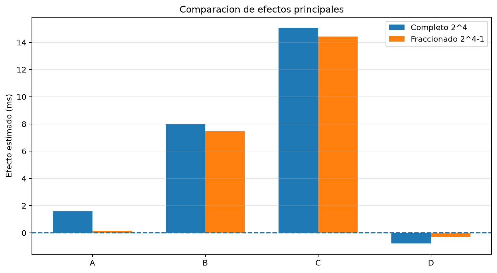
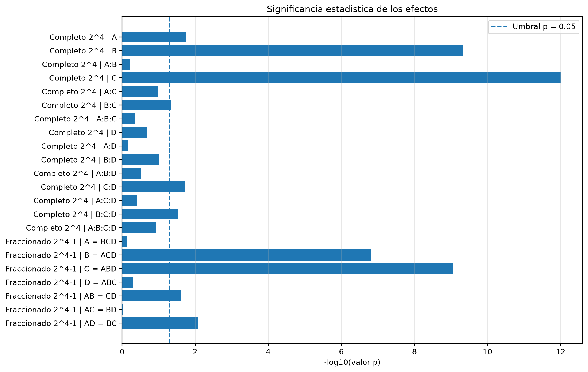
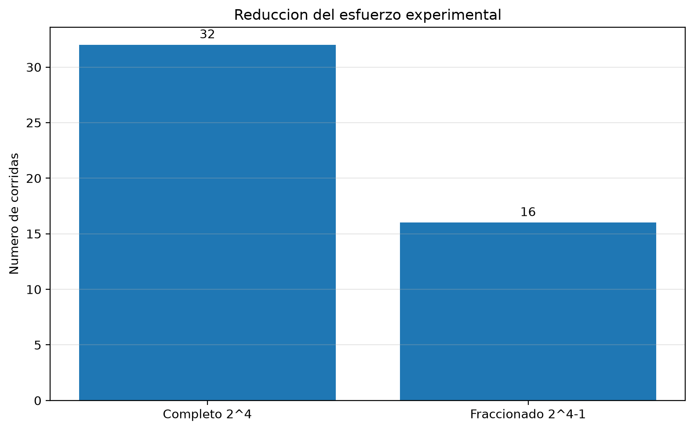

# ENTREGA E2 — Trusted Data Lab

**Proyecto:** Observatorio de Vivienda y Costos de Colima

**Equipo:** David Cuevas Farías y Nancy Haide Vázquez Ávalos

**Etapa:** E2 — Procesamiento geoespacial, trazabilidad, análisis estadístico y calidad de datos.

**Fecha de actualización:** 23 de noviembre de 2026.

**Repositorio:** https://github.com/NancyHaideVazquez/trusted-data-lab

---

## 1. Resumen ejecutivo

Durante la etapa E2 del proyecto Trusted Data Lab se fortaleció el Observatorio de Vivienda y Costos de Colima mediante la incorporación de información geográfica oficial, el procesamiento de datos municipales, la integración de indicadores económicos y la implementación de mecanismos de trazabilidad y calidad.

Se incorporó información del Marco Geoestadístico municipal 2026 del Instituto Nacional de Estadística y Geografía (INEGI). Se procesaron los límites de los diez municipios del estado de Colima y se generó una representación cartográfica que destaca los municipios de Colima y Villa de Álvarez.

También se fortaleció la arquitectura Bronce–Plata–Oro para conservar la procedencia de los registros y facilitar la reproducción de las transformaciones.

Los resultados de integración generaron 564 registros mensuales en la capa Plata y 564 registros en la capa Oro.

En el área de Análisis Estadístico se desarrollaron experimentos factoriales para evaluar el comportamiento del flujo de integración de datos. Se implementó un diseño factorial completo 2³, un diseño factorial completo 2⁴ y un diseño factorial fraccionado 2⁴⁻¹.

Se realizaron análisis ANOVA, estimación de efectos, evaluación de interacciones, diagnósticos de residuos y comparaciones entre diseños experimentales.

En el área de Calidad de Software se ejecutaron pruebas automatizadas, análisis estático con Ruff y verificaciones de formato. La validación general del proyecto reportó 145 pruebas aprobadas.

Se incorporaron evaluaciones internas ISO/IEC 25010 y 25012, antecedentes normativos y registros PSP actualizados. La auditoría cruzada permanece pendiente.

La documentación de esta etapa reúne los resultados de Ingeniería de Datos, Análisis Estadístico y Calidad en los Sistemas de Información.

## 2. Ingeniería de Datos

### 2.1 Incorporación de información geoespacial

Se incorporó a la capa Bronce información del Marco Geoestadístico municipal 2026 del Instituto Nacional de Estadística y Geografía (INEGI).

La fuente geográfica se encuentra en:

`data/bronce/inegi_marco_geoestadistico/2026/`

Se conservaron los archivos originales y sus metadatos para facilitar la identificación de la procedencia de la información.

### 2.2 Procesamiento de límites municipales

Se implementó el módulo:

`src/geoespacial.py`

Este módulo permite procesar la información geográfica y generar un producto normalizado en la capa Plata.

**Resultados principales:**

| Elemento | Resultado |
|---|---|
| Fuente | Marco Geoestadístico municipal 2026 del INEGI |
| Entidad federativa | Colima |
| Municipios procesados | 10 |
| Geometrías válidas | 10 |
| Formato de salida | GeoPackage |
| Sistema de referencia | EPSG:4326 |
| Archivo generado | `data/plata/municipios_colima_2026.gpkg` |

El archivo de salida es un producto derivado que puede regenerarse mediante el procesamiento correspondiente.

### 2.3 Generación del mapa municipal

Se desarrolló el script:

`src/mapa_colima.py`

Su ejecución permitió generar una representación cartográfica de los municipios de Colima, destacando Colima y Villa de Álvarez como territorios de interés del observatorio.

La evidencia gráfica se encuentra en:

`reportes/figuras/mapa_municipios_colima_v2.png`

El mapa representa límites administrativos y no debe interpretarse como una visualización de precios de vivienda o indicadores económicos municipales.

### 2.4 Integración Bronce–Plata–Oro

Se fortaleció el procesamiento de información económica procedente de INEGI y Banxico.

Las fuentes consideradas fueron:

| Fuente | Identificador | Información |
|---|---|---|
| INEGI | `910402` | Inflación mensual de servicios subyacentes |
| Banxico | `SF43783` | TIIE de 28 días |

Los productos generados fueron:

| Capa | Archivo | Registros |
|---|---|---:|
| Plata | `data/plata/integracion_mensual_e2.csv` | 564 |
| Oro | `data/oro/indicadores_mensuales_e2.csv` | 564 |

La comparación de registros permite comprobar que las 564 filas se conservaron durante la transformación de Plata a Oro.

### 2.5 Trazabilidad de datos

Se incorporaron mecanismos para identificar la procedencia de los registros procesados.

Entre los campos utilizados se encuentran:

- `archivo_origen`: referencia al archivo original en Bronce.
- `fecha_ingesta_utc`: fecha de captura registrada para la fuente.

Es importante distinguir la fecha de captura de los datos de la fecha en que se ejecutó su procesamiento.

La implementación y documentación de trazabilidad se encuentran en:

- `src/trazabilidad.py`
- `docs/E2/trazabilidad.md`

La trazabilidad facilita la revisión de las fuentes y la reproducción de los resultados.

### 2.6 Verificación de procedencia

Se verificó la integridad del archivo original `2026_1_06_MUN.zip` mediante SHA-256.

El hash calculado coincide con el registrado en `metadatos.json`.

**Fuente:** INEGI, Marco Geoestadístico municipal 2026.

**Condiciones de uso:**

https://www.inegi.org.mx/inegi/terminos.html

La fecha exacta de ingesta y la URL directa de descarga permanecen sin documentar.

La revisión de procedencia y condiciones de uso se encuentra registrada en `docs/etica-datos.md`.

### 2.7 Resultados de trazabilidad

Durante la validación técnica se obtuvieron los siguientes resultados:

| Criterio | Plata | Oro |
|---|---:|---:|
| Registros totales | 564 | 564 |
| Registros de Banxico | 381 | 381 |
| Registros de INEGI | 183 | 183 |
| Registros sin archivo de origen | 0 | 0 |
| Registros sin fecha de ingesta | 0 | 0 |
| Archivos originales inexistentes | 0 | 0 |
| Fechas de ingesta válidas | 564 | 564 |

Los resultados respaldan la conservación de la procedencia de los registros durante la integración.

### 2.8 Evidencias de Ingeniería de Datos

| Actividad | Commit |
|---|---|
| Incorporación del Marco Geoestadístico | `b4fe64f` |
| Procesamiento geoespacial | `8ef0ae2` |
| Generación del mapa municipal | `6f79137` |
| Incorporación de trazabilidad | `ce8b16a` |

## 3. Análisis Estadístico

### 3.1 Alcance de los indicadores

El observatorio utiliza indicadores económicos nacionales que permiten contextualizar determinadas condiciones financieras y de precios.

Entre ellos se encuentran la inflación mensual de servicios subyacentes del INEGI y la TIIE de 28 días de Banxico.

Estos indicadores no representan directamente el costo de la vivienda en Colima ni en Villa de Álvarez.

La información geográfica permite identificar los municipios del estado de Colima y establecer una base territorial para análisis posteriores.

Por lo tanto:

- No se atribuyen valores nacionales a municipios específicos.
- No se presentan comparaciones municipales de precios sin fuentes adecuadas.
- Se conserva la distinción entre indicadores económicos y delimitaciones territoriales.
- Se documentan las limitaciones de cobertura y escala de los datos.

### 3.2 Experimento factorial completo 2³

Se implementó un diseño factorial completo 2³ para evaluar el efecto de tres factores sobre el tiempo de integración de datos.

**Objetivo:** evaluar cómo influyen la cantidad de registros, la trazabilidad y la validación Pandera sobre el rendimiento del flujo de integración.

Los factores considerados fueron:

| Factor | Descripción | Nivel bajo (-1) | Nivel alto (+1) |
|---|---|---|---|
| A | Cantidad de registros | 200 | 500 |
| B | Trazabilidad | Desactivada | Activada |
| C | Validación Pandera | Desactivada | Activada |

El diseño contempla ocho tratamientos y dos réplicas por tratamiento, para un total de 16 corridas experimentales.

Se realizaron dos tandas:

- Primera tanda: 16 corridas sin calentamiento.
- Segunda tanda: ocho ejecuciones de calentamiento y 16 corridas de confirmación.

Las combinaciones se ejecutaron en orden aleatorizado mediante la semilla 2026.

#### 3.2.1 Resultados del ANOVA 2³

El análisis estadístico se realizó mediante un modelo factorial completo:

`tiempo_ms ~ A * B * C`

Los resultados de la tanda de confirmación fueron:

| Factor o interacción | Efecto estimado (ms) | Valor p | Interpretación |
|---|---:|---:|---|
| A | +1.4528 | 0.083061 | No significativo |
| B | +7.4401 | 0.000008 | Significativo |
| A × B | -0.4013 | 0.599367 | No significativo |
| C | +13.7474 | 0.000000068 | Significativo |
| A × C | -0.0152 | 0.983981 | No significativo |
| B × C | +0.6679 | 0.389304 | No significativo |
| A × B × C | -1.2462 | 0.127873 | No significativo |

Se utilizó un nivel de significancia de 0.05.

Los factores B y C presentaron efectos estadísticamente significativos sobre el tiempo de procesamiento.

La activación de la trazabilidad incrementó el tiempo promedio de ejecución aproximadamente 7.44 ms.

La validación Pandera presentó el mayor efecto positivo, con un incremento aproximado de 13.75 ms.

La cantidad de registros no presentó evidencia estadística suficiente de un efecto significativo en esta tanda de confirmación.

#### 3.2.2 Diagnóstico del modelo

| Indicador | Resultado |
|---|---:|
| R² | 0.9830 |
| R² ajustado | 0.9681 |
| Desviación residual | 1.4675 ms |
| Shapiro-Wilk W | 0.915498 |
| Shapiro-Wilk p | 0.142733 |

El modelo explicó aproximadamente el 98.30 % de la variabilidad observada en el tiempo de procesamiento.

La prueba Shapiro-Wilk no mostró evidencia suficiente para rechazar la normalidad de los residuos al nivel de significancia de 0.05. Esto no constituye una demostración de normalidad.

#### 3.2.3 Comparación de las tandas experimentales

En la primera tanda se registró un tiempo extremo de 168.756 ms.

El diagnóstico inicial presentó:

- R² = 0.5574.
- Desviación residual = 35.3814 ms.
- Shapiro-Wilk p = 0.000016.

En la tanda de confirmación, el tiempo máximo fue de 29.167 ms.

El diagnóstico de confirmación presentó:

- R² = 0.9830.
- Desviación residual = 1.4675 ms.
- Shapiro-Wilk p = 0.142733.

La segunda tanda mostró menor variabilidad. El calentamiento pudo contribuir a este cambio, aunque no se ha demostrado que fuera su única causa.

#### 3.2.4 Evidencias del experimento 2³

**Código:**

- `src/experimento_factorial_e2.py`
- `src/analisis_factorial_2_3_e2.py`
- `src/graficas_factorial_e2.py`

**Resultados:**

- `data/reportes/experimento_factorial_e2.csv`
- `data/reportes/experimento_factorial_e2_original.csv`
- `data/reportes/experimento_factorial_e2_confirmacion.csv`
- `data/reportes/anova_factorial_2_3.csv`

**Gráficas:**

- `data/reportes/graficas_e2_monico/01_efectos_principales.png`
- `data/reportes/graficas_e2_monico/02_interacciones.png`
- `data/reportes/graficas_e2_monico/03_residuos.png`
- `data/reportes/graficas_e2_monico/04_qqplot.png`

### 3.3 Comparación de diseños factoriales 2⁴ y 2⁴⁻¹

Se desarrolló una comparación entre un diseño factorial completo 2⁴ y un diseño factorial fraccionado 2⁴⁻¹.

El objetivo fue evaluar las diferencias en los efectos estimados, la significancia estadística y el esfuerzo experimental requerido.

Los cuatro factores utilizados fueron:

| Factor | Descripción | Nivel bajo (-1) | Nivel alto (+1) |
|---|---|---|---|
| A | Cantidad de registros | 200 | 500 |
| B | Trazabilidad | Desactivada | Activada |
| C | Validación Pandera | Desactivada | Activada |
| D | Generación de resumen estadístico | Desactivada | Activada |

#### 3.3.1 Diseño factorial completo 2⁴

El diseño factorial completo contempla 16 tratamientos experimentales y dos réplicas por tratamiento, para un total de 32 corridas.

Se utilizó el modelo:

`tiempo_ms ~ A * B * C * D`

Los resultados de los efectos principales fueron:

| Factor | Efecto estimado (ms) | Valor p | Interpretación |
|---|---:|---:|---|
| A | +1.5826 | 0.017880 | Significativo |
| B | +7.9747 | 4.593855e-10 | Significativo |
| C | +15.0554 | 2.809236e-14 | Significativo |
| D | -0.7806 | 0.211543 | No significativo |

La validación Pandera presentó el mayor efecto positivo sobre el tiempo de procesamiento, seguida por la trazabilidad.

La cantidad de registros también presentó un efecto estadísticamente significativo en este experimento.

El factor D no mostró evidencia suficiente de un efecto significativo.

Entre las interacciones estadísticamente significativas se identificaron:

| Interacción | Efecto estimado (ms) | Valor p |
|---|---:|---:|
| B × C | +1.3090 | 0.044326 |
| C × D | -1.5591 | 0.019360 |
| B × C × D | -1.4362 | 0.029237 |

Las interacciones indican que el efecto de algunos factores puede variar dependiendo de la combinación de niveles de otros factores.

#### 3.3.2 Diagnóstico del diseño completo

| Indicador | Resultado |
|---|---:|
| R² | 0.9814 |
| R² ajustado | 0.9640 |
| Desviación residual | 1.6964 ms |
| Shapiro-Wilk W | 0.943642 |
| Shapiro-Wilk p | 0.095015 |

La prueba Shapiro-Wilk no mostró evidencia suficiente para rechazar la normalidad de los residuos al nivel de significancia de 0.05.

#### 3.3.3 Diseño factorial fraccionado 2⁴⁻¹

Para reducir el esfuerzo experimental se construyó una fracción de resolución IV utilizando el generador:

**D = ABC**

Su relación definitoria es:

**I = ABCD**

Este diseño conserva ocho tratamientos de los 16 posibles y mantiene dos réplicas por tratamiento, para un total de 16 corridas.

La reducción permite evaluar los factores principales y determinadas interacciones con la mitad de las ejecuciones del diseño completo.

La estructura de alias establece las siguientes equivalencias:

| Efecto | Alias |
|---|---|
| A | BCD |
| B | ACD |
| C | ABD |
| D | ABC |
| AB | CD |
| AC | BD |
| AD | BC |

Esto significa que algunos efectos no pueden distinguirse individualmente mediante este diseño.

Se utilizó el modelo:

`tiempo_ms ~ A + B + C + D + A:B + A:C + A:D`

Los resultados fueron:

| Contraste | Alias | Efecto estimado (ms) | Valor p | Interpretación |
|---|---|---:|---:|---|
| A | A = BCD | +0.1464 | 0.749820 | No significativo |
| B | B = ACD | +7.4573 | 1.586045e-07 | Significativo |
| C | C = ABD | +14.4215 | 8.724929e-10 | Significativo |
| D | D = ABC | -0.3164 | 0.495902 | No significativo |
| A × B | AB = CD | -1.2311 | 0.024085 | Significativo |
| A × C | AC = BD | -0.0253 | 0.955911 | No significativo |
| A × D | AD = BC | +1.5458 | 0.008256 | Significativo |

La validación Pandera y la trazabilidad conservaron efectos principales positivos y estadísticamente significativos.

Sin embargo, los efectos estimados en este diseño deben interpretarse considerando su estructura de alias.

Por ejemplo, el contraste AB = CD no permite determinar si la significancia corresponde exclusivamente a la interacción entre A y B o a la interacción entre C y D.

De igual manera, el contraste AD = BC no permite separar individualmente ambas interacciones.

#### 3.3.4 Diagnóstico del diseño fraccionado

| Indicador | Resultado |
|---|---:|
| R² | 0.9942 |
| R² ajustado | 0.9890 |
| Desviación residual | 0.8871 ms |
| Shapiro-Wilk W | 0.995479 |
| Shapiro-Wilk p | 0.999999 |

La prueba Shapiro-Wilk no mostró evidencia suficiente para rechazar la normalidad de los residuos al nivel de significancia de 0.05.

#### 3.3.5 Comparación de los diseños

| Indicador | Completo 2⁴ | Fraccionado 2⁴⁻¹ |
|---|---:|---:|
| Corridas | 32 | 16 |
| Tratamientos | 16 | 8 |
| Réplicas por tratamiento | 2 | 2 |
| R² | 0.9814 | 0.9942 |
| R² ajustado | 0.9640 | 0.9890 |
| Desviación residual (ms) | 1.6964 | 0.8871 |

El diseño fraccionado redujo de 32 a 16 las corridas consideradas, lo que representa una disminución del 50 % en el esfuerzo experimental.

Esta reducción implica menor esfuerzo de ejecución, aunque también limita la posibilidad de separar determinados efectos e interacciones.

El diseño fraccionado presentó mejores indicadores de ajuste en esta comparación. Sin embargo, esto no significa que sea universalmente superior.

Los modelos utilizan diferentes cantidades de observaciones y diferentes estructuras de términos, por lo que sus indicadores no deben interpretarse como una comparación directa de capacidad predictiva.

**Nota metodológica:** las 16 corridas del diseño fraccionado corresponden a una fracción del diseño factorial de cuatro factores. Por tanto, los dos diseños no deben interpretarse como experimentos independientes cuando se utilizan observaciones procedentes de la misma ejecución experimental.

#### 3.3.6 Evidencias gráficas comparativas

**Gráfica 1. Comparación de efectos principales**



La gráfica muestra los efectos estimados de los cuatro factores para ambos diseños.

**Gráfica 2. Significancia estadística**



La gráfica representa la significancia estadística mediante el valor transformado -log10(p), utilizando como referencia el umbral de 0.05.

**Gráfica 3. Número de corridas**



La gráfica compara el número de corridas de ambos diseños y permite observar la reducción del esfuerzo experimental.

#### 3.3.7 Evidencias de la comparación factorial

**Código:**

- `src/experimento_factorial_2_4_e2.py`
- `src/analisis_factorial_2_4_e2.py`
- `src/analisis_fraccionado_2_4_e2.py`
- `src/comparacion_factorial_2_4_e2.py`
- `src/graficas_comparacion_2_4_e2.py`

**Resultados:**

- `data/reportes/experimento_factorial_2_4_completo.csv`
- `data/reportes/experimento_factorial_2_4_fraccionado.csv`
- `data/reportes/anova_factorial_2_4_completo.csv`
- `data/reportes/anova_factorial_2_4_fraccionado.csv`
- `data/reportes/comparacion_factorial_2_4.csv`

**Gráficas:**

- `data/reportes/graficas_comparacion_2_4/01_efectos_principales.png`
- `data/reportes/graficas_comparacion_2_4/02_significancia_estadistica.png`
- `data/reportes/graficas_comparacion_2_4/03_numero_corridas.png`

### 3.4 Limitaciones del análisis estadístico

Los resultados deben interpretarse considerando las siguientes limitaciones:

1. Los experimentos utilizaron dos réplicas por tratamiento.
2. Los tiempos pueden variar según la carga del equipo.
3. Se evaluaron únicamente los tamaños de muestra definidos en los diseños.
4. La primera tanda del experimento 2³ presentó una medición extrema.
5. Las tandas de confirmación y originales se ejecutaron con condiciones de calentamiento diferentes.
6. El diseño fraccionado presenta efectos confundidos por su estructura de alias.
7. Los indicadores nacionales no representan automáticamente condiciones económicas municipales.
8. Los resultados estadísticos no deben extrapolarse automáticamente a tamaños de datos o condiciones de procesamiento diferentes.

## 4. Calidad en los Sistemas de Información

### 4.1 Pruebas automatizadas

Se incorporaron pruebas para verificar el procesamiento geoespacial, la trazabilidad y otros componentes del proyecto.

Entre los archivos de pruebas se encuentran:

- `tests/test_geoespacial.py`
- `tests/test_trazabilidad_e2.py`

Durante la validación general del proyecto se obtuvo el siguiente resultado:

| Verificación | Resultado |
|---|---|
| Pruebas automatizadas | 145 aprobadas |
| Análisis estático con Ruff | Sin errores |
| Compilación de módulos estadísticos | Sin errores |
| Verificación de formato Git | Sin errores |

Las pruebas permiten verificar aspectos del procesamiento, la estructura de los resultados y la conservación de información.

### 4.2 Validación de calidad con Pandera

Se utilizó Pandera como herramienta de validación de calidad dentro de los experimentos factoriales.

Su activación se evaluó como un factor experimental para medir el efecto de la validación sobre el tiempo de procesamiento.

Los resultados de los experimentos muestran que la ejecución de la validación incrementó el tiempo de procesamiento bajo las condiciones evaluadas.

Esto permite observar el costo computacional asociado con incorporar controles de calidad en el flujo de integración.

### 4.3 Documentación ética

Se elaboró el documento:

`docs/etica-datos.md`

Este documento aborda consideraciones relacionadas con el uso responsable de información, la procedencia de las fuentes, las limitaciones de los indicadores y la necesidad de evitar interpretaciones incorrectas.

Se consideró especialmente importante distinguir los indicadores nacionales de las mediciones municipales para evitar conclusiones que no estén respaldadas por las fuentes.

### 4.4 Distribución de responsabilidades

Para el desarrollo y cierre de E2 se establecieron dos áreas complementarias de responsabilidad:

| Integrante | Área | Responsabilidades |
|---|---|---|
| David Cuevas Farías | Implementación técnica | Incorporación de información geográfica, desarrollo de scripts, procesamiento municipal, generación del mapa, integración, trazabilidad y análisis estadístico |
| Nancy Haide Vázquez Ávalos | Validación y aseguramiento de calidad | Revisión de fuentes y metadatos, validación de resultados geográficos, auditoría de trazabilidad, verificación de pruebas y revisión documental |

Esta distribución busca equilibrar las actividades de construcción técnica y revisión de calidad.

### 4.5 Evidencia de proceso personal (PSP)

El repositorio contiene registros de tiempo y defectos para ambos integrantes:

| Integrante | Registro de tiempo | Registro de defectos |
|---|---|---|
| David Cuevas Farías | `calidad/tiempo-david.csv` | `calidad/defectos-david.csv` |
| Nancy Haide Vázquez Ávalos | `calidad/tiempo-nancy.csv` | `calidad/defectos-nancy.csv` |

El registro de David contiene 29 actividades acumuladas y 10 defectos. Para G01–G07 se registraron 270 minutos efectivos estimados y 45 minutos de interrupciones. Las nueve actividades adicionales del 22 y 23 de noviembre suman 270 minutos efectivos estimados y 45 minutos de descanso acumulado, confirmados por David. En conjunto, los registros de E2 representan 540 minutos efectivos y 90 minutos de interrupciones estimadas, sin sumar nuevamente las verificaciones de apoyo G05–G07.

| Actividad adicional | Minutos efectivos estimados |
|---|---:|
| G08 — Factorial 2³ | 30 |
| G09 — Factorial 2⁴ | 30 |
| G10 — Ruff | 30 |
| G11 — ANOVA | 30 |
| Actualización de entrega y relatoría | 30 |
| Ética y legalidad | 15 |
| Q02 — ISO/IEC 25012 | 30 |
| Q01 — ISO/IEC 25010 | 30 |
| Q03 — Antecedentes normativos | 45 |
| Total | 270 |

Los horarios exactos de las actividades adicionales no se conocen; las duraciones se registraron en la descripción del CSV. Los cuatro defectos adicionales (7–10) corresponden a imports, formato documental, sincronización Git y disponibilidad de DuckDB. Los tiempos de corrección no confirmados permanecen vacíos.

Los registros de Nancy requieren confirmación individual; las tres verificaciones de apoyo realizadas por David no se atribuyen a Nancy ni se suman como trabajo adicional sin comprobar que no exista duplicidad. Evidencia: commit `fefae1c`.

### 4.6 Validaciones complementarias G05–G07

El 22 de noviembre de 2026 se documentaron verificaciones adicionales de calidad correspondientes a E2.

| Actividad | Resultado | Tiempo reportado |
|---|---|---:|
| G05 — Revisión de ética de datos | Aprobada | 20 min |
| G06 — Pruebas automatizadas | 145 pruebas aprobadas | 35 min |
| G07 — Revisión documental | Comprobaciones aprobadas | 20 min |

**Tiempo total reportado:** 75 minutos.

La evidencia se encuentra en:

`docs/E2/validacion-calidad.md`

Estas verificaciones fueron realizadas por David en apoyo a Nancy. Estas verificaciones corresponden al trabajo documentado y no sustituyen las revisiones individuales que requieran evidencias adicionales.

### 4.7 Q01 — Evaluación de calidad del producto ISO/IEC 25010

Se documentaron las ocho características solicitadas, tomando como referencia ISO/IEC 25010:2011 y considerando las diferencias terminológicas de la edición 2023. La evaluación interna no constituye certificación.

| Característica | Resultado observado | Limitación |
|---|---|---|
| Adecuación funcional | 145 pruebas aprobadas | No implica cobertura de todos los requisitos |
| Eficiencia | 13.9944 ms promedio; 517.5033 KiB promedio | Diez lecturas de 564 registros; memoria Python medida con tracemalloc |
| Compatibilidad | 5/5 comprobaciones | CSV con Pandas y DuckDB, JSON, GeoPackage y PNG |
| Interacción | 5/5 tareas de revisión del mapa | Un evaluador interno; sin usuarios externos |
| Fiabilidad | 8/10 ejecuciones de calidad exitosas (#24–33) | 80 %, inferior a la meta propuesta de 95 % |
| Seguridad | Auditoría de requisitos: 0 vulnerabilidades conocidas; entorno global: 78 hallazgos en 9 paquetes | No equivale a ausencia de vulnerabilidades; Gitleaks no disponible en la revisión |
| Mantenibilidad | Ruff sin errores; cobertura 823/2261 sentencias (36.40 %) | Cobertura insuficiente, especialmente en extractores |
| Portabilidad | Windows/Python 3.14.3 y CI Ubuntu/Python 3.11 | Validación de pruebas, no de todos los scripts |

Evidencia principal: [ISO/IEC 25010](calidad/iso25010.md), commit `5299de2`. Revisión de Nancy pendiente.

### 4.8 Q02 — Evaluación de calidad de datos ISO/IEC 25012

Se evaluaron las quince características de ISO/IEC 25012:2008 sobre los productos de E2. Los indicadores indirectos se identifican como aproximaciones y no como certificación.

| Característica | Resultado o evidencia | Limitación |
|---|---|---|
| Exactitud | 564/564 valores coincidentes con Bronce (tolerancia 1e-9) | Banxico agregado por promedio mensual |
| Completitud | 5640/5640 campos completos | Diez columnas de Oro |
| Consistencia | 564/564 registros conformes | Reglas evaluadas de periodo, valor y unicidad |
| Credibilidad | 564/564 con fuente y serie esperadas | Identificación, no verificación independiente de la fuente |
| Actualidad | 11.37 días desde ingesta; INEGI: 3 días entre actualización y captura | No se conoce fecha de publicación de Banxico |
| Accesibilidad | 2/2 archivos locales legibles | No prueba acceso externo |
| Conformidad | 564/564 registros Plata conformes a Pandera | Alcance del esquema aplicado |
| Confidencialidad | 4/4 patrones de exclusión comprobados | No es escaneo integral de secretos |
| Eficiencia | 23.9783 ms de lectura | Una medición local |
| Precisión | 564/564 valores conservados Plata–Oro | No mide precisión instrumental |
| Trazabilidad | 564/564 registros trazables; 2 hashes SHA-256 | Hashes de referencia actuales, no comparación histórica |
| Comprensibilidad | 4 documentos disponibles | No mide comprensión de usuarios |
| Disponibilidad | 2/2 archivos disponibles localmente | No mide disponibilidad continua |
| Portabilidad | 564 registros conservados en lectura y escritura CSV | Comprobación local con Pandas |
| Recuperabilidad | 564/564 valores contrastados con Bronce | No equivale a restauración integral del sistema |

Evidencia principal: [ISO/IEC 25012](calidad/iso25012.md), commits `8f42839` y `e2c8cb0`. Revisión de Nancy pendiente.

### 4.9 Q03 — Antecedentes normativos

Se documentaron ISO/IEC 9126-1:2001 como antecedente de calidad del producto; ISO/IEC 25000:2014 como marco SQuaRE; ISO/IEC 25010:2011 y 2023 para modelos de calidad; ISO/IEC 25012:2008 para calidad de datos; e ISO 9001:2015 e ISO 9000:2015 para gestión de calidad y fundamentos. Se relacionaron con las prácticas y evidencias del observatorio sin afirmar certificación.

Evidencia: [Antecedentes normativos](calidad/antecedentes_normativos.md), commit `ce79abf`. Pendiente de revisión bibliográfica de las fichas oficiales y revisión de Nancy.

### 4.10 Q04 — Auditoría cruzada

**Estado: pendiente de indicaciones de la docente.** No se ha confirmado el equipo asignado ni la versión a auditar. No se presentan hallazgos externos simulados. Cuando se reciban las instrucciones se documentarán criterio, evidencia, severidad, impacto, acción, responsable y cierre, así como la respuesta a la auditoría recibida.

### 4.11 Evidencias de calidad adicionales

| Evidencia | Ruta |
|---|---|
| Auditoría del entorno | `data/reportes/auditoria_dependencias_e2.json` |
| Auditoría de requisitos | `data/reportes/auditoria_proyecto_e2.json` |
| Cobertura | `data/reportes/cobertura_iso25010_e2.json` |
| Compatibilidad | `data/reportes/compatibilidad_iso25010_e2.csv` |
| Eficiencia | `data/reportes/eficiencia_iso25010_e2.csv` |
| Métricas de datos | `data/reportes/metricas_iso25012_e2.csv` |
| Hashes Bronce | `data/reportes/hashes_bronce_e2.csv` |
| Exactitud Bronce–Oro | `data/reportes/exactitud_bronce_oro_e2.csv` |
| Script de métricas | `src/metricas_iso25012.py` |

## 5. Limitaciones y consideraciones generales

La etapa E2 presenta las siguientes limitaciones:

1. **Escala de los indicadores:** las series económicas nacionales no representan automáticamente condiciones municipales de vivienda.
2. **Alcance del mapa:** la visualización muestra límites administrativos, no precios ni valores económicos municipales.
3. **Archivos derivados:** algunos productos de Plata y Oro se generan mediante scripts y no necesariamente se encuentran versionados en Git.
4. **Trazabilidad temporal:** las fechas de captura no deben confundirse con fechas de procesamiento.
5. **Diseños experimentales:** los resultados corresponden a las condiciones específicas evaluadas y no garantizan el mismo comportamiento en otros equipos o volúmenes.
6. **Réplicas:** se utilizaron dos réplicas por tratamiento en los experimentos documentados.
7. **Diseño fraccionado:** algunos efectos e interacciones se encuentran confundidos debido a la estructura de alias.
8. **PSP:** los registros individuales deben reflejar los tiempos y actividades realmente realizados.
9. **Revisión de calidad:** las actividades de cada integrante deben estar respaldadas por sus evidencias correspondientes.

10. **Calidad:** cobertura y fiabilidad por debajo de las metas propuestas; revisión de seguridad limitada.
11. **Auditoría:** Q04 pendiente; revisión individual y bibliográfica pendiente.
12. **Análisis estadístico:** falta confirmar con la rúbrica la evidencia de ANOVA de dos factores 3×2 y bloqueo del diseño 2³.

Estas limitaciones se declaran para evitar presentar como universales resultados que únicamente corresponden a las condiciones evaluadas.

## 6. Relatoría y entregables

### 6.1 Documentación

| Documento | Ubicación |
|---|---|
| Entrega E2 | `docs/E2/ENTREGA.md` |
| Relatoría E2 | `docs/relatoria-E2.md` |
| Trazabilidad | `docs/E2/trazabilidad.md` |
| Validación de calidad | `docs/E2/validacion-calidad.md` |
| Ética de datos | `docs/etica-datos.md` |
| Experimento factorial 2³ | `docs/E2/analisis_estadistico/experimento_factorial_2_3.md` |
| Comparación factorial 2⁴ | `docs/E2/analisis_estadistico/comparacion_factorial_2_4.md` |
| ISO/IEC 25010 | `docs/E2/calidad/iso25010.md` |
| ISO/IEC 25012 | `docs/E2/calidad/iso25012.md` |
| Antecedentes normativos | `docs/E2/calidad/antecedentes_normativos.md` |

Relatoría: [Consultar relatoría E2](../relatoria-E2.md).

### 6.2 Productos técnicos

| Producto | Ubicación |
|---|---|
| Procesamiento geoespacial | `src/geoespacial.py` |
| Generación del mapa | `src/mapa_colima.py` |
| Trazabilidad | `src/trazabilidad.py` |
| Integración de datos | `src/integracion.py` |
| Indicadores Oro | `src/oro.py` |
| Pruebas geoespaciales | `tests/test_geoespacial.py` |
| Pruebas de trazabilidad | `tests/test_trazabilidad_e2.py` |

### 6.3 Evidencias estadísticas

| Evidencia | Ubicación |
|---|---|
| Experimento factorial 2³ | `data/reportes/experimento_factorial_e2_confirmacion.csv` |
| ANOVA 2³ | `data/reportes/anova_factorial_2_3.csv` |
| Experimento completo 2⁴ | `data/reportes/experimento_factorial_2_4_completo.csv` |
| Experimento fraccionado 2⁴⁻¹ | `data/reportes/experimento_factorial_2_4_fraccionado.csv` |
| ANOVA completo 2⁴ | `data/reportes/anova_factorial_2_4_completo.csv` |
| ANOVA fraccionado 2⁴⁻¹ | `data/reportes/anova_factorial_2_4_fraccionado.csv` |
| Comparación de diseños | `data/reportes/comparacion_factorial_2_4.csv` |

### 6.4 Evidencias de validación

La validación técnica documentada incluye:

- Procesamiento de los diez municipios de Colima.
- Diez geometrías válidas.
- Generación del GeoPackage con EPSG:4326.
- Integración de 564 registros en Plata.
- Integración de 564 registros en Oro.
- Conservación de la procedencia de los registros.
- Ejecución satisfactoria de 145 pruebas automatizadas.
- Análisis estático con Ruff sin errores.
- Verificación de formato mediante Git.

### 6.5 Uso de IA generativa

Se utilizó ChatGPT como apoyo para explicar procedimientos técnicos, revisar comandos de PowerShell y Git, orientar la implementación de scripts y pruebas, interpretar resultados estadísticos y estructurar documentación.

Las respuestas generadas se contrastaron con los archivos, las ejecuciones y las evidencias disponibles en el repositorio.

La responsabilidad de verificar los resultados y presentar la entrega corresponde al equipo.

## 7. Control de versiones

### 7.1 Repositorio

**Repositorio:** https://github.com/NancyHaideVazquez/trusted-data-lab

### 7.2 Historial de commits

| Commit | Descripción |
|---|---|
| `b4fe64f` | Incorporar Marco Geoestadístico municipal 2026 |
| `8ef0ae2` | Implementar procesamiento geoespacial y pruebas |
| `6f79137` | Generar mapa municipal |
| `ce8b16a` | Incorporar trazabilidad Bronce–Plata–Oro |
| `1a8adcf` | Documentar ética y uso responsable de datos |
| `d93ef88` | Documentar entrega y evidencias |
| `9fd82f6` | Documentar relatoría y actualizar entrega |
| `3c58f28` | Incorporar evidencias de validación y actualizar PSP |
| `691bb86` | Documentar procedencia INEGI y corregir estilo del código |
| `892c21f` | Incorporar experimento factorial 2³ y análisis estadístico |
| `01f2421` | Completar comparación de diseños factoriales 2⁴ |
| `2622d2e` | Corregir orden de imports para cumplir Ruff en E2 |
| `3e359ef` | Documentar ANOVA del experimento factorial 2³ |
| `5bc1963` | Actualizar entrega, relatoría y comparación factorial |
| `d6fc572` | Completar ética y legalidad; etiqueta e2 |
| `8f42839` | Evaluar ISO/IEC 25012 |
| `e2c8cb0` | Corregir formato ISO/IEC 25012 |
| `5299de2` | Evaluar ISO/IEC 25010 |
| `ce79abf` | Documentar antecedentes normativos |
| `fefae1c` | Actualizar PSP de David |

Los commits anteriores permiten consultar la evolución de las actividades y los productos incorporados a la etapa.

### 7.3 Reproducción de los experimentos

Desde la raíz del repositorio se pueden ejecutar los programas mediante los siguientes comandos:

**Experimento factorial 2³:**

```powershell
python -m src.experimento_factorial_e2
python -m src.analisis_factorial_2_3_e2
python -m src.graficas_factorial_e2
```

**Diseño factorial completo 2⁴:**

```powershell
python -m src.experimento_factorial_2_4_e2
python -m src.analisis_factorial_2_4_e2
```

**Diseño factorial fraccionado 2⁴⁻¹:**

```powershell
python -m src.analisis_fraccionado_2_4_e2
```

**Comparación de diseños y gráficas:**

```powershell
python -m src.comparacion_factorial_2_4_e2
python -m src.graficas_comparacion_2_4_e2
```

**Validación del proyecto:**

```powershell
python -m ruff check src tests --output-format concise
python -m pytest -q
git diff --check
```

**Nota:** ejecutar nuevamente los experimentos sobrescribe sus archivos CSV de salida. Se recomienda conservar una copia de los resultados utilizados en esta entrega antes de repetir las ejecuciones.

### 7.4 Estado de la entrega

La etapa E2 cuenta con productos geoespaciales, integración de datos, mecanismos de trazabilidad, experimentos factoriales, análisis estadísticos, evidencias gráficas y pruebas automatizadas.

Los resultados técnicos y estadísticos se encuentran documentados en sus respectivos archivos dentro del repositorio.

La entrega integra las evidencias correspondientes a Ingeniería de Datos, Análisis Estadístico y Calidad en los Sistemas de Información.

El cierre definitivo debe considerar la revisión de los requisitos oficiales, la comprobación de los enlaces de evidencia y la actualización de los registros individuales de calidad que correspondan.

**Estado:** Q01–Q03 documentadas y publicadas; PSP de David actualizado. Q04, revisión de Nancy, confirmación de requisitos estadísticos y revisión final pendientes.

La etiqueta publicada `e2` apunta a `d6fc572`; las evidencias adicionales de calidad se encuentran en `main` y no forman parte de esa etiqueta. No se ha modificado la etiqueta original.

Versión de referencia de las evidencias adicionales: `fefae1c`.

---

**Responsables:** David Cuevas Farías y Nancy Haide Vázquez Ávalos.

**Proyecto:** Observatorio de Vivienda y Costos de Colima.

**Repositorio:** [Trusted Data Lab](https://github.com/NancyHaideVazquez/trusted-data-lab)
