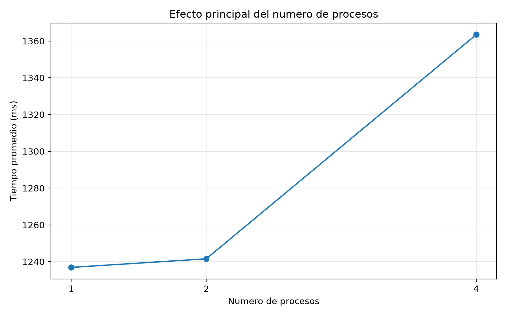
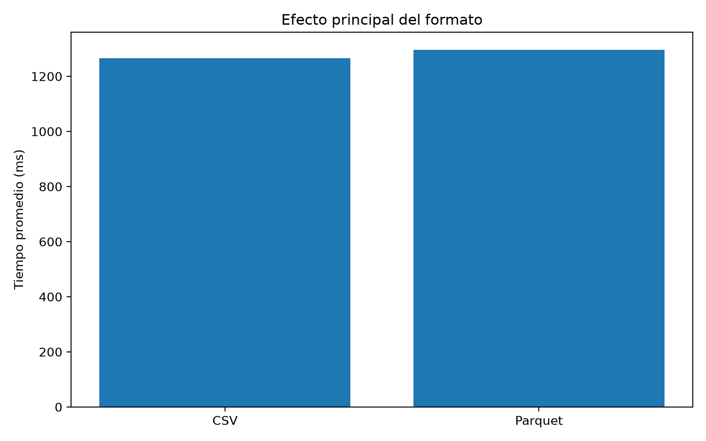
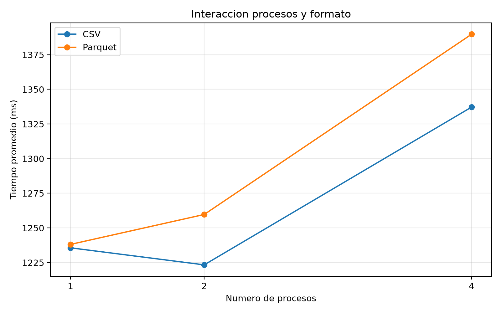
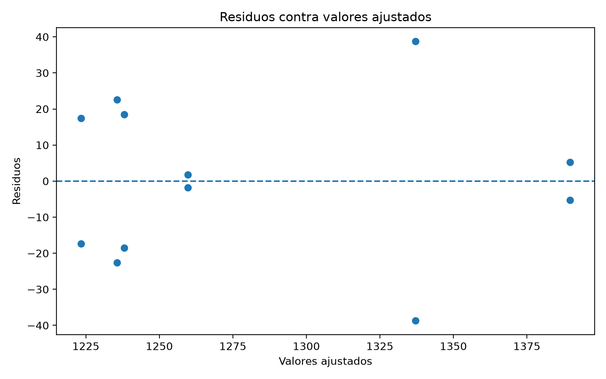
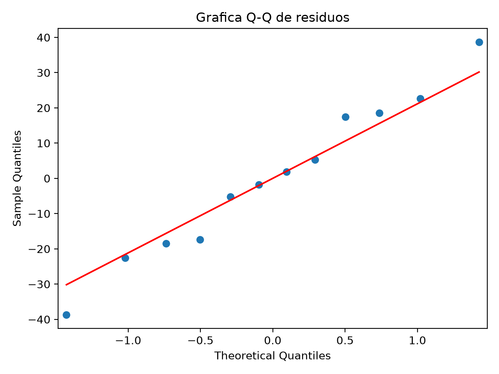
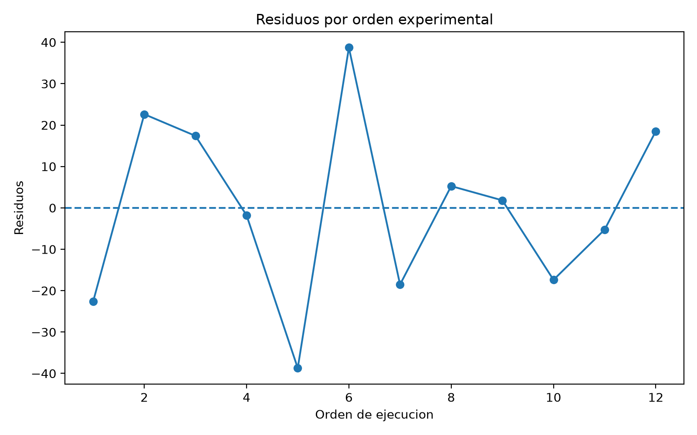

# Experimento factorial 3×2 — ANOVA de dos factores

## 1. Información general

- **Proyecto:** Trusted Data Lab — Observatorio de Vivienda y Costos de Colima.
- **Etapa:** E2.
- **Materia:** Análisis Estadístico.
- **Equipo:** David Cuevas Farías y Nancy Haide Vázquez Ávalos.
- **Responsable de ejecución:** David Cuevas Farías.
- **Fecha:** 23 de noviembre de 2026.
- **Nivel de significancia:** 0.05.

## 2. Objetivo

Evaluar el efecto del número de procesos y del formato de almacenamiento sobre el tiempo de procesamiento de 564 registros integrados de INEGI y Banxico, así como la interacción entre ambos factores.

El alcance es la escritura y lectura paralela de particiones y su concatenación, no la paralelización de la integración original ni el rendimiento completo del pipeline.

## 3. Diseño experimental

| Factor | Niveles |
|---|---|
| A: número de procesos | 1, 2, 4 |
| B: formato | CSV, Parquet |
| Réplicas por tratamiento | 2 |
| Tratamientos | 6 |
| Corridas medidas | 12 |
| Calentamientos no incluidos en el ANOVA | 6 |
| Semilla de aleatorización | 2026 |
| Variable respuesta | Tiempo en milisegundos |

Se utilizaron los mismos 564 registros para todos los tratamientos. Se integraron las fuentes con trazabilidad y se convirtieron las columnas a texto para comprobar equivalencia entre formatos. Las particiones se prepararon antes de iniciar el cronómetro. El tiempo medido incluye creación y cierre del ejecutor de procesos, transferencia de tareas, escritura, lectura y concatenación. La comprobación de equivalencia, ordenamiento final y cálculo del tamaño de archivos se efectuaron fuera del intervalo medido.

Se utilizó ProcessPoolExecutor incluso para el nivel de un proceso. Por ello, este nivel no equivale a una implementación secuencial sin costo de creación de procesos. El número de trabajadores configurado no garantiza que todos hayan trabajado simultáneamente durante toda la corrida.

## 4. Hipótesis

- H0A: las medias marginales del tiempo son iguales para 1, 2 y 4 procesos.
- H1A: al menos una media marginal difiere.
- H0B: las medias marginales de CSV y Parquet son iguales.
- H1B: las medias marginales difieren.
- H0AB: no existe interacción entre número de procesos y formato.
- H1AB: existe interacción entre ambos factores.

Modelo: Y_ijk = μ + A_i + B_j + (AB)_ij + ε_ijk.

Se ajustó un modelo de mínimos cuadrados ordinarios con ambos factores categóricos y su interacción, utilizando ANOVA tipo II. El diseño balanceado tiene seis grados de libertad residuales.

## 5. Mediciones reales

| Orden | Réplica | Procesos | Formato | Tiempo (ms) |
|---:|---:|---:|---|---:|
| 1 | 1 | 1 | CSV | 1213.0104 |
| 2 | 2 | 1 | CSV | 1258.2498 |
| 3 | 1 | 2 | CSV | 1240.7401 |
| 4 | 1 | 2 | Parquet | 1257.8778 |
| 5 | 2 | 4 | CSV | 1298.4746 |
| 6 | 1 | 4 | CSV | 1375.8845 |
| 7 | 2 | 1 | Parquet | 1219.5833 |
| 8 | 2 | 4 | Parquet | 1394.9944 |
| 9 | 2 | 2 | Parquet | 1261.5059 |
| 10 | 2 | 2 | CSV | 1205.9560 |
| 11 | 1 | 4 | Parquet | 1384.4836 |
| 12 | 1 | 1 | Parquet | 1256.6288 |

Los valores se presentan con cuatro decimales conforme al resumen de ejecución. El CSV original conserva las mediciones registradas por el script. Las doce corridas terminaron sin errores de equivalencia.

## 6. Estadística descriptiva

| Procesos | Formato | n | Media (ms) | Desviación estándar (ms) | Mínimo | Máximo |
|---:|---|---:|---:|---:|---:|---:|
| 1 | CSV | 2 | 1235.63010 | 31.989087 | 1213.0104 | 1258.2498 |
| 1 | Parquet | 2 | 1238.10605 | 26.195124 | 1219.5833 | 1256.6288 |
| 2 | CSV | 2 | 1223.34805 | 24.596073 | 1205.9560 | 1240.7401 |
| 2 | Parquet | 2 | 1259.69185 | 2.565454 | 1257.8778 | 1261.5059 |
| 4 | CSV | 2 | 1337.17955 | 54.737065 | 1298.4746 | 1375.8845 |
| 4 | Parquet | 2 | 1389.73900 | 7.432258 | 1384.4836 | 1394.9944 |

El menor promedio observado corresponde a dos procesos y CSV. El mayor corresponde a cuatro procesos y Parquet. Esta comparación descriptiva no constituye una prueba de superioridad entre tratamientos individuales.

## 7. Tabla ANOVA

| Fuente | Suma de cuadrados | gl | Cuadrado medio | F | p | Decisión nominal |
|---|---:|---:|---:|---:|---:|---|
| Procesos | 41221.561120 | 2 | 20610.780560 | 23.018435 | 0.001533 | Rechazar H0A |
| Formato | 2783.386064 | 1 | 2783.386064 | 3.108528 | 0.128343 | No rechazar H0B |
| Interacción | 1306.111847 | 2 | 653.055923 | 0.729343 | 0.520555 | No rechazar H0AB |
| Error | 5372.419320 | 6 | 895.403220 | — | — | — |

Las decisiones son condicionales a los supuestos del modelo. El número de procesos presenta evidencia nominal de diferencias entre medias marginales. No se detectó significancia para formato ni interacción; ello no demuestra equivalencia ni ausencia de efecto.

## 8. Diagnóstico y supuestos

| Indicador | Resultado |
|---|---:|
| R² | 0.894001 |
| R² ajustado | 0.805668 |
| Desviación residual (ms) | 29.923289 |
| Shapiro-Wilk W | 0.984279 |
| Shapiro-Wilk p | 0.995404 |
| Levene F | 1.620746e+28 |
| Levene p | 2.663597e-84 |

Shapiro-Wilk no rechaza la normalidad, pero su capacidad diagnóstica es limitada con esta muestra y residuos ajustados. El R² describe el ajuste en las corridas observadas, no la capacidad predictiva fuera del experimento.

La prueba de Levene centrada en la media es degenerada con dos observaciones por grupo: ambas desviaciones absolutas son iguales dentro de cada tratamiento, de modo que la variación intragrupo de dichas desviaciones es teóricamente cero. El estadístico extremo puede deberse a precisión numérica. Se conserva el resultado original por transparencia, pero no se utiliza como evidencia fiable a favor o en contra de la homogeneidad. La homogeneidad queda sin verificar adecuadamente.

La aleatorización reduce el riesgo de confusión con el orden temporal, pero no demuestra independencia. Se generaron gráficas de residuos frente a ajustados, Q-Q y orden de ejecución para inspección. No se afirma que estas gráficas hayan sido revisadas visualmente en esta documentación.

## 9. Gráficas generadas

### 9.1 Efecto principal de procesos



### 9.2 Efecto principal de formato



### 9.3 Interacción



### 9.4 Residuos frente a ajustados



### 9.5 Gráfica Q-Q



### 9.6 Residuos por orden experimental



## 10. Interpretación y limitaciones

Para esta carga pequeña, cuatro procesos tuvieron mayores tiempos medios que uno o dos procesos en ambos formatos. Una explicación plausible es el costo de arranque y comunicación de procesos; dicho costo no se midió por separado. No se puede extrapolar el resultado a cargas grandes, otros equipos o almacenamiento con tipos numéricos nativos.

Se recomienda aumentar las réplicas, registrar hardware y condiciones de ejecución, comprobar varianzas y realizar comparaciones múltiples si se pretende identificar diferencias específicas entre niveles. No se realizaron comparaciones post hoc ni una corrida de confirmación independiente para este diseño.

Este experimento no acredita por sí mismo el bloqueo del diseño 2³ anterior. Las réplicas no deben reclasificarse retrospectivamente como bloques físicos sin evidencia.

## 11. Reproducibilidad y evidencias

Desde la raíz del repositorio, con las dependencias instaladas:

```powershell
python -m src.experimento_anova_3_2_e2
python -m src.analisis_anova_3_2_e2
python -m ruff check src/experimento_anova_3_2_e2.py src/analisis_anova_3_2_e2.py
```

La primera instrucción vuelve a medir y sobrescribe el CSV experimental; conservar la evidencia original antes de repetirla. La segunda analiza el CSV disponible.

| Evidencia | Archivo |
|---|---|
| Ejecución | [experimento_anova_3_2_e2.py](../../../src/experimento_anova_3_2_e2.py) |
| Análisis | [analisis_anova_3_2_e2.py](../../../src/analisis_anova_3_2_e2.py) |
| Corridas | [experimento_anova_3_2.csv](../../../data/reportes/experimento_anova_3_2.csv) |
| ANOVA | [anova_3_2.csv](../../../data/reportes/anova_3_2.csv) |
| Resumen | [resumen_anova_3_2.csv](../../../data/reportes/resumen_anova_3_2.csv) |
| Diagnóstico | [diagnostico_anova_3_2.csv](../../../data/reportes/diagnostico_anova_3_2.csv) |

Se verificó la existencia de los cuatro CSV y las seis imágenes. Ruff reportó All checks passed! para ambos scripts. La publicación y la revisión por Nancy quedan pendientes al redactar este informe.

## 12. Conclusión

Se completó el diseño balanceado 3×2 con doce mediciones reales y se estimó el modelo con interacción. El número de procesos fue significativo en el ANOVA nominal, mientras que formato e interacción no alcanzaron el umbral de 0.05. Dos procesos con CSV obtuvieron el menor promedio observado. Las conclusiones son exploratorias debido al reducido número de réplicas y a la imposibilidad de validar adecuadamente la homogeneidad de varianzas mediante Levene en este diseño.

## 13. Uso de IA generativa

ChatGPT se utilizó como apoyo para preparar los scripts, interpretar las salidas y redactar el informe. Las mediciones y los resultados estadísticos proceden de las ejecuciones reales comunicadas por David. No se generaron datos experimentales ficticios.
