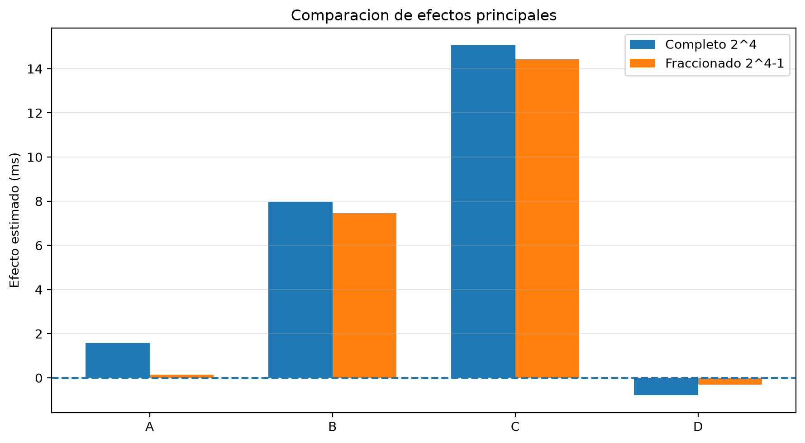
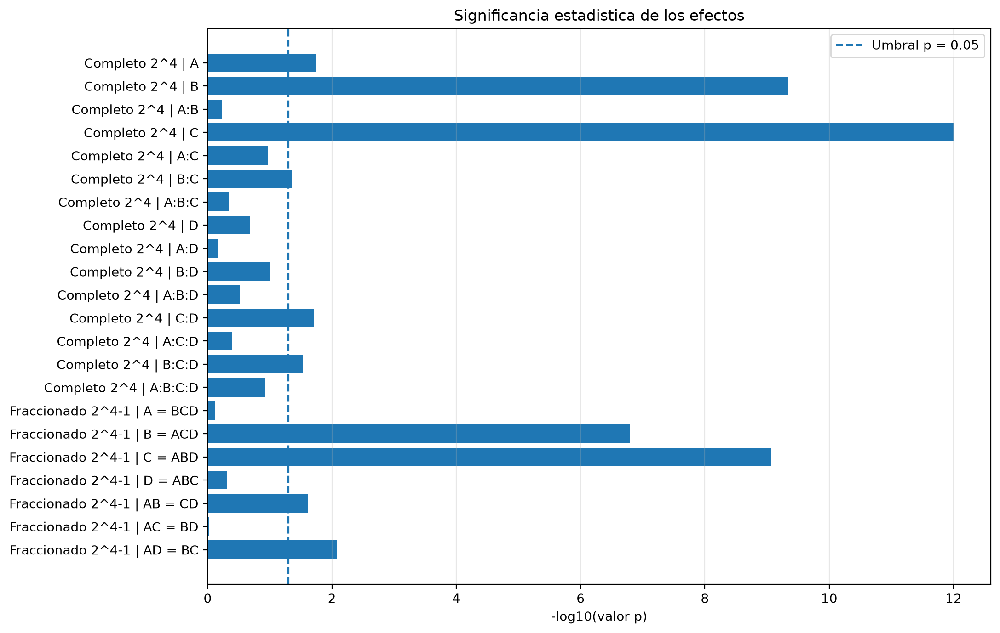
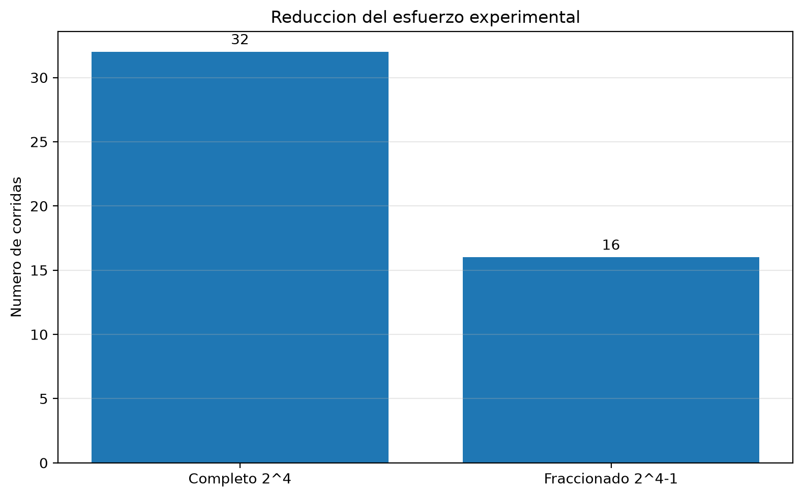

# Comparación de diseños factoriales 2⁴ y 2⁴⁻¹ — Etapa E2

## 1. Información general

**Proyecto:** Observatorio de Vivienda y Costos de Colima

**Etapa:** E2 — Análisis Estadístico

**Área:** Diseño y análisis de experimentos

**Fecha:** 22 de noviembre de 2026

**Responsables:** David Cuevas Farías y Nancy Haide Vázquez Ávalos

## 2. Objetivo

Comparar un diseño factorial completo 2⁴ con un diseño factorial fraccionado 2⁴⁻¹, con el propósito de evaluar las diferencias en los efectos estimados, la significancia estadística y el esfuerzo experimental requerido.

Se busca determinar si el diseño fraccionado permite identificar los factores que tienen mayor influencia sobre el tiempo de integración de datos, considerando las limitaciones asociadas con la estructura de alias.

## 3. Descripción de los diseños experimentales

### 3.1. Diseño factorial completo 2⁴

Se utilizó un diseño factorial completo con cuatro factores, cada uno con dos niveles:

| Factor | Descripción | Nivel bajo (-1) | Nivel alto (+1) |
|---|---|---|---|
| A | Cantidad de registros | 200 | 500 |
| B | Trazabilidad | Desactivada | Activada |
| C | Validación Pandera | Desactivada | Activada |
| D | Generación de resumen estadístico | Desactivada | Activada |

El diseño completo contempla 16 tratamientos experimentales. Se realizaron dos réplicas por tratamiento, obteniendo un total de 32 corridas.

### 3.2. Diseño factorial fraccionado 2⁴⁻¹

Para reducir el esfuerzo experimental se construyó una fracción de resolución IV, utilizando el generador:

**D = ABC**

Su relación definitoria es:

**I = ABCD**

Este diseño conserva 8 tratamientos de los 16 posibles y mantiene dos réplicas por tratamiento, para un total de 16 corridas.

La reducción permite evaluar los factores principales y determinadas interacciones con la mitad de las ejecuciones del diseño completo.

## 4. Resultados del diseño factorial completo

El análisis se realizó mediante un modelo de regresión lineal con todos los efectos principales y sus interacciones:

`tiempo_ms ~ A * B * C * D`

### 4.1. Efectos principales

| Factor | Efecto estimado (ms) | Valor p | Interpretación |
|---|---:|---:|---|
| A | +1.5826 | 0.017880 | Significativo |
| B | +7.9747 | <0.001 | Significativo |
| C | +15.0554 | <0.001 | Significativo |
| D | -0.7806 | 0.211544 | No significativo |

La validación Pandera (C) presentó el mayor efecto sobre el tiempo de procesamiento, seguida por la trazabilidad (B).

La cantidad de registros (A) también presentó un efecto estadísticamente significativo en este experimento. El factor D no mostró evidencia suficiente de un efecto significativo.

### 4.2. Interacciones significativas

Se identificaron las siguientes interacciones con un nivel de significancia de 0.05:

| Interacción | Efecto estimado (ms) | Valor p |
|---|---:|---:|
| B × C | +1.3090 | 0.044326 |
| C × D | -1.5591 | 0.019360 |
| B × C × D | -1.4362 | 0.029237 |

Las interacciones indican que el efecto de algunos factores puede variar dependiendo de la combinación de niveles de otros factores.

### 4.3. Diagnóstico del modelo

- R²: 0.9814.
- R² ajustado: 0.9640.
- Desviación residual: 1.6964 ms.
- Shapiro-Wilk W: 0.943642.
- Shapiro-Wilk p: 0.095015.

El modelo explicó aproximadamente el 98.14 % de la variabilidad observada en el tiempo de procesamiento.

La prueba Shapiro-Wilk no mostró evidencia suficiente para rechazar la normalidad de los residuos al nivel de significancia de 0.05. Esto no constituye una demostración de normalidad.

## 5. Resultados del diseño factorial fraccionado

Se utilizó el modelo:

`tiempo_ms ~ A + B + C + D + A:B + A:C + A:D`

Este modelo permite estimar siete contrastes independientes.

### 5.1. Efectos estimados y estructura de alias

| Contraste | Alias | Efecto estimado (ms) | Valor p |
|---|---|---:|---:|
| A | A = BCD | +0.1464 | 0.749820 |
| B | B = ACD | +7.4573 | <0.001 |
| C | C = ABD | +14.4215 | <0.001 |
| D | D = ABC | -0.3164 | 0.495902 |
| A × B | AB = CD | -1.2311 | 0.024085 |
| A × C | AC = BD | -0.0253 | 0.955911 |
| A × D | AD = BC | +1.5458 | 0.008256 |

La validación Pandera y la trazabilidad conservaron efectos principales positivos y estadísticamente significativos.

Sin embargo, los efectos estimados en este diseño deben interpretarse considerando su estructura de alias.

### 5.2. Diagnóstico del modelo

- R²: 0.9942.
- R² ajustado: 0.9890.
- Desviación residual: 0.8871 ms.
- Shapiro-Wilk W: 0.995479.
- Shapiro-Wilk p: 0.999999.

El modelo presentó un R² ajustado de 0.9890 y una desviación residual de 0.8871 ms.

La prueba Shapiro-Wilk no mostró evidencia suficiente para rechazar la normalidad de los residuos al nivel de 0.05. Debido al tamaño reducido de la muestra, este resultado debe interpretarse con cautela.

## 6. Comparación de los diseños

### 6.1. Comparación de efectos principales

| Factor | Completo 2⁴ (ms) | Fraccionado 2⁴⁻¹ (ms) |
|---|---:|---:|
| A | +1.5826 | +0.1464 |
| B | +7.9747 | +7.4573 |
| C | +15.0554 | +14.4215 |
| D | -0.7806 | -0.3164 |

Los dos diseños identificaron a la validación Pandera como el factor con mayor efecto positivo sobre el tiempo de procesamiento.

La trazabilidad también presentó un efecto positivo importante en ambos análisis.

Las estimaciones de A y D mostraron diferencias mayores, por lo que su interpretación debe considerar las interacciones confundidas en el diseño fraccionado.

### 6.2. Comparación del esfuerzo experimental

| Indicador | Diseño completo | Diseño fraccionado |
|---|---:|---:|
| Tratamientos | 16 | 8 |
| Réplicas por tratamiento | 2 | 2 |
| Corridas | 32 | 16 |
| Reducción de corridas | 0 % | 50 % |

El diseño fraccionado redujo de 32 a 16 las corridas consideradas, lo que representa una disminución del 50 %.

Esta reducción implica menor esfuerzo experimental, aunque también limita la posibilidad de separar determinados efectos e interacciones.

**Nota metodológica:** las 16 corridas del diseño fraccionado fueron seleccionadas de las 32 observaciones del diseño completo mediante el generador D = ABC. Por tanto, no representan una segunda ejecución independiente.

### 6.3. Comparación de los modelos

| Indicador | Completo | Fraccionado |
|---|---:|---:|
| R² | 0.9814 | 0.9942 |
| R² ajustado | 0.9640 | 0.9890 |
| Desviación residual (ms) | 1.6964 | 0.8871 |

El diseño fraccionado presentó mejores indicadores de ajuste en esta comparación. Sin embargo, esto no significa que sea universalmente superior: los modelos utilizan diferentes cantidades de observaciones y diferentes estructuras de términos, por lo que sus indicadores no deben interpretarse como una comparación directa de capacidad predictiva.

## 7. Interpretación de las evidencias gráficas

### Gráfica 1. Comparación de efectos principales




La gráfica muestra los efectos estimados de los cuatro factores para ambos diseños.

Se observa que Pandera presenta el mayor efecto positivo, seguida por la trazabilidad. También se identifican diferencias entre las estimaciones de A y D.

Esto permite observar que ambos diseños coinciden en los factores de mayor influencia, aunque no producen estimaciones idénticas.

### Gráfica 2. Significancia estadística de los efectos




La gráfica representa la significancia estadística mediante el valor transformado -log10(p).

La línea vertical representa el umbral de significancia p = 0.05.

En el diseño completo se identificaron efectos principales e interacciones significativas. En el fraccionado se identificaron B, C, AB y AD como contrastes significativos.

Las interacciones del diseño fraccionado deben interpretarse considerando los alias correspondientes.

### Gráfica 3. Reducción del esfuerzo experimental




La gráfica compara el número de corridas de ambos diseños.

El diseño completo requirió 32 corridas, mientras que el fraccionado utilizó 16.

Esto representa una reducción del 50 % en el número de ejecuciones consideradas.

## 8. Limitaciones del análisis

- El diseño completo contó con dos réplicas por tratamiento.
- El diseño fraccionado utiliza la mitad de las observaciones del diseño completo.
- Las observaciones del diseño fraccionado proceden del mismo conjunto experimental y no son independientes del diseño completo.
- La resolución IV confunde los efectos principales con interacciones de tres factores.
- Las interacciones de dos factores están confundidas entre sí.
- Los resultados corresponden únicamente a las condiciones experimentales evaluadas.
- Los tiempos de ejecución pueden variar dependiendo de la carga del equipo y las condiciones de ejecución.
- Los indicadores de ajuste no demuestran por sí solos que un modelo tenga mejor capacidad de predicción.

## 9. Conclusiones

La comparación permitió observar que el diseño factorial completo 2⁴ proporciona información más amplia sobre los efectos principales y las interacciones entre los cuatro factores.

El diseño factorial fraccionado 2⁴⁻¹ permitió reducir a la mitad el número de corridas, conservando la identificación de los factores que presentaron los efectos principales más importantes en este experimento: la trazabilidad y la validación Pandera.

La validación Pandera fue el factor con mayor efecto positivo sobre el tiempo de integración de datos en ambos diseños. Esto indica que su incorporación incrementó el tiempo de procesamiento bajo las condiciones evaluadas, aunque debe considerarse su función de control de calidad dentro del flujo de datos.

Por otra parte, las diferencias encontradas en algunos efectos e interacciones muestran la importancia de considerar la estructura de alias antes de interpretar los resultados de un diseño fraccionado.

En conclusión, el diseño completo resulta más apropiado cuando se necesita estudiar las interacciones con mayor detalle, mientras que el diseño fraccionado representa una alternativa para reducir el esfuerzo experimental cuando se acepta la limitación de información provocada por los alias.

## 10. Archivos de evidencia y reproducibilidad

### Código fuente

- `src/experimento_factorial_2_4_e2.py`
- `src/analisis_factorial_2_4_e2.py`
- `src/analisis_fraccionado_2_4_e2.py`
- `src/comparacion_factorial_2_4_e2.py`

### Resultados experimentales

- `data/reportes/experimento_factorial_2_4_completo.csv`
- `data/reportes/experimento_factorial_2_4_fraccionado.csv`
- `data/reportes/anova_factorial_2_4_completo.csv`
- `data/reportes/anova_factorial_2_4_fraccionado.csv`
- `data/reportes/comparacion_factorial_2_4.csv`

### Evidencias gráficas

- `data/reportes/graficas_comparacion_2_4/01_efectos_principales.png`
- `data/reportes/graficas_comparacion_2_4/02_significancia_estadistica.png`
- `data/reportes/graficas_comparacion_2_4/03_numero_corridas.png`

### Comandos de reproducción

Desde la raíz del repositorio:

```powershell
python -m src.experimento_factorial_2_4_e2
python -m src.analisis_factorial_2_4_e2
python -m src.analisis_fraccionado_2_4_e2
python -m src.comparacion_factorial_2_4_e2
```

**Nota:** ejecutar nuevamente el experimento completo sobrescribe su archivo CSV de salida y, por tanto, también puede cambiar los resultados del análisis posterior. Se recomienda conservar una copia de los resultados utilizados en esta entrega.

---

**Proyecto:** Observatorio de Vivienda y Costos de Colima

**Etapa:** E2 — Análisis Estadístico

**Responsables:** David Cuevas Farías y Nancy Haide Vázquez Ávalos
