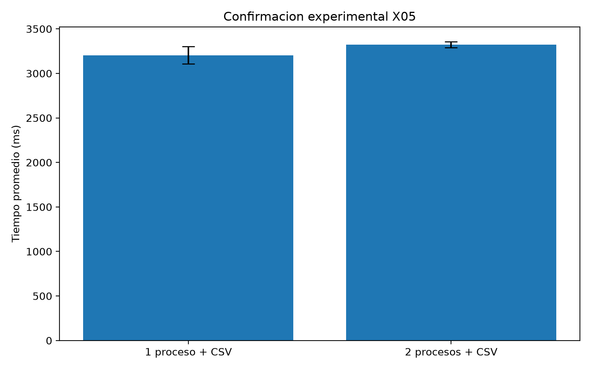
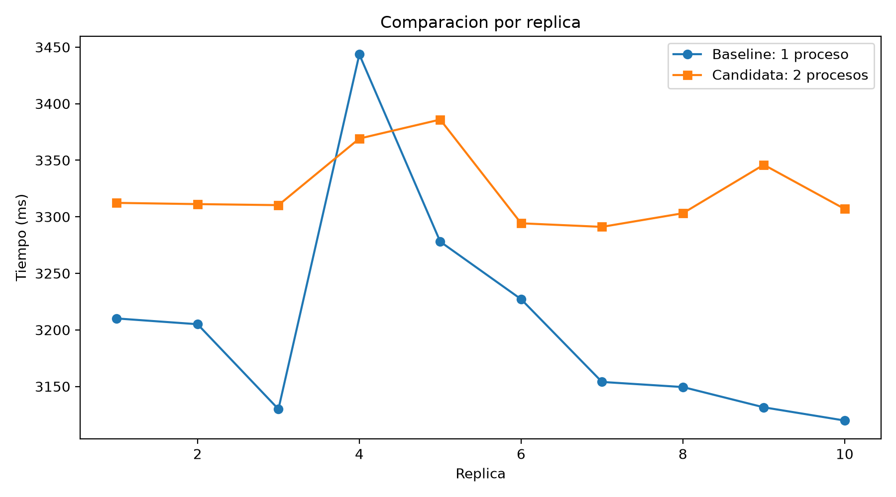
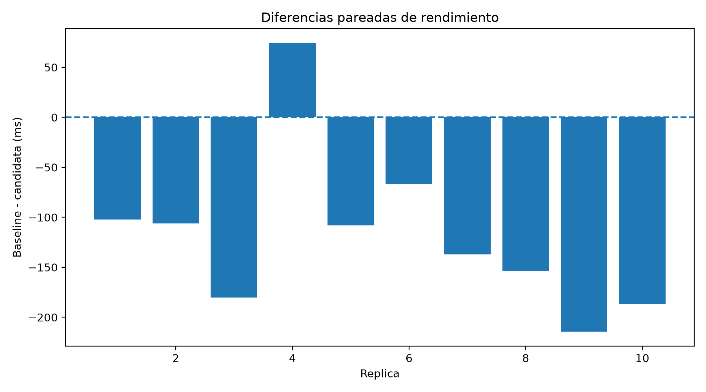

# X05 — Confirmación experimental de rendimiento

**Proyecto:** Trusted Data Lab — Observatorio de Vivienda y Costos de Colima
**Etapa:** E2
**Equipo:** David Cuevas Farías y Nancy Haide Vázquez Ávalos
**Fecha de ejecución:** 23 de noviembre de 2026

## 1. Objetivo

Confirmar mediante nuevas corridas si la configuración candidata seleccionada en el ANOVA 3×2 reduce el tiempo de procesamiento frente a una configuración de referencia, sin alterar la equivalencia lógica de los datos.

## 2. Selección de configuraciones

En el ANOVA exploratorio, un proceso con CSV obtuvo 1235.63010 ms y dos procesos con CSV obtuvieron 1223.34805 ms.

La segunda configuración presentó el menor promedio observado entre los seis tratamientos. Esto no constituye por sí mismo evidencia de superioridad frente a un proceso.

Antes de ejecutar X05 se estableció como referencia un proceso con CSV y como candidata dos procesos con CSV. La referencia fue definida para la confirmación, después del análisis exploratorio.

## 3. Diseño experimental

| Elemento | Especificación |
|---|---|
| Referencia | 1 proceso, CSV |
| Candidata | 2 procesos, CSV |
| Réplicas | 10 pares, 20 corridas nuevas |
| Orden | Aleatorización dentro de cada par, semilla 2027 |
| Calentamiento | Una corrida por configuración, excluida del análisis |
| Entrada | 564 registros integrados, con trazabilidad |
| Respuesta | Tiempo en milisegundos |
| Integridad | Equivalencia de DataFrames y SHA-256 lógico |
| Significancia | 0.05, prueba t pareada bilateral |

## 4. Procedimiento y reproducibilidad

Se utilizaron los archivos locales:

- data/reportes/limpieza_preliminar_inegi.csv
- data/reportes/reduccion_banxico.csv

La integración con trazabilidad y conversión a cadenas se realizaron antes de las mediciones. No se realizaron consultas nuevas a las API durante las corridas.

El script divide los registros en particiones, escribe y lee archivos CSV temporales mediante ProcessPoolExecutor y concatena los resultados.

El tiempo incluye creación y cierre del ejecutor, escritura, lectura y concatenación.

Excluye preparación de particiones, integración inicial, ordenamiento de verificación, cálculo del checksum y tamaño de archivos.

El número de procesos representa el máximo de trabajadores configurados, no una medición de trabajadores activos.

Ejecutar desde la raíz del repositorio:

    python -m src.experimento_confirmacion_x05_e2

El script impide sobrescribir el CSV de corridas existente. Para repetir el experimento se deben preservar las evidencias anteriores y utilizar una ubicación de salida distinta o respaldarlas previamente.

## 5. Hipótesis

Sea D el tiempo de la referencia menos el tiempo de la candidata.

- H0: la media de D es cero.
- H1: la media de D es distinta de cero.

Una diferencia positiva favorece a la candidata; una negativa favorece a la referencia.

## 6. Resultados por réplica

| Réplica | Referencia (ms) | Candidata (ms) |
|---:|---:|---:|
| 1 | 3210.1061 | 3312.2983 |
| 2 | 3205.0140 | 3311.2027 |
| 3 | 3129.9296 | 3310.2943 |
| 4 | 3443.5399 | 3369.1443 |
| 5 | 3278.0036 | 3385.9539 |
| 6 | 3227.1314 | 3294.2348 |
| 7 | 3153.9819 | 3291.0764 |
| 8 | 3149.4603 | 3303.1296 |
| 9 | 3131.5431 | 3345.9748 |
| 10 | 3119.8470 | 3306.9233 |

El orden cronológico y las fechas UTC se conservan en el CSV de corridas.

## 7. Estadística descriptiva

| Configuración | n | Media (ms) | Desviación estándar (ms) | Mínimo (ms) | Máximo (ms) |
|---|---:|---:|---:|---:|---:|
| Referencia | 10 | 3204.85569 | 98.158880 | 3119.8470 | 3443.5399 |
| Candidata | 10 | 3323.02324 | 32.549636 | 3291.0764 | 3385.9539 |

## 8. Mejora e incertidumbre

La mejora porcentual se calcula como:

Mejora (%) = 100 × (media de referencia - media candidata) / media de referencia.

| Indicador | Resultado |
|---|---:|
| Diferencia media (ms) | -118.16755 |
| Mejora porcentual | -3.687141 % |
| IC 95 % inferior de la diferencia (ms) | -176.426822 |
| IC 95 % superior de la diferencia (ms) | -59.908278 |
| Estadístico t | -4.588344 |
| Grados de libertad | 9 |
| Valor p bilateral | 0.001312 |

La candidata tardó 3.69 % más respecto de la referencia.

El intervalo de confianza corresponde a la diferencia absoluta, no al porcentaje.

Bajo los supuestos de la prueba, se rechaza H0. La referencia fue más rápida en nueve pares.

## 9. Integridad y errores

Las 20 corridas registraron cero errores y un único checksum de salida.

El checksum esperado de la entrada normalizada fue:

    0d521727ffc75e8555c2ac2f3ce32334dee13a779b1bc977134661a9ea6140d5

El script verifica igualdad de DataFrames y del SHA-256 de su representación CSV ordenada.

Esto demuestra equivalencia lógica dentro del experimento, no identidad binaria de todos los archivos temporales ni exactitud respecto de las fuentes externas.

La trazabilidad se mantuvo en ambas configuraciones.

Pandera no forma parte del tramo medido en este benchmark; no se atribuye a X05 una validación Pandera adicional.

## 10. Decisión técnica

No se confirma la mejora esperada.

Se recomienda conservar un proceso con CSV para este escenario de 564 registros.

No se modifica el pipeline productivo como consecuencia automática de este resultado.

## 11. Limitaciones

Las corridas corresponden a un entorno local Windows y una sola sesión de confirmación.

No se controló exhaustivamente la carga del sistema ni la caché del sistema operativo.

Los tiempos absolutos difieren de los del ANOVA exploratorio; no se combinan ambas sesiones ni se atribuye esa diferencia a una causa demostrada.

El costo de arranque de procesos es una explicación posible, no verificada por medición separada.

La prueba t supone diferencias aproximadamente normales e independencia entre pares; estos supuestos no se verificaron formalmente en X05.

Diez pares limitan la generalización.

No se midió memoria total ni rendimiento integral del pipeline.

El diseño no permite extrapolar la decisión a grandes volúmenes, otros formatos o equipos.

## 12. Evidencias

- [Script X05](../../../src/experimento_confirmacion_x05_e2.py)
- [Corridas](../../../data/reportes/experimento_confirmacion_x05.csv)
- [Resumen](../../../data/reportes/resumen_confirmacion_x05.csv)
- [Comparación estadística](../../../data/reportes/comparacion_confirmacion_x05.csv)
- [Figuras](../../../reportes/figuras/confirmacion_x05/)
- [ANOVA exploratorio 3×2](anova_3_2.md)

## 13. Uso de IA y revisión

Se utilizó ChatGPT como apoyo para diseñar el script, interpretar los resultados y redactar la documentación.

Las mediciones corresponden a la ejecución local reportada por David; no son datos simulados.

La revisión cruzada por Nancy y la publicación del commit de estas evidencias quedan pendientes.
