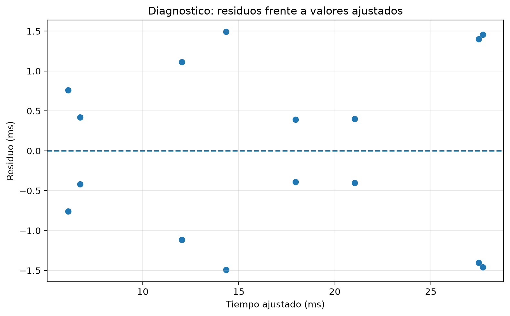

# Experimento factorial 2³ — Etapa E2

## 1. Información general

**Proyecto:** Observatorio de Vivienda y Costos de Colima

**Etapa:** E2 — Integración, procesamiento y análisis estadístico

**Área:** Análisis Estadístico

**Fecha:** 22 de noviembre de 2026

**Responsables:** David Cuevas Farías y Nancy Haide Vázquez Ávalos

## 2. Objetivo

Evaluar el efecto de la cantidad de registros, la incorporación de trazabilidad y la validación de calidad mediante Pandera sobre el tiempo de ejecución del flujo de integración de datos del proyecto.

Se busca identificar qué factores tienen mayor influencia en el rendimiento del procesamiento y determinar si existen interacciones estadísticamente significativas entre ellos.

## 3. Diseño experimental

Se utilizó un diseño factorial completo 2³, compuesto por tres factores con dos niveles cada uno, ocho tratamientos y dos réplicas por tratamiento.

Esto representa un total de 16 corridas experimentales por tanda.

| Factor | Variable | Nivel bajo (-1) | Nivel alto (+1) |
|---|---|---|---|
| A | Cantidad de registros | 200 | 500 |
| B | Trazabilidad | Desactivada | Activada |
| C | Validación Pandera | Desactivada | Activada |

La variable de respuesta fue el tiempo de ejecución, medido en milisegundos.

## 4. Metodología experimental

Se utilizaron datos previamente procesados de INEGI y Banxico, correspondientes a las etapas de preparación e integración de datos del Observatorio.

El tiempo de ejecución se midió mediante la función `perf_counter_ns()` de Python, convirtiendo posteriormente el resultado a milisegundos.

La lectura de archivos CSV y la preparación de las muestras quedaron fuera del intervalo de medición, con el propósito de evaluar principalmente el costo computacional de la integración y las operaciones seleccionadas.

Se realizaron dos tandas experimentales:

### 4.1. Primera tanda experimental

Se ejecutaron 16 corridas correspondientes a los ocho tratamientos factoriales, con dos réplicas por tratamiento.

En esta primera ejecución no se realizó un calentamiento previo del flujo experimental.

Durante las mediciones se identificó un tiempo extremo de 168.756 ms, que incrementó la variabilidad de los resultados.

El análisis inicial presentó los siguientes indicadores:

- R² = 0.5574.
- Desviación residual = 35.3814 ms.
- Shapiro-Wilk: p = 0.000016.

Estos resultados indicaron una variabilidad considerable y evidencia estadística para cuestionar la normalidad de los residuos.

### 4.2. Segunda tanda experimental: confirmación

Para mejorar la estabilidad de las mediciones se realizó una segunda tanda experimental.

Antes de registrar los tiempos se ejecutaron ocho combinaciones de calentamiento, correspondientes a los tratamientos del diseño factorial.

Posteriormente se realizaron las 16 corridas de confirmación, manteniendo dos réplicas por tratamiento.

Las combinaciones se ejecutaron en orden aleatorizado mediante la semilla 2026.

El tiempo máximo registrado en esta tanda fue de 29.1671 ms.

La segunda tanda presentó una menor variabilidad que la primera, aunque el calentamiento no puede considerarse la única causa demostrada de esta diferencia.

## 5. Resultados de confirmación

Los resultados de la segunda tanda se almacenaron en:

`data/reportes/experimento_factorial_e2_confirmacion.csv`

Los efectos principales se calcularon como la diferencia entre el tiempo promedio del nivel alto y el tiempo promedio del nivel bajo.

| Factor | Efecto estimado (ms) | Valor p | Interpretación |
|---|---:|---:|---|
| A | +1.4528 | 0.083061 | No significativo |
| B | +7.4401 | 0.000008 | Significativo |
| C | +13.7474 | < 0.000001 | Significativo |

Los factores B y C presentaron efectos estadísticamente significativos sobre el tiempo de procesamiento.

El factor A no presentó evidencia estadística suficiente para afirmar que el incremento de 200 a 500 registros modificara el tiempo de ejecución en las condiciones evaluadas.

## 6. Análisis de varianza (ANOVA)

Se realizó un análisis de varianza mediante un modelo lineal factorial completo:

`tiempo_ms ~ A * B * C`

El análisis se ejecutó con la biblioteca Statsmodels de Python, utilizando ANOVA tipo II.

Se estableció un nivel de significancia de α = 0.05.

### 6.1. Tabla ANOVA

| Término | Suma de cuadrados | F | Valor p |
|---|---:|---:|---:|
| A | 8.442511 | 3.920010 | 0.083061 |
| B | 221.420352 | 102.809465 | 0.00000765 |
| A×B | 0.644167 | 0.299098 | 0.599367 |
| C | 755.958528 | 351.005185 | 0.000000068 |
| A×C | 0.000924 | 0.000429 | 0.983981 |
| B×C | 1.784362 | 0.828511 | 0.389304 |
| A×B×C | 6.212058 | 2.884371 | 0.127873 |
| Residual | 17.229570 | — | — |

### 6.2. Interpretación de los efectos principales

**Factor A: Cantidad de registros**

El valor p fue de 0.083061, superior al nivel de significancia de 0.05.

Por lo tanto, no se encontró evidencia estadística suficiente para considerar significativo el efecto de incrementar la cantidad de registros de 200 a 500.

**Factor B: Trazabilidad**

El valor p fue de aproximadamente 0.00000765.

La activación de la trazabilidad incrementó el tiempo promedio estimado en 7.4401 ms.

Este resultado indica que la incorporación de trazabilidad representa un costo computacional estadísticamente significativo en las condiciones evaluadas.

**Factor C: Validación Pandera**

El valor p fue de aproximadamente 0.000000068.

La validación mediante Pandera presentó el mayor efecto principal, con un incremento estimado de 13.7474 ms.

Esto indica que la validación de calidad representa el mayor costo computacional entre los tres factores estudiados.

### 6.3. Interpretación de las interacciones

Las interacciones A×B, A×C, B×C y A×B×C presentaron valores p superiores a 0.05.

Por lo tanto, no se encontró evidencia estadística suficiente para afirmar que existieran interacciones significativas entre los factores.

Los efectos de trazabilidad y validación Pandera se interpretan principalmente como efectos individuales dentro del modelo experimental evaluado.

## 7. Diagnóstico del modelo estadístico

Para evaluar el ajuste del modelo y el comportamiento de sus residuos se calcularon los siguientes indicadores:

| Indicador | Resultado |
|---|---:|
| R² | 0.9830 |
| R² ajustado | 0.9681 |
| Desviación residual | 1.4675 ms |
| Shapiro-Wilk W | 0.915498 |
| Shapiro-Wilk p | 0.142733 |

El coeficiente R² indica que el modelo explica aproximadamente el 98.30 % de la variabilidad observada en los tiempos de ejecución de la tanda de confirmación.

La prueba Shapiro-Wilk presentó un valor p de 0.142733, superior a 0.05. Por lo tanto, no existe evidencia suficiente para rechazar la hipótesis de normalidad de los residuos.

Este resultado es favorable para el supuesto de normalidad, aunque no demuestra por sí solo que todos los supuestos del ANOVA se cumplan.

También es necesario considerar que el tamaño de muestra es reducido, por lo que la capacidad de detectar desviaciones de los supuestos es limitada.

## 8. Evidencias gráficas

Las gráficas generadas para analizar el comportamiento del experimento se encuentran en:

`data/reportes/graficas_e2_monico/`

### 8.1. Gráfica de efectos principales


La gráfica permite observar cómo cambia el tiempo promedio de ejecución al modificar el nivel de cada factor.

La validación Pandera presenta el mayor incremento en el tiempo de procesamiento, seguida de la trazabilidad.

### 8.2. Gráfica de interacciones


La gráfica permite comparar el comportamiento de los factores cuando se modifican conjuntamente.

Las líneas aproximadamente paralelas son consistentes con la ausencia de evidencia estadística de interacciones significativas en el ANOVA.

### 8.3. Gráfica de residuos



La gráfica presenta los residuos frente a los valores ajustados por el modelo.

Permite examinar posibles patrones, tendencias o cambios en la dispersión de los errores.

### 8.4. Gráfica normal Q-Q


La gráfica compara los cuantiles observados de los residuos con los cuantiles teóricos de una distribución normal.

Su interpretación complementa la prueba Shapiro-Wilk y permite evaluar visualmente el supuesto de normalidad.

## 9. Comparación de las dos tandas experimentales

La comparación entre las dos tandas permite observar diferencias importantes en la estabilidad de las mediciones.

| Indicador | Primera tanda | Confirmación |
|---|---:|---:|
| Corridas | 16 | 16 |
| Tiempo máximo registrado | 168.756 ms | 29.1671 ms |
| R² | 0.5574 | 0.9830 |
| Desviación residual | 35.3814 ms | 1.4675 ms |
| Shapiro-Wilk p | 0.000016 | 0.142733 |

La primera tanda presentó una medición extrema que incrementó considerablemente la variabilidad.

En la segunda tanda se incorporó un calentamiento previo y se mantuvo el mismo diseño factorial.

Los resultados de confirmación mostraron un ajuste estadístico considerablemente mejor y menor dispersión residual.

Sin embargo, debido a que las condiciones de ejecución fueron diferentes, no se puede atribuir toda la mejora exclusivamente al calentamiento.

La segunda tanda se utiliza como referencia principal para las conclusiones estadísticas de este documento.

## 10. Limitaciones del experimento

Durante el desarrollo experimental se identificaron las siguientes limitaciones:

- Se realizaron únicamente dos réplicas por tratamiento en cada tanda.
- Los tiempos pueden variar según la carga de trabajo del equipo.
- Se evaluaron solamente dos tamaños de muestra: 200 y 500 registros.
- La primera tanda presentó una medición extrema.
- Las dos tandas se ejecutaron bajo condiciones de calentamiento diferentes.
- El análisis estadístico no demuestra por sí solo el cumplimiento de todos los supuestos del ANOVA.
- Los resultados corresponden al entorno de ejecución y a las condiciones experimentales utilizadas.

Por estas razones, las conclusiones deben limitarse a las condiciones evaluadas y no generalizarse automáticamente a cualquier volumen de datos o equipo de procesamiento.

## 11. Conclusiones

El experimento factorial completo 2³ permitió evaluar la influencia de la cantidad de registros, la trazabilidad y la validación Pandera sobre el tiempo de integración de datos del Observatorio de Vivienda y Costos de Colima.

En la tanda de confirmación se encontró que la trazabilidad y la validación Pandera tuvieron efectos estadísticamente significativos sobre el tiempo de procesamiento.

La validación Pandera presentó el mayor efecto estimado, con un incremento de 13.7474 ms, mientras que la trazabilidad presentó un incremento de 7.4401 ms.

Por otra parte, el incremento de 200 a 500 registros no presentó un efecto estadísticamente significativo al nivel de 0.05.

Tampoco se encontró evidencia suficiente de interacciones significativas entre los factores.

El modelo de confirmación obtuvo un R² de 0.9830 y una desviación residual de 1.4675 ms, lo que representa un ajuste favorable para los datos analizados.

La comparación entre las dos tandas permitió identificar la importancia de controlar las condiciones de ejecución y considerar el calentamiento del sistema al realizar experimentos de rendimiento.

Finalmente, el experimento muestra que las operaciones de trazabilidad y validación de calidad tienen un costo computacional medible. Sin embargo, estas operaciones cumplen funciones importantes para garantizar la procedencia, integridad y confiabilidad de los datos.

Por ello, sus resultados deben interpretarse considerando tanto el rendimiento como la calidad del procesamiento.

## 12. Archivos de evidencia y reproducibilidad

### 12.1. Código fuente

- `src/experimento_factorial_e2.py`
- `src/graficas_factorial_e2.py`
- `src/analisis_factorial_2_3_e2.py`

### 12.2. Resultados experimentales

- `data/reportes/experimento_factorial_e2.csv`
- `data/reportes/experimento_factorial_e2_original.csv`
- `data/reportes/experimento_factorial_e2_confirmacion.csv`
- `data/reportes/anova_factorial_2_3.csv`

### 12.3. Evidencias gráficas

- `data/reportes/graficas_e2_monico/01_efectos_principales.png`
- `data/reportes/graficas_e2_monico/02_interacciones.png`
- `data/reportes/graficas_e2_monico/03_residuos.png`
- `data/reportes/graficas_e2_monico/04_qqplot.png`

### 12.4. Reproducción del experimento

Desde la raíz del repositorio se pueden ejecutar los siguientes comandos:

**Ejecutar el experimento factorial:**

```powershell
python -m src.experimento_factorial_e2
```

**Generar las gráficas:**

```powershell
python -m src.graficas_factorial_e2
```

**Ejecutar el análisis ANOVA:**

```powershell
python -m src.analisis_factorial_2_3_e2
```

El programa experimental actual guarda las mediciones en el archivo CSV de confirmación. Por ello, se recomienda respaldar los resultados existentes antes de repetir la ejecución.

### 12.5. Uso de inteligencia artificial generativa

Se utilizó ChatGPT como herramienta de apoyo para la revisión del código, interpretación de resultados estadísticos, documentación del procedimiento experimental y organización de las evidencias.

La ejecución de los experimentos, generación de resultados y validación de los archivos se realizó mediante los programas del repositorio.