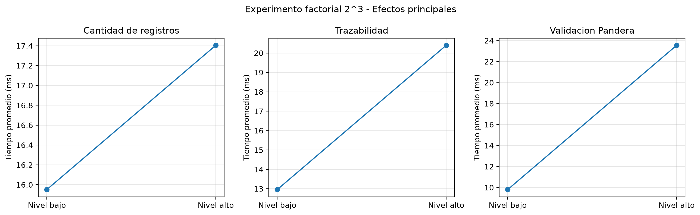
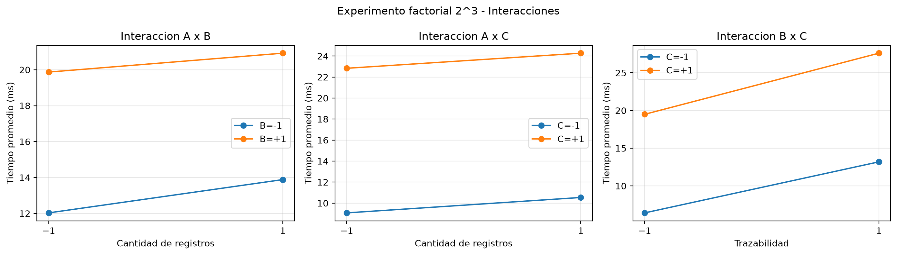
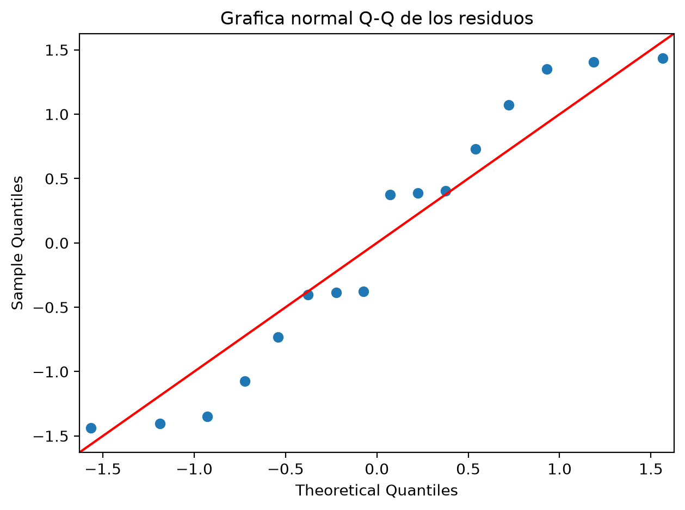

# Experimento factorial 2³ — Etapa E2

## Información general

**Proyecto:** Observatorio de Vivienda y Costos de Colima

**Área:** Análisis Estadístico

**Fecha:** 22 de noviembre de 2026

**Responsables:** David Cuevas Farías y Nancy Haide Vázquez Ávalos

## Objetivo

Evaluar el efecto de la cantidad de registros, la trazabilidad y la validación Pandera sobre el tiempo de integración de datos.

## Diseño experimental

Se utilizó un diseño factorial completo 2³ con ocho tratamientos y dos réplicas por tratamiento.

| Factor | Nivel bajo (-1) | Nivel alto (+1) |
|---|---|---|
| A: Registros | 200 | 500 |
| B: Trazabilidad | Desactivada | Activada |
| C: Pandera | Desactivada | Activada |

## Resultados de confirmación

| Factor | Efecto (ms) | Valor p |
|---|---:|---:|
| A | +1.4528 | 0.083061 |
| B | +7.4401 | 0.000008 |
| C | +13.7473 | < 0.000001 |
| A×B | -0.4013 | 0.599367 |
| A×C | -0.0152 | 0.983980 |
| B×C | +0.6679 | 0.389304 |
| A×B×C | -1.2462 | 0.127873 |

## Diagnóstico

R² = 0.9830.

Desviación residual = 1.4675 ms.

Shapiro-Wilk: p = 0.142733.

## Conclusión preliminar

La trazabilidad y la validación Pandera tuvieron efectos estadísticamente significativos sobre el tiempo de procesamiento en la tanda de confirmación.

Las conclusiones están limitadas a las condiciones experimentales evaluadas y a dos réplicas por tratamiento.

## Metodología experimental

Se utilizaron datos previamente procesados de INEGI y Banxico.

El tiempo de ejecución se midió mediante `perf_counter_ns()` de Python.

La lectura de los archivos CSV y la preparación de las muestras quedaron fuera del tiempo medido.

Se realizaron dos tandas experimentales:

- Primera tanda: 16 corridas sin calentamiento.
- Segunda tanda: 8 ejecuciones de calentamiento y 16 corridas de confirmación.

Las combinaciones se ejecutaron en orden aleatorizado mediante la semilla 2026.

La desactivación de trazabilidad y Pandera se utilizó únicamente como condición experimental.

## Comparación de resultados

En la primera tanda se registró un tiempo extremo de 168.756 ms.

El análisis inicial presentó:

- R² = 0.5574.
- Desviación residual = 35.3814 ms.
- Shapiro-Wilk: p = 0.000016.

En la tanda de confirmación, el tiempo máximo fue de 29.167 ms.

El análisis de confirmación presentó:

- R² = 0.9830.
- Desviación residual = 1.4675 ms.
- Shapiro-Wilk: p = 0.142733.

La segunda tanda mostró menor variabilidad. El calentamiento pudo contribuir a este cambio, aunque no se ha demostrado que fuera su única causa.

## Evidencias gráficas

### Gráfica 1. Efectos principales

La validación Pandera presentó el mayor efecto estimado sobre el tiempo de procesamiento.

### Gráfica 2. Interacciones

Las líneas aproximadamente paralelas son consistentes con las interacciones no significativas del ANOVA.

### Gráfica 3. Residuos

Los residuos aparecen a ambos lados de cero, sin una tendencia curva evidente.

### Gráfica 4. Normalidad Q-Q

La gráfica Q-Q y la prueba Shapiro-Wilk no muestran evidencia suficiente para rechazar la normalidad de los residuos en la tanda de confirmación.

## Limitaciones

- Solo se realizaron dos réplicas por tratamiento y por tanda.
- Los tiempos pueden variar según la carga del equipo.
- Se evaluaron únicamente 200 y 500 registros.
- La primera tanda presentó una medición extrema.
- Las dos tandas se ejecutaron con condiciones de calentamiento diferentes.
- No se han comprobado todos los supuestos del ANOVA.

## Archivos de evidencia

**Código:**

- `src/experimento_factorial_e2.py`
- `src/graficas_factorial_e2.py`

**Resultados:**

- `data/reportes/experimento_factorial_e2.csv`
- `data/reportes/experimento_factorial_e2_original.csv`
- `data/reportes/experimento_factorial_e2_confirmacion.csv`

**Gráficas:**

- `data/reportes/graficas_e2_monico/01_efectos_principales.png`
- `data/reportes/graficas_e2_monico/02_interacciones.png`
- `data/reportes/graficas_e2_monico/03_residuos.png`
- `data/reportes/graficas_e2_monico/04_qqplot.png`

## Reproducción

Desde la raíz del repositorio se pueden ejecutar los programas mediante los siguientes comandos:

    python -m src.experimento_factorial_e2
    python -m src.graficas_factorial_e2

El programa experimental actual guarda las mediciones en el CSV de confirmación. Se recomienda respaldar ese archivo antes de repetir la ejecución.

