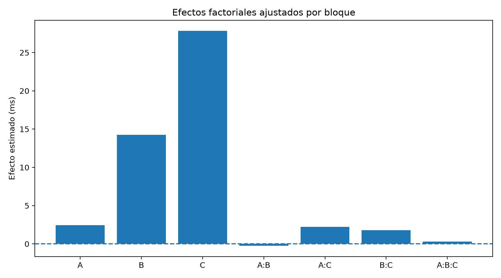
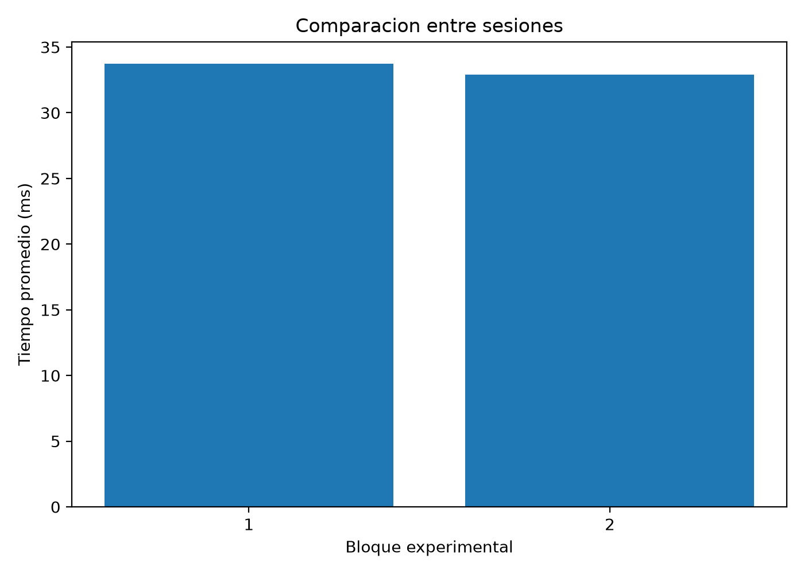
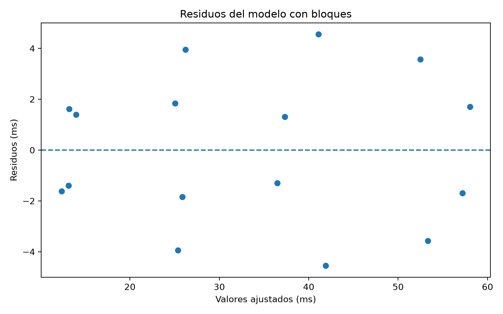
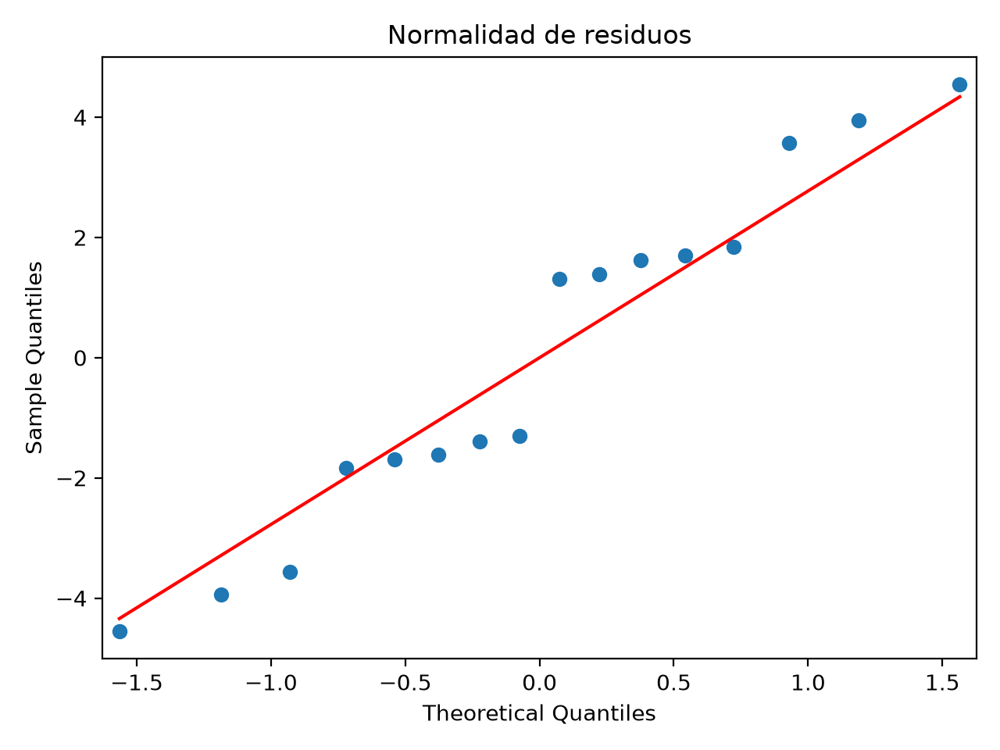
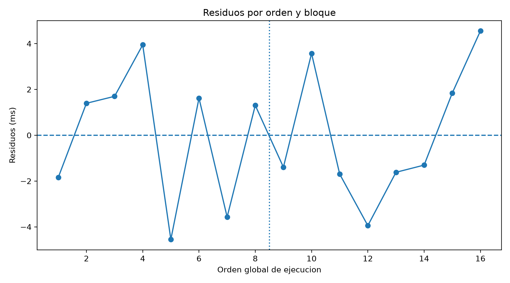

# Experimento factorial 2³ con bloques completos aleatorizados

**Proyecto:** Observatorio de Vivienda y Costos de Colima — Trusted Data Lab, E2
**Equipo:** David Cuevas Farías y Nancy Haide Vázquez Ávalos

## 1. Objetivo

Evaluar el tiempo de integración de datos considerando tres factores y controlar posibles diferencias entre sesiones de ejecución. Este experimento complementa el factorial anterior sin sustituir sus mediciones.

## 2. Diseño experimental

| Factor | Nivel −1 | Nivel +1 |
|---|---|---|
| A: volumen | 200 registros | 500 registros |
| B: trazabilidad | Desactivada | Activada |
| C: Pandera | Desactivado | Activado |

Se realizaron dos bloques completos de ocho tratamientos, para un total de 16 corridas medidas. Cada bloque corresponde a una invocación independiente del programa. Se utilizaron muestras reproducibles con semilla 2026, calentamiento de los ocho tratamientos en cada sesión y aleatorización interna con semilla 2026 más el número de bloque. La respuesta es el tiempo en milisegundos medido con `perf_counter_ns`. Se verificó la cantidad de registros de salida. Los archivos de resultados contienen la fecha UTC de cada corrida.

## 3. Justificación del bloqueo

La sesión de ejecución puede introducir variaciones por el estado del intérprete, la carga del sistema y las condiciones de ejecución. El bloqueo se definió antes de medir y cada sesión contiene todas las combinaciones factoriales. No se asignaron bloques retrospectivamente al experimento anterior. Las dos sesiones no representan necesariamente días distintos ni condiciones de carga deliberadamente diferentes.

## 4. Mediciones reales

| A | B | C | Bloque 1 (ms) | Bloque 2 (ms) |
|---:|---:|---:|---:|---:|
| -1 | -1 | -1 | 14.8079 | 10.7491 |
| -1 | -1 | 1 | 38.6179 | 35.1871 |
| -1 | 1 | -1 | 30.1458 | 21.4331 |
| -1 | 1 | 1 | 49.7415 | 56.0565 |
| 1 | -1 | -1 | 15.3681 | 11.7565 |
| 1 | -1 | 1 | 37.3487 | 45.6263 |
| 1 | 1 | -1 | 24.0266 | 26.8845 |
| 1 | 1 | 1 | 59.7259 | 55.5080 |

La tabla presenta los tratamientos en orden factorial, no en orden de ejecución. El orden real está en los CSV originales.

## 5. Modelo e hipótesis

Se ajustó por mínimos cuadrados el modelo `tiempo_ms ~ C(bloque) + A * B * factor_c`, con factores codificados como −1 y +1. Se considera un efecto aditivo del bloque y las siete componentes factoriales. Para cada término, H0 establece que su efecto es cero; H1 establece que es distinto de cero. Se empleó ANOVA tipo II y un nivel de significancia de 0.05 por contraste, sin ajuste por multiplicidad.

## 6. Tabla ANOVA

| Término | SC | gl | CM | F | p | Significativo |
|---|---:|---:|---:|---:|---:|---|
| Bloque | 2.707094 | 1 | 2.707094 | 0.153974 | 0.706440 | No |
| A | 23.779521 | 1 | 23.779521 | 1.352531 | 0.282944 | No |
| B | 813.109502 | 1 | 813.109502 | 46.248014 | 0.000253 | Sí |
| C | 3098.043949 | 1 | 3098.043949 | 176.210436 | 0.000003 | Sí |
| AB | 0.242433 | 1 | 0.242433 | 0.013789 | 0.909820 | No |
| AC | 19.594124 | 1 | 19.594124 | 1.114474 | 0.326179 | No |
| BC | 13.038418 | 1 | 13.038418 | 0.741599 | 0.417668 | No |
| ABC | 0.391031 | 1 | 0.391031 | 0.022241 | 0.885653 | No |
| Residual | 123.070506 | 7 | 17.581501 | — | — | No aplica |

## 7. Efectos factoriales

| Factor | Efecto (ms) | p |
|---|---:|---:|
| A | 2.438212 | 0.282944 |
| B | 14.257538 | 0.000253 |
| C | 27.830038 | 0.000003 |
| AB | -0.246187 | 0.909820 |
| AC | 2.213262 | 0.326179 |
| BC | 1.805437 | 0.417668 |
| ABC | 0.312663 | 0.885653 |

Los efectos corresponden al doble del coeficiente estimado con codificación ±1. B y C presentan efectos positivos significativos; no se detectaron efectos significativos de A ni de las interacciones. Esto no demuestra que sus efectos sean exactamente cero.



## 8. Comparación entre bloques

| Bloque | n | Media (ms) | Desviación estándar | Mínimo | Máximo |
|---|---:|---:|---:|---:|---:|
| 1 | 8 | 33.722800 | 15.907540 | 14.8079 | 59.7259 |
| 2 | 8 | 32.900137 | 18.204869 | 10.7491 | 56.0565 |

La diferencia de medias fue 0.822663 ms. No se rechazó la hipótesis nula del bloque (p = 0.706440). Las desviaciones estándar de esta tabla incluyen las diferencias entre tratamientos y no son estimaciones aisladas del error experimental.



## 9. Diagnóstico del modelo

| Indicador | Resultado |
|---|---:|
| R² | 0.969939 |
| R² ajustado | 0.935583 |
| Desviación residual (ms) | 4.193030 |
| Shapiro-Wilk W | 0.937811 |
| Shapiro-Wilk p | 0.323063 |

No se rechazó la normalidad de los residuos. La potencia de esta prueba es limitada. Se generaron las siguientes gráficas para inspeccionar dispersión, normalidad y posibles patrones temporales; no se afirma una inspección visual que no haya sido registrada.







## 10. Comparación con el experimento anterior

El factorial anterior sin bloqueo explícito también identificó trazabilidad y Pandera como factores significativos. La coincidencia cualitativa respalda la estabilidad de ese hallazgo en las ejecuciones realizadas, aunque los tiempos absolutos difieren y no se conoce la causa exacta de esa diferencia. No se combinaron ambos experimentos como si fueran una sola muestra homogénea.

## 11. Limitaciones y decisiones

- Solo se observaron dos sesiones y una corrida por tratamiento dentro de cada sesión.
- El modelo supone aditividad del bloque; no permite estimar por separado una interacción bloque-tratamiento y error puro.
- No se realizó una prueba independiente de homogeneidad de varianzas; la inspección gráfica queda pendiente de revisión.
- No se midieron memoria, carga del sistema ni temperatura; no se atribuyen diferencias a causas específicas no medidas.
- Los resultados se limitan a las muestras y al entorno ensayado. No implican generalización a otros equipos o volúmenes.
- Desactivar trazabilidad o Pandera para reducir tiempo no es una recomendación de producción: ambos mecanismos cumplen funciones de calidad.

## 12. Evidencias y reproducibilidad

Desde la raíz del repositorio, los comandos empleados fueron:

```powershell
python -m src.experimento_factorial_bloques_e2 --bloque 1
python -m src.experimento_factorial_bloques_e2 --bloque 2
python -m src.analisis_factorial_bloques_e2
```

El script de medición impide sobrescribir un bloque existente. Para repetir el análisis de las mediciones originales basta el último comando.

| Evidencia | Ruta |
|---|---|
| Medición | [experimento_factorial_bloques_e2.py](../../../src/experimento_factorial_bloques_e2.py) |
| Análisis | [analisis_factorial_bloques_e2.py](../../../src/analisis_factorial_bloques_e2.py) |
| Bloque 1 | [CSV](../../../data/reportes/factorial_2_3_bloque_1.csv) |
| Bloque 2 | [CSV](../../../data/reportes/factorial_2_3_bloque_2.csv) |
| ANOVA | [CSV](../../../data/reportes/anova_factorial_bloques_e2.csv) |
| Efectos | [CSV](../../../data/reportes/efectos_factorial_bloques_e2.csv) |
| Resumen | [CSV](../../../data/reportes/resumen_factorial_bloques_e2.csv) |
| Diagnóstico | [CSV](../../../data/reportes/diagnostico_factorial_bloques_e2.csv) |

## 13. Conclusión

Se completó un factorial 2³ con bloqueo por sesión, 16 mediciones reales y aleatorización dentro de cada bloque. Los efectos significativos observados fueron trazabilidad y Pandera. No se encontró evidencia de un efecto del bloque. El diseño y sus limitaciones quedan documentados sin modificar los resultados anteriores.

Se utilizó ChatGPT como apoyo para elaborar los scripts, interpretar las salidas y redactar el informe. Las mediciones fueron ejecutadas por David en su entorno local. La revisión cruzada del equipo y la publicación de los archivos quedan pendientes de confirmación.
