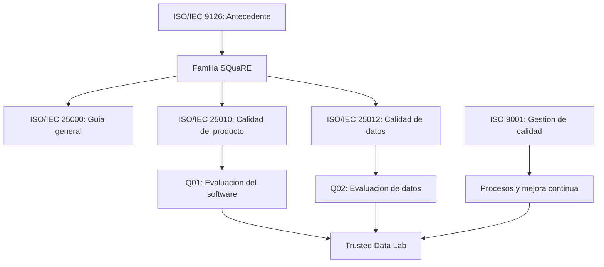
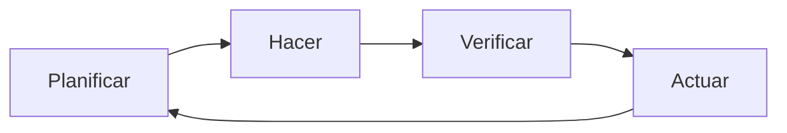
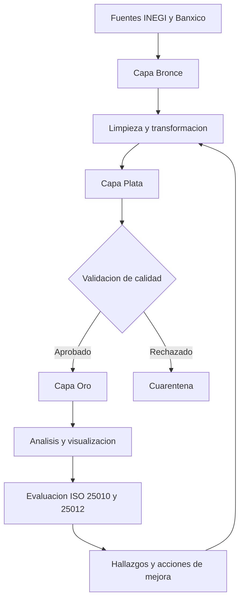

# Q03 — Antecedentes normativos y estándares de calidad

## 1. Información general

| Elemento | Descripción |
|---|---|
| Proyecto | Observatorio de Vivienda y Costos de Colima |
| Repositorio | Trusted Data Lab |
| Etapa | E2 |
| Materia | Calidad en los Sistemas de Información |
| Integrantes | Nancy Haide Vázquez Ávalos y David Cuevas Farías |
| Responsable asignada | Nancy Haide Vázquez Ávalos |
| Elaboración inicial | David Cuevas Farías |
| Fecha | 23 de noviembre de 2026 |
| Versión de referencia del proyecto | 5299de2 |
| Actividad | Q03 — Antecedentes normativos |
| Estado | Documentado; revisión del equipo pendiente |

## 2. Introducción

La calidad en los sistemas de información constituye un elemento fundamental para garantizar que los productos de software, los datos y los procesos organizacionales satisfagan las necesidades de sus usuarios.

La Organización Internacional de Normalización (ISO) y la Comisión Electrotécnica Internacional (IEC) han desarrollado diferentes normas que permiten establecer modelos, criterios y mecanismos de evaluación orientados a la mejora continua.

En el proyecto Observatorio de Vivienda y Costos de Colima, estas normas proporcionan un marco de referencia para evaluar los procesos de captura, almacenamiento, transformación, análisis y publicación de información económica y geoespacial.

Durante la etapa E2 se consideran cinco referencias normativas:

- ISO/IEC 9126.
- ISO/IEC 25000.
- ISO/IEC 25010.
- ISO/IEC 25012.
- ISO 9001.

Cada una aborda diferentes dimensiones de la calidad y contribuye a establecer criterios de evaluación para el producto de software, los datos y los procesos de trabajo.

La aplicación de estas normas tiene fines académicos y no constituye una certificación oficial del proyecto.

## 3. Objetivos

### 3.1. Objetivo general

Analizar los antecedentes y fundamentos de las principales normas internacionales relacionadas con la calidad del software, los datos y los procesos, identificando su aplicación dentro de Trusted Data Lab.

### 3.2. Objetivos específicos

- Identificar la evolución de los modelos internacionales de calidad del software.
- Comprender la relación entre ISO/IEC 9126 y la familia SQuaRE.
- Diferenciar la calidad del producto de software de la calidad de los datos.
- Relacionar ISO 9001 con la gestión de procesos y la mejora continua.
- Vincular las normas con las evidencias obtenidas durante E2.
- Identificar oportunidades de mejora para futuras etapas del proyecto.

## 4. Evolución de los modelos de calidad

La evaluación de la calidad del software ha evolucionado desde modelos centrados en las características del producto hasta marcos que integran requisitos, mediciones, evaluación y calidad de los datos.

### 4.1. Antecedentes históricos

| Año | Norma o referencia | Aportación principal |
|---|---|---|
| 1987 | ISO 9001 | Formalización de requisitos para sistemas de gestión de la calidad. |
| 1991 | ISO/IEC 9126 | Modelo inicial de características de calidad del software. |
| 2001 | ISO/IEC 9126-1 | Actualización del modelo de calidad del producto. |
| 2005 | ISO/IEC 25000 | Introducción de la familia SQuaRE. |
| 2008 | ISO/IEC 25012 | Modelo de calidad de datos. |
| 2011 | ISO/IEC 25010 | Modelo de calidad de sistemas y productos de software. |
| 2014 | ISO/IEC 25000 | Actualización de la guía de la familia SQuaRE. |
| 2015 | ISO 9001 | Enfoque basado en procesos, riesgos y mejora continua. |
| 2023 | ISO/IEC 25010 | Actualización del modelo de calidad del producto. |
| 2026 | ISO 9001 e ISO 9000 | Nuevas ediciones de gestión de la calidad. |

ISO 9001 pertenece al ámbito de la gestión de la calidad organizacional, mientras que ISO/IEC 9126 y la familia SQuaRE se concentran principalmente en la ingeniería y evaluación de sistemas, software y datos.

### 4.2. Relación conceptual

El diagrama representa la relación conceptual entre las normas y las actividades académicas del proyecto.

## 5. ISO/IEC 9126 — Calidad del software

### 5.1. Identificación

| Elemento | Descripción |
|---|---|
| Norma | ISO/IEC 9126-1:2001 |
| Nombre | Software engineering — Product quality — Part 1: Quality model |
| Enfoque | Modelo de calidad del producto de software |
| Papel histórico | Antecedente de los modelos de calidad de SQuaRE |

### 5.2. Descripción

ISO/IEC 9126 estableció un modelo para identificar y evaluar características relacionadas con la calidad del software.

Su propósito consistía en proporcionar una estructura que permitiera analizar si un producto de software satisfacía las necesidades funcionales y no funcionales de sus usuarios.

La edición ISO/IEC 9126-1:2001 organizó la calidad del producto en seis características principales.

### 5.3. Características principales

| Característica | Descripción |
|---|---|
| Funcionalidad | Capacidad de proporcionar las funciones requeridas. |
| Fiabilidad | Capacidad de mantener un funcionamiento adecuado. |
| Usabilidad | Facilidad de comprensión, aprendizaje y utilización. |
| Eficiencia | Relación entre desempeño y recursos utilizados. |
| Mantenibilidad | Facilidad para analizar, modificar y corregir el software. |
| Portabilidad | Capacidad de trasladar el software entre diferentes entornos. |

### 5.4. Aplicación en Trusted Data Lab

| Característica | Aplicación en el proyecto |
|---|---|
| Funcionalidad | Captura, limpieza, integración y publicación de datos. |
| Fiabilidad | Registro de capturas exitosas y fallidas. |
| Usabilidad | Comprensión del mapa municipal y de los reportes. |
| Eficiencia | Medición de tiempos mediante experimentos factoriales. |
| Mantenibilidad | Separación modular, pruebas automatizadas y Ruff. |
| Portabilidad | Ejecución de pruebas en Windows y Ubuntu. |

### 5.5. Relación con ISO/IEC 25010

ISO/IEC 9126 constituye un antecedente directo del modelo de calidad desarrollado posteriormente dentro de la familia SQuaRE.

ISO/IEC 25010:2011 amplió y reorganizó el modelo de calidad del producto, incorporando compatibilidad y seguridad como características independientes.

En Trusted Data Lab se utiliza ISO/IEC 9126 como referencia histórica, mientras que la evaluación cuantitativa del producto se realiza mediante ISO/IEC 25010.

## 6. ISO/IEC 25000 — Familia SQuaRE

### 6.1. Identificación

| Elemento | Descripción |
|---|---|
| Norma | ISO/IEC 25000:2014 |
| Nombre | Systems and software engineering — Systems and software Quality Requirements and Evaluation (SQuaRE) — Guide to SQuaRE |
| Enfoque | Organización de requisitos y evaluación de calidad |
| Familia | ISO/IEC 25000 |

### 6.2. Descripción

SQuaRE corresponde a Systems and software Quality Requirements and Evaluation.

Esta familia de normas proporciona una estructura para establecer requisitos de calidad, seleccionar modelos, realizar mediciones y evaluar productos de software, sistemas y datos.

ISO/IEC 25000 funciona como una guía general que permite comprender la organización y relación entre las diferentes divisiones de SQuaRE.

### 6.3. Divisiones principales

| División | Enfoque |
|---|---|
| ISO/IEC 2500n | Gestión de la calidad. |
| ISO/IEC 2501n | Modelos de calidad. |
| ISO/IEC 2502n | Medición de la calidad. |
| ISO/IEC 2503n | Requisitos de calidad. |
| ISO/IEC 2504n | Evaluación de la calidad. |
| ISO/IEC 25050–25099 | Extensiones de SQuaRE. |

### 6.4. Aplicación en Trusted Data Lab

| Elemento de SQuaRE | Aplicación |
|---|---|
| Gestión de calidad | Organización de actividades Q01, Q02, Q03 y Q04. |
| Modelos de calidad | Uso de ISO/IEC 25010 e ISO/IEC 25012. |
| Medición | Cálculo de cobertura, exactitud, completitud y tiempos. |
| Requisitos | Definición de criterios y metas internas de evaluación. |
| Evaluación | Comparación de resultados con las metas propuestas. |
| Mejora | Identificación de limitaciones y acciones correctivas. |

### 6.5. Evidencias relacionadas

- [Evaluación ISO/IEC 25010](iso25010.md)
- [Evaluación ISO/IEC 25012](iso25012.md)
- [Reportes de medición](../../../data/reportes/)
- [Validación de calidad](../validacion-calidad.md)

La familia SQuaRE permite organizar las actividades de calidad del proyecto mediante criterios documentados y resultados verificables.

No se afirma que el proyecto haya implementado todas las normas pertenecientes a esta familia.

## 7. ISO/IEC 25010 — Calidad del producto de software

### 7.1. Identificación

| Elemento | Descripción |
|---|---|
| Norma utilizada | ISO/IEC 25010:2011 (retirada; referencia académica) |
| Referencia complementaria | ISO/IEC 25010:2023 |
| Enfoque | Modelo de calidad del producto |
| Actividad relacionada | Q01 |

### 7.2. Descripción

ISO/IEC 25010 establece modelos de calidad que permiten identificar y evaluar características de sistemas y productos de software.

Para la actividad Q01 se utiliza el modelo de calidad del producto de la edición 2011, compuesto por ocho características principales.

La edición 2023 reorganiza el modelo de calidad del producto y contempla nueve características, incluyendo seguridad operacional o safety, además de modificaciones de terminología como capacidad de interacción y flexibilidad.

La evaluación de E2 conserva las ocho características de la edición 2011 para mantener correspondencia con los criterios académicos establecidos.

### 7.3. Características evaluadas

| Característica | Aplicación en Trusted Data Lab |
|---|---|
| Adecuación funcional | Ejecución de pruebas automatizadas. |
| Eficiencia de desempeño | Medición de tiempos y memoria. |
| Compatibilidad | Lectura de formatos con diferentes herramientas. |
| Usabilidad | Evaluación manual del mapa geoespacial. |
| Fiabilidad | Bitácoras de captura e integración continua. |
| Seguridad | Auditoría de dependencias y protección de credenciales. |
| Mantenibilidad | Cobertura, modularidad y análisis estático. |
| Portabilidad | Ejecución de pruebas en Windows y Ubuntu. |

### 7.4. Resultados obtenidos durante E2

| Característica | Resultado medido | Evaluación |
|---|---|---|
| Adecuación funcional | 145 de 145 pruebas aprobadas | Satisfactorio dentro del alcance probado |
| Eficiencia | 13.9944 ms de lectura promedio | Satisfactorio |
| Compatibilidad | 5 de 5 comprobaciones aprobadas | Satisfactorio |
| Usabilidad | 5 de 5 tareas completadas | Satisfactorio en evaluación interna |
| Fiabilidad | 106 de 106 capturas registradas; CI 8 de 10 | Parcial |
| Seguridad | 0 hallazgos en dependencias resueltas del proyecto; revisión de secretos pendiente | Parcial |
| Mantenibilidad | 36.40 % de cobertura; Ruff aprobado | Requiere mejora |
| Portabilidad | 2 de 2 entornos de pruebas aprobados | Satisfactorio dentro del alcance probado |

### 7.5. Evidencias

- [Documento completo de ISO/IEC 25010](iso25010.md)
- [Cobertura de código](../../../data/reportes/cobertura_iso25010_e2.json)
- [Auditoría específica del proyecto](../../../data/reportes/auditoria_proyecto_e2.json)
- [Reporte de compatibilidad](../../../data/reportes/compatibilidad_iso25010_e2.csv)
- [Reporte de eficiencia](../../../data/reportes/eficiencia_iso25010_e2.csv)
- [GitHub Actions](https://github.com/NancyHaideVazquez/trusted-data-lab/actions)

### 7.6. Limitaciones

Los resultados corresponden a una evaluación académica inicial.

La aprobación de las pruebas automatizadas no demuestra la cobertura completa de todos los requisitos funcionales.

Asimismo, la ausencia de hallazgos en la auditoría de dependencias resueltas no garantiza que el producto esté libre de vulnerabilidades.

La evaluación permitió identificar oportunidades de mejora relacionadas con cobertura de código, seguridad, fiabilidad y ampliación de pruebas.

## 8. ISO/IEC 25012 — Calidad de los datos

### 8.1. Identificación

| Elemento | Descripción |
|---|---|
| Norma | ISO/IEC 25012:2008 |
| Nombre | Software engineering — Software product Quality Requirements and Evaluation (SQuaRE) — Data quality model |
| Enfoque | Modelo de calidad de datos |
| Actividad relacionada | Q02 |

### 8.2. Descripción

ISO/IEC 25012 establece un modelo de calidad aplicable a los datos gestionados mediante sistemas informáticos.

Su propósito consiste en proporcionar características que permitan evaluar si los datos son adecuados para satisfacer las necesidades establecidas.

El modelo contempla quince características, organizadas desde dos perspectivas:

- Calidad inherente de los datos.
- Calidad dependiente del sistema.

Algunas características pertenecen a ambas perspectivas.

### 8.3. Clasificación de las características

| Característica | Inherente | Dependiente del sistema |
|---|---|---|
| Exactitud | Sí | No |
| Completitud | Sí | No |
| Consistencia | Sí | No |
| Credibilidad | Sí | No |
| Actualidad | Sí | No |
| Accesibilidad | Sí | Sí |
| Conformidad | Sí | Sí |
| Confidencialidad | Sí | Sí |
| Eficiencia | Sí | Sí |
| Precisión | Sí | Sí |
| Trazabilidad | Sí | Sí |
| Comprensibilidad | Sí | Sí |
| Disponibilidad | No | Sí |
| Portabilidad | No | Sí |
| Recuperabilidad | No | Sí |

### 8.4. Aplicación en Trusted Data Lab

El proyecto utiliza una arquitectura de datos organizada en tres capas.

| Capa | Función |
|---|---|
| Bronce | Conservación de archivos originales capturados desde las fuentes. |
| Plata | Limpieza, transformación, integración y validación de los datos. |
| Oro | Publicación de información preparada para análisis y consumo. |

La aplicación de ISO/IEC 25012 permite evaluar la calidad de los datos durante su transformación y publicación.

### 8.5. Fuentes de información

| Fuente | Serie o indicador | Descripción |
|---|---|---|
| Banxico | SF43783 | TIIE a 28 días |
| INEGI | 910402 | Inflación mensual de servicios subyacentes |

Los indicadores económicos utilizados tienen cobertura nacional.

Por esta razón, no deben interpretarse directamente como mediciones municipales de vivienda o costos en Colima y Villa de Álvarez.

### 8.6. Resultados obtenidos durante E2

| Indicador | Resultado |
|---|---|
| Registros de la capa Oro | 564 |
| Registros de Banxico | 381 |
| Registros de INEGI | 183 |
| Exactitud frente a Bronce | 564 de 564 coincidencias |
| Completitud | 5640 de 5640 campos evaluados |
| Consistencia | 564 de 564 registros |
| Trazabilidad | 564 de 564 registros |
| Conservación de valores Plata/Oro | 564 de 564 registros |
| Conformidad mediante Pandera | 564 de 564 registros |
| Identificación de fuentes y series | 564 de 564 registros |
| Disponibilidad local comprobada | 2 de 2 archivos |
| Archivos Bronce con hash SHA-256 calculado | 2 |

Las métricas de exactitud, completitud, consistencia y trazabilidad alcanzaron el 100 % dentro del conjunto y las condiciones evaluadas.

Otras características se evaluaron mediante indicadores indirectos o comprobaciones parciales.

Los hashes calculados constituyen una línea base de integridad y no una comparación histórica contra hashes previamente registrados.

### 8.7. Evidencias

- [Documento completo de ISO/IEC 25012](iso25012.md)
- [Métricas de calidad de datos](../../../data/reportes/metricas_iso25012_e2.csv)
- [Comparación de exactitud Bronce/Oro](../../../data/reportes/exactitud_bronce_oro_e2.csv)
- [Hashes de archivos Bronce](../../../data/reportes/hashes_bronce_e2.csv)
- [Script de métricas](../../../src/metricas_iso25012.py)
- [Validación de calidad](../validacion-calidad.md)
- [Documentación de trazabilidad](../trazabilidad.md)

### 8.8. Limitaciones

La evaluación no demuestra que todas las características de calidad de datos hayan alcanzado un cumplimiento completo.

Algunas métricas corresponden a aproximaciones, comprobaciones locales o escenarios limitados.

La recuperabilidad requiere pruebas adicionales de reconstrucción integral desde Bronce, mientras que la disponibilidad necesita mediciones durante periodos más amplios.

## 9. ISO 9001 — Sistemas de gestión de la calidad

### 9.1. Identificación

| Elemento | Descripción |
|---|---|
| Norma de referencia histórica | ISO 9001:2015 |
| Edición vigente de referencia complementaria | ISO 9001:2026 |
| Nombre | Quality management systems — Requirements |
| Enfoque | Sistemas de gestión de la calidad |
| Aplicación | Organización de procesos y mejora continua |

### 9.2. Descripción

ISO 9001 establece requisitos para los sistemas de gestión de la calidad de las organizaciones.

Su propósito consiste en favorecer la capacidad de proporcionar productos y servicios que satisfagan requisitos aplicables y necesidades de los usuarios, mediante procesos controlados y actividades de mejora continua.

A diferencia de ISO/IEC 25010 e ISO/IEC 25012, ISO 9001 no establece un modelo específico de características de calidad del software o de los datos.

### 9.3. Principios de gestión de la calidad

Los principios asociados con la gestión de la calidad se describen en la familia ISO 9000.

| Principio | Aplicación propuesta en el proyecto |
|---|---|
| Enfoque al cliente | Identificar necesidades de los usuarios del observatorio. |
| Liderazgo | Definir responsabilidades y objetivos del equipo. |
| Compromiso de las personas | Participación de los integrantes en las actividades. |
| Enfoque a procesos | Organización del flujo Bronce, Plata y Oro. |
| Mejora | Identificación y corrección de defectos. |
| Toma de decisiones basada en evidencia | Utilización de métricas, pruebas y reportes. |
| Gestión de las relaciones | Coordinación del equipo y consideración de las fuentes de datos. |

### 9.4. Ciclo PHVA

El ciclo Planificar, Hacer, Verificar y Actuar constituye un mecanismo de mejora continua relacionado con el enfoque a procesos.

### 9.5. Aplicación del ciclo PHVA

| Etapa | Aplicación en Trusted Data Lab |
|---|---|
| Planificar | Definir actividades, responsables, fuentes, criterios y objetivos de E2. |
| Hacer | Ejecutar captura, transformación, integración y análisis de datos. |
| Verificar | Realizar pruebas, auditorías, mediciones y revisión de resultados. |
| Actuar | Corregir defectos y establecer acciones de mejora. |

### 9.6. Gestión de riesgos

| Riesgo | Consecuencia | Control o acción propuesta |
|---|---|---|
| Interrupción de una fuente | Datos desactualizados | Captura automatizada y revisión de bitácoras. |
| Registros inconsistentes | Resultados incorrectos | Validación mediante Pandera y cuarentena. |
| Pérdida de trazabilidad | Dificultad para verificar el origen | Registro de archivos originales y fechas de ingesta. |
| Exposición de credenciales | Acceso no autorizado | GitHub Secrets, gitignore y escaneo pendiente. |
| Dependencias vulnerables | Riesgos de seguridad | Auditorías mediante pip-audit. |
| Cobertura insuficiente | Defectos no detectados | Ampliación de pruebas automatizadas. |
| Interpretación territorial incorrecta | Conclusiones engañosas | Documentación de cobertura y limitaciones. |

### 9.7. Relación con PSP

El Personal Software Process (PSP) permite registrar actividades individuales, tiempos de trabajo y defectos.

Dentro de Trusted Data Lab, estos registros contribuyen a organizar el seguimiento de las actividades y proporcionar evidencia para la mejora de los procesos.

Los archivos relacionados son:

- [Registro de tiempos de David](../../../calidad/tiempo-david.csv)
- [Registro de tiempos de Nancy](../../../calidad/tiempo-nancy.csv)
- [Registro de defectos de David](../../../calidad/defectos-david.csv)
- [Registro de defectos de Nancy](../../../calidad/defectos-nancy.csv)

Los registros individuales deberán revisarse y completarse con información real de cada integrante.

El uso de PSP no constituye por sí mismo una demostración de cumplimiento de ISO 9001.

### 9.8. Limitaciones

Trusted Data Lab utiliza algunos principios de gestión de la calidad como referencia académica.

No se ha implementado ni auditado formalmente un sistema completo de gestión de la calidad conforme a ISO 9001.

Por lo tanto, no se afirma que el proyecto se encuentre certificado bajo esta norma.

## 10. Comparación general de las normas

| Norma | Edición de referencia | Objeto de evaluación | Aplicación en E2 |
|---|---|---|---|
| ISO/IEC 9126-1 | 2001 | Producto de software | Antecedente histórico |
| ISO/IEC 25000 | 2014 | Requisitos y evaluación de calidad | Organización conceptual de SQuaRE |
| ISO/IEC 25010 | 2011 y referencia complementaria 2023 | Producto de software | Evaluación Q01 |
| ISO/IEC 25012 | 2008 | Datos | Evaluación Q02 |
| ISO 9001 | 2015 (histórica); 2026 (complementaria) | Sistema de gestión de la calidad | Procesos, riesgos y mejora continua |

### 10.1. Diferencias principales

ISO/IEC 9126 proporciona el antecedente histórico del modelo de calidad del software.

ISO/IEC 25000 organiza la familia SQuaRE y establece un marco general para los requisitos y la evaluación de calidad.

ISO/IEC 25010 permite analizar características del producto de software.

ISO/IEC 25012 se concentra en las características de los datos gestionados por el sistema.

ISO 9001 establece requisitos para la gestión de la calidad de los procesos organizacionales.

### 10.2. Complementariedad

La calidad del software no garantiza automáticamente la calidad de los datos.

Un sistema puede funcionar correctamente desde el punto de vista técnico y, al mismo tiempo, procesar información incompleta, incorrecta o desactualizada.

De igual manera, disponer de datos de buena calidad no garantiza que el software sea eficiente, mantenible o seguro.

Por esta razón, Trusted Data Lab utiliza modelos complementarios para evaluar diferentes dimensiones de la calidad.

## 11. Aplicación integrada en Trusted Data Lab

### 11.1. Relación entre procesos y normas

| Proceso | Referencia normativa | Evidencia |
|---|---|---|
| Planeación de actividades | ISO 9001 | Documentación y registros PSP |
| Captura de información | ISO/IEC 25010 y 25012 | Extractores y bitácoras |
| Conservación de originales | ISO/IEC 25012 | Archivos Bronce y hashes |
| Limpieza y transformación | ISO/IEC 25012 | Scripts de procesamiento |
| Integración de datos | ISO/IEC 25010 y 25012 | Pruebas y registros integrados |
| Validación | ISO/IEC 25012 | Pandera y cuarentena |
| Análisis estadístico | ISO/IEC 25010 | Experimentos factoriales |
| Visualización | ISO/IEC 25010 | Mapa municipal y prueba manual |
| Integración continua | ISO/IEC 25010 | GitHub Actions |
| Evaluación de calidad | ISO/IEC 25000 | Documentos Q01 y Q02 |
| Corrección de defectos | ISO 9001 | Commits y registros PSP |
| Auditoría cruzada | Referencias de calidad y criterios académicos | Actividad Q04 pendiente |

### 11.2. Flujo de calidad

El diagrama representa de manera conceptual la relación entre el procesamiento de datos, la validación y la mejora continua.

## 12. Evidencias cuantitativas consolidadas

| Dimensión | Indicador | Resultado |
|---|---|---|
| Software | Pruebas automatizadas aprobadas | 145/145 |
| Software | Cobertura general | 36.40 % |
| Software | Tiempo promedio de lectura | 13.9944 ms |
| Software | Memoria Python máxima rastreada | 541.543 KiB |
| Software | Compatibilidad | 5/5 |
| Software | Usabilidad interna | 5/5 |
| Software | Portabilidad de pruebas | 2/2 entornos |
| Software | Capturas exitosas registradas | 106/106 |
| Software | Integración continua en ventana evaluada | 8/10 |
| Software | Hallazgos en dependencias resueltas del proyecto | 0 |
| Datos | Registros de Oro | 564 |
| Datos | Exactitud frente a Bronce | 100 % |
| Datos | Completitud | 100 % |
| Datos | Consistencia | 100 % |
| Datos | Trazabilidad | 100 % |
| Datos | Conformidad mediante Pandera | 100 % |
| Procesos | Registros PSP | Disponibles; revisión pendiente |
| Procesos | Auditoría cruzada externa | Pendiente |

Los resultados se recuperaron de las evaluaciones Q01 y Q02.

No se realizaron nuevas mediciones para esta actividad, debido a que su propósito consiste en establecer los antecedentes normativos y relacionarlos con las evidencias existentes.

## 13. Oportunidades de mejora

| ID | Oportunidad | Referencia relacionada | Prioridad |
|---|---|---|---|
| Q03-M01 | Incrementar la cobertura de pruebas | ISO/IEC 25010 | Alta |
| Q03-M02 | Incorporar escaneo de secretos con Gitleaks | ISO/IEC 25010 | Alta |
| Q03-M03 | Aislar y auditar las dependencias instaladas del proyecto | ISO/IEC 25010 | Alta |
| Q03-M04 | Automatizar las mediciones de calidad | ISO/IEC 25000 | Alta |
| Q03-M05 | Comprobar reconstrucción integral desde Bronce | ISO/IEC 25012 | Alta |
| Q03-M06 | Ampliar la evaluación de actualidad y disponibilidad | ISO/IEC 25012 | Media |
| Q03-M07 | Completar los registros PSP | ISO 9001 como referencia de gestión | Alta |
| Q03-M08 | Realizar auditoría cruzada con otro equipo | Mejora continua | Alta |
| Q03-M09 | Evaluar el producto con usuarios externos | ISO/IEC 25010 | Media |
| Q03-M10 | Documentar seguimiento de acciones correctivas | ISO 9001 como referencia de gestión | Alta |

Estas oportunidades constituyen propuestas de mejora derivadas de las evaluaciones internas.

No representan hallazgos emitidos por un organismo certificador ni por un equipo auditor externo.

## 14. Relación con las actividades de calidad de E2

| Actividad | Descripción | Estado |
|---|---|---|
| Q01 | Evaluación del producto mediante ISO/IEC 25010 | Documentada y publicada |
| Q02 | Evaluación de datos mediante ISO/IEC 25012 | Documentada y publicada |
| Q03 | Antecedentes normativos y aplicación al proyecto | Documentada; revisión pendiente |
| Q04 | Auditoría cruzada | Pendiente de evidencia externa |
| PSP | Registro de tiempos y defectos | Revisión y actualización pendientes |

### 14.1. Evidencias de control de versiones

| Actividad | Commit de referencia |
|---|---|
| Q01 — ISO/IEC 25010 | 5299de2 |
| Q02 — ISO/IEC 25012 y corrección de formato | e2c8cb0 |

Enlaces:

- [Commit Q01](https://github.com/NancyHaideVazquez/trusted-data-lab/commit/5299de2)
- [Commit de referencia Q02](https://github.com/NancyHaideVazquez/trusted-data-lab/commit/e2c8cb0)

## 15. Alcance de la aplicación normativa

La utilización de las normas internacionales dentro de Trusted Data Lab tiene un propósito académico y de mejora continua.

El proyecto utiliza modelos, conceptos y características de calidad para establecer criterios internos de evaluación.

No se realizó una auditoría formal de certificación ni una evaluación exhaustiva de todos los requisitos de las normas mencionadas.

Los resultados no deben interpretarse como:

- Una certificación ISO.
- Una declaración formal de conformidad normativa.
- Una garantía de ausencia de defectos.
- Una garantía de seguridad absoluta.
- Una evaluación completa de todas las subcaracterísticas.
- Una acreditación emitida por un organismo externo.

Las metas y métricas utilizadas corresponden a criterios académicos e internos del proyecto.

## 16. Conclusiones

El análisis de los antecedentes normativos permitió identificar la evolución y complementariedad de los principales modelos internacionales relacionados con la calidad del software, los datos y los procesos.

ISO/IEC 9126 constituye un antecedente histórico de los modelos de calidad del producto de software.

La familia SQuaRE, organizada mediante ISO/IEC 25000, proporciona un marco para relacionar requisitos, mediciones y evaluaciones de calidad.

ISO/IEC 25010 permitió evaluar las ocho características del producto de software consideradas en la actividad Q01, identificando fortalezas en funcionalidad, eficiencia, compatibilidad, usabilidad y portabilidad, así como oportunidades de mejora en seguridad, fiabilidad y mantenibilidad.

ISO/IEC 25012 permitió analizar las quince características de calidad de datos consideradas en Q02, obteniendo resultados favorables en exactitud, completitud, consistencia, conformidad y trazabilidad dentro del alcance evaluado.

ISO 9001 proporciona una referencia para organizar procesos, responsabilidades, riesgos y actividades de mejora continua.

La aplicación conjunta de estas referencias permite fortalecer la documentación, la reproducibilidad y la evaluación de Trusted Data Lab.

Las mediciones obtenidas constituyen una línea base para continuar mejorando el proyecto durante las siguientes etapas.

## 17. Referencias bibliográficas

Las siguientes ediciones se establecen como referencias normativas de la actividad. La descripción se realiza a nivel conceptual y no sustituye la consulta del texto oficial completo de cada norma.

1. International Organization for Standardization e International Electrotechnical Commission. (2001). ISO/IEC 9126-1:2001. Software engineering — Product quality — Part 1: Quality model. [Ficha oficial ISO](https://www.iso.org/standard/22749.html).

2. International Organization for Standardization e International Electrotechnical Commission. (2014). ISO/IEC 25000:2014. Systems and software engineering — Systems and software Quality Requirements and Evaluation (SQuaRE) — Guide to SQuaRE. [Ficha oficial ISO](https://www.iso.org/standard/64764.html).

3. International Organization for Standardization e International Electrotechnical Commission. (2011). ISO/IEC 25010:2011. Systems and software engineering — Systems and software Quality Requirements and Evaluation (SQuaRE) — System and software quality models. [Ficha oficial ISO](https://www.iso.org/standard/35733.html).

4. International Organization for Standardization e International Electrotechnical Commission. (2023). ISO/IEC 25010:2023. Systems and software engineering — Systems and software Quality Requirements and Evaluation (SQuaRE) — Product quality model. [Ficha oficial ISO](https://www.iso.org/standard/78176.html).

5. International Organization for Standardization e International Electrotechnical Commission. (2008). ISO/IEC 25012:2008. Software engineering — Software product Quality Requirements and Evaluation (SQuaRE) — Data quality model. [Ficha oficial ISO](https://www.iso.org/standard/35736.html).

6. International Organization for Standardization. (2015). ISO 9001:2015. Quality management systems — Requirements. [Ficha oficial ISO](https://www.iso.org/standard/62085.html).

7. International Organization for Standardization. (2015). ISO 9000:2015. Quality management systems — Fundamentals and vocabulary. [Ficha oficial ISO](https://www.iso.org/standard/45481.html).

8. International Organization for Standardization. (2026). ISO 9001:2026. [Ficha oficial ISO](https://www.iso.org/standard/9001).

### 17.1. Recursos de referencia

- Organización Internacional de Normalización: https://www.iso.org/
- Comisión Electrotécnica Internacional: https://www.iec.ch/
- Plataforma de consulta de normas ISO: https://www.iso.org/obp/
- Portal informativo de ISO 25000: https://iso25000.com/
- Repositorio Trusted Data Lab: https://github.com/NancyHaideVazquez/trusted-data-lab

### 17.2. Verificación bibliográfica — 23 de noviembre de 2026

| Edición | Estado según el catálogo oficial |
|---|---|
| ISO/IEC 9126-1:2001 | Retirada; antecedente histórico |
| ISO/IEC 25000:2014 | Vigente; confirmada en 2026 |
| ISO/IEC 25010:2011 | Retirada; utilizada para conservar los ocho criterios académicos de Q01 |
| ISO/IEC 25010:2023 | Vigente; nueve características de calidad del producto |
| ISO/IEC 25012:2008 | Vigente; confirmada en 2025 |
| ISO 9001:2015 | Retirada en septiembre de 2026; sustituida por ISO 9001:2026 |
| ISO 9000:2015 | Retirada; sustituida por ISO 9000:2026 |
| ISO 9001:2026 | Vigente; referencia complementaria |

La consulta asistida por ChatGPT verificó las fichas públicas, las ediciones y los estados del catálogo ISO. No equivale a una lectura integral de los textos normativos ni a una auditoría de conformidad. La revisión y aprobación de Nancy y la validación conjunta continúan pendientes.

## 18. Uso de inteligencia artificial generativa

Se utilizó ChatGPT como herramienta de apoyo para verificar las fichas públicas oficiales de ISO, organizar los antecedentes normativos, estructurar las tablas comparativas y relacionar los modelos de calidad con las evidencias del proyecto.

Los resultados cuantitativos incluidos corresponden a mediciones realizadas durante Q01 y Q02.

No se generaron resultados experimentales ficticios ni se atribuyeron certificaciones oficiales al proyecto.

## 19. Control de revisión

| Actividad | Responsable | Estado |
|---|---|---|
| Elaboración inicial de antecedentes normativos | David Cuevas Farías | Realizada |
| Integración de resultados Q01 y Q02 | David Cuevas Farías | Realizada |
| Verificación de fichas oficiales | Apoyo de ChatGPT | Realizada |
| Revisión normativa y bibliográfica del equipo | Nancy Haide Vázquez Ávalos | Pendiente de confirmación |
| Validación conjunta | Nancy y David | Pendiente |

**Estado de Q03:** antecedentes normativos documentados, relacionados con las evidencias de E2 y pendientes de revisión final del equipo.
