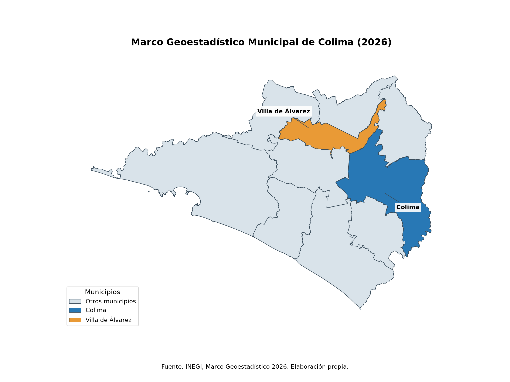

# Q01 — Evaluación de calidad del producto ISO/IEC 25010

## 1. Información general

| Elemento | Descripción |
|---|---|
| Proyecto | Observatorio de Vivienda y Costos de Colima |
| Repositorio | Trusted Data Lab |
| Etapa | E2 |
| Materia | Calidad en los Sistemas de Información |
| Integrantes | Nancy Haide Vázquez Ávalos y David Cuevas Farías |
| Responsable asignada | Nancy Haide Vázquez Ávalos |
| Ejecución de mediciones | David Cuevas Farías |
| Fecha de evaluación | 23 de noviembre de 2026 |
| Versión evaluada | Commit e2c8cb0 |
| Rama | main |
| Norma de referencia | ISO/IEC 25010:2011 |
| Estado | Evaluación inicial documentada; revisión del equipo pendiente |

## 2. Introducción

La calidad del producto de software constituye un elemento fundamental para garantizar que los procesos de captura, transformación, almacenamiento, análisis y publicación de datos del Observatorio de Vivienda y Costos de Colima funcionen de manera adecuada.

Durante la etapa E2 se realizó una evaluación del producto utilizando como referencia el modelo de calidad de ISO/IEC 25010:2011, considerando sus ocho características principales.

La evaluación se sustenta en pruebas automatizadas, mediciones de rendimiento, auditorías de dependencias, registros de captura, comprobaciones de compatibilidad, revisión manual del mapa geoespacial y ejecuciones de integración continua mediante GitHub Actions.

Los resultados permiten identificar fortalezas, deficiencias y oportunidades de mejora mediante evidencias verificables.

Esta evaluación tiene fines académicos y no representa una certificación oficial de cumplimiento de la norma.

## 3. Objetivo

Evaluar la calidad del producto de software desarrollado durante la etapa E2 mediante indicadores cuantitativos y cualitativos asociados con las ocho características del modelo ISO/IEC 25010:2011.

### 3.1. Objetivos específicos

- Comprobar el funcionamiento de los componentes mediante pruebas automatizadas.
- Medir los tiempos de lectura y el consumo de memoria.
- Verificar la compatibilidad de los formatos de almacenamiento.
- Evaluar la facilidad de utilización del mapa geoespacial.
- Determinar la fiabilidad de las capturas registradas.
- Identificar vulnerabilidades conocidas en las dependencias.
- Medir la cobertura y mantenibilidad del código.
- Comprobar la ejecución del sistema en diferentes entornos.

## 4. Marco de referencia

ISO/IEC 25010 forma parte de la familia de normas SQuaRE, orientada a los requisitos y la evaluación de calidad de sistemas y productos de software.

Para esta actividad se utiliza la edición 2011, cuyo modelo de calidad del producto contempla ocho características:

1. Adecuación funcional.
2. Eficiencia de desempeño.
3. Compatibilidad.
4. Usabilidad.
5. Fiabilidad.
6. Seguridad.
7. Mantenibilidad.
8. Portabilidad.

La edición 2023 presenta modificaciones en la estructura y terminología del modelo. Se conserva la clasificación de ocho características de la edición 2011 para mantener la correspondencia con los criterios académicos establecidos para E2.

## 5. Metodología de evaluación

La evaluación se realizó mediante las siguientes actividades:

- Ejecución de pruebas automatizadas con pytest.
- Medición de cobertura mediante pytest-cov.
- Análisis estático mediante Ruff.
- Auditoría de dependencias mediante pip-audit.
- Revisión de registros históricos de captura.
- Lectura de archivos CSV, JSON, GeoPackage y PNG.
- Medición experimental de tiempo y memoria.
- Evaluación manual del mapa municipal.
- Revisión de ejecuciones de GitHub Actions.
- Comprobación de reglas de exclusión de archivos sensibles.

Las metas utilizadas en las fichas constituyen criterios internos propuestos para valorar los resultados de esta evaluación inicial. No corresponden a umbrales obligatorios establecidos por ISO/IEC 25010 ni fueron definidos previamente como requisitos contractuales.

### 5.1. Escala de evaluación

| Calificación | Interpretación |
|---|---|
| Satisfactorio | La evidencia disponible cumple la meta propuesta. |
| Parcial | Existen resultados favorables, pero también limitaciones o comprobaciones pendientes. |
| Requiere mejora | El resultado medido no alcanza la meta propuesta. |
| No evaluado | No existe evidencia suficiente para determinar el resultado. |

## 6. Evaluación de las ocho características

Todas las fichas corresponden a la evaluación realizada el 23 de noviembre de 2026 sobre la versión e2c8cb0, salvo las evidencias experimentales e históricas que fueron recuperadas de actividades anteriores.

### 6.1. Adecuación funcional

#### Descripción

Capacidad del producto para proporcionar funciones que satisfacen las necesidades establecidas bajo condiciones específicas.

#### Ficha de evaluación

| Elemento | Resultado |
|---|---|
| Identificador | Q01-C01 |
| Característica | Adecuación funcional |
| Métrica | Porcentaje de pruebas automatizadas aprobadas |
| Fórmula | (Pruebas aprobadas / Pruebas ejecutadas) × 100 |
| Numerador | 145 |
| Denominador | 145 |
| Meta propuesta | 100 % |
| Resultado | 100 % |
| Tiempo de ejecución | 27.40 segundos |
| Calificación | Satisfactorio dentro del alcance probado |

#### Componentes evaluados

| Componente | Evidencia |
|---|---|
| Lectura de datos | tests/test_lectura.py |
| Limpieza | tests/test_limpieza.py |
| Integración | tests/test_integracion.py |
| Validación de calidad | tests/test_calidad.py |
| Cuarentena | tests/test_cuarentena.py |
| Transformaciones | tests/test_transformaciones.py |
| Reducción | tests/test_reduccion.py |
| Discretización | tests/test_discretizacion.py |
| Procesamiento geoespacial | tests/test_geoespacial.py |
| Trazabilidad | tests/test_trazabilidad_e2.py |
| Procesamiento integral | tests/test_pipeline.py |
| Modelos estadísticos | tests/test_modelos_estadisticos.py |
| Publicación | tests/test_publicacion.py |

#### Evidencia de ejecución

```text
145 passed in 27.40s
```

Comando utilizado:

```bash
python -m pytest tests/ -q --cov=src --cov=extractores --cov-report=term-missing --cov-report=json:data/reportes/cobertura_iso25010_e2.json
```

Evidencias:

- [Reporte de cobertura](../../../data/reportes/cobertura_iso25010_e2.json)
- [Directorio de pruebas](../../../tests/)
- [Configuración de integración continua](../../../.github/workflows/calidad-e1.yml)

#### Limitaciones

El porcentaje de pruebas aprobadas representa una aproximación a la adecuación funcional. No demuestra que el 100 % de los requisitos funcionales estén cubiertos, debido a que todavía no existe una matriz exhaustiva de requisitos contra casos de prueba.

#### Acción de mejora

Ampliar las pruebas de los extractores, los ejecutores de E2 y los módulos de experimentación estadística.

### 6.2. Eficiencia de desempeño

#### Descripción

Capacidad del producto para ofrecer un desempeño adecuado considerando los tiempos de respuesta y los recursos utilizados.

#### Ficha de evaluación

| Elemento | Resultado |
|---|---|
| Identificador | Q01-C02 |
| Característica | Eficiencia de desempeño |
| Métrica principal | Tiempo promedio de lectura de la capa Oro |
| Fórmula | Suma de tiempos de lectura / Número de ejecuciones |
| Número de ejecuciones | 10 |
| Registros procesados por ejecución | 564 |
| Meta propuesta | Tiempo promedio menor o igual a 100 ms |
| Resultado | 13.9944 ms |
| Calificación | Satisfactorio dentro del escenario evaluado |

#### Resultados de rendimiento

| Indicador | Resultado |
|---|---:|
| Tiempo promedio | 13.9944 ms |
| Tiempo mínimo | 7.4761 ms |
| Tiempo máximo | 28.4135 ms |
| Memoria Python promedio de los picos | 517.5033 KiB |
| Memoria Python máxima registrada | 541.5430 KiB |
| Número de corridas | 10 |
| Registros de la capa Oro | 564 |

Como criterio complementario se propone mantener el pico de memoria rastreada por Python por debajo de 1024 KiB para este escenario de lectura.

El máximo observado fue de 541.5430 KiB, por lo que se cumple dicho criterio.

#### Herramientas utilizadas

- time.perf_counter para medir tiempos.
- tracemalloc para rastrear asignaciones de memoria de Python.
- statistics para calcular promedios.
- Pandas para la lectura de datos y generación del reporte.

#### Evidencia experimental complementaria

Durante E2 también se realizaron experimentos factoriales para estudiar el efecto de diferentes factores sobre el tiempo de procesamiento.

| Experimento | Corridas analizadas | Resultado relevante |
|---|---:|---|
| Factorial 2³ de confirmación | 16 | Trazabilidad y Pandera presentan efectos significativos. |
| Factorial 2⁴ completo | 32 | Permite evaluar efectos principales e interacciones. |
| Factorial 2⁴⁻¹ fraccionado | 16 | Reduce en 50 % las corridas analizadas respecto al diseño completo. |

El diseño fraccionado fue obtenido a partir de las observaciones del diseño completo; no representa una nueva ejecución experimental independiente.

Evidencias:

- [Reporte de eficiencia](../../../data/reportes/eficiencia_iso25010_e2.csv)
- [Experimento factorial 2³](../analisis_estadistico/experimento_factorial_2_3.md)
- [Comparación factorial 2⁴](../analisis_estadistico/comparacion_factorial_2_4.md)

#### Limitaciones

Las mediciones corresponden a un equipo local y a un conjunto de 564 registros. No representan pruebas de carga masiva, concurrencia ni condiciones de producción.

La memoria obtenida mediante tracemalloc corresponde a asignaciones rastreadas por Python y no al consumo total de memoria RAM del proceso.

#### Acción de mejora

Realizar pruebas con mayores volúmenes de datos y medir el consumo total de memoria del proceso.

### 6.3. Compatibilidad

#### Descripción

Capacidad del producto para intercambiar información y utilizar formatos mediante diferentes herramientas de procesamiento.

#### Ficha de evaluación

| Elemento | Resultado |
|---|---|
| Identificador | Q01-C03 |
| Característica | Compatibilidad |
| Métrica | Porcentaje de comprobaciones de lectura aprobadas |
| Fórmula | (Comprobaciones aprobadas / Comprobaciones realizadas) × 100 |
| Numerador | 5 |
| Denominador | 5 |
| Meta propuesta | 100 % |
| Resultado | 100 % |
| Calificación | Satisfactorio dentro del alcance probado |

#### Pruebas realizadas

| Formato | Herramienta | Resultado | Estado |
|---|---|---|---|
| CSV | Pandas | 564 registros | Aprobado |
| CSV | DuckDB | 564 registros | Aprobado |
| JSON | Python | 2 elementos de nivel superior | Aprobado |
| GeoPackage | GeoPandas | 10 municipios | Aprobado |
| PNG | Pillow | 2400 × 1800 píxeles | Aprobado |

Durante la primera ejecución se detectó que DuckDB no estaba instalado en el entorno local.

El problema se corrigió mediante:

```bash
python -m pip install "duckdb>=1.1,<2"
```

La versión instalada fue DuckDB 1.5.6.

Posteriormente se repitieron las comprobaciones y las cinco finalizaron correctamente.

#### Evidencias

- [Reporte de compatibilidad](../../../data/reportes/compatibilidad_iso25010_e2.csv)
- [Mapa municipal](../../../reportes/figuras/mapa_municipios_colima_v2.png)
- [Dependencias del proyecto](../../../requirements.txt)

#### Limitaciones

Se verificaron cuatro formatos mediante cinco combinaciones de lectura.

La evaluación comprueba la apertura y lectura de los archivos, pero no garantiza interoperabilidad con todas las aplicaciones externas ni evalúa completamente la coexistencia con otros sistemas.

#### Acción de mejora

Incorporar estas comprobaciones a las pruebas automatizadas y evaluar herramientas externas de análisis geográfico.

### 6.4. Usabilidad

#### Descripción

Capacidad del producto para permitir que los usuarios comprendan y utilicen sus resultados de manera efectiva.

#### Ficha de evaluación

| Elemento | Resultado |
|---|---|
| Identificador | Q01-C04 |
| Característica | Usabilidad |
| Producto evaluado | Mapa municipal de Colima y Villa de Álvarez |
| Evaluador | David Cuevas Farías |
| Método | Evaluación manual de tareas |
| Métrica | Porcentaje de tareas completadas correctamente |
| Fórmula | (Tareas completadas / Tareas evaluadas) × 100 |
| Numerador | 5 |
| Denominador | 5 |
| Meta propuesta | 100 % |
| Resultado | 100 % |
| Calificación | Satisfactorio en la evaluación interna |

#### Resultados de la prueba manual

| ID | Tarea | Resultado |
|---|---|---|
| U01 | Abrir correctamente el mapa | Aprobado |
| U02 | Identificar el municipio de Colima | Aprobado |
| U03 | Identificar Villa de Álvarez | Aprobado |
| U04 | Comprender la leyenda | Aprobado |
| U05 | Verificar la legibilidad de los textos | Aprobado |

Las cinco tareas fueron confirmadas por el evaluador el 23 de noviembre de 2026.

#### Evidencia visual



#### Limitaciones

La evaluación fue realizada por un integrante del equipo que conoce previamente el proyecto.

No se realizaron pruebas con usuarios externos, mediciones de satisfacción ni evaluaciones específicas de accesibilidad.

El producto evaluado corresponde a una representación cartográfica estática y no a un tablero interactivo.

#### Acción de mejora

Realizar pruebas con usuarios externos e incorporar criterios de accesibilidad, contraste y comprensión de la información.

### 6.5. Fiabilidad

#### Descripción

Capacidad del producto para realizar sus funciones de manera consistente durante un periodo determinado.

#### Ficha de evaluación

| Elemento | Resultado |
|---|---|
| Identificador | Q01-C05 |
| Característica | Fiabilidad |
| Métrica | Porcentaje de capturas exitosas registradas |
| Fórmula | (Capturas exitosas / Capturas registradas) × 100 |
| Numerador | 106 |
| Denominador | 106 |
| Meta propuesta | Mayor o igual a 95 % |
| Resultado | 100 % |
| Calificación | Satisfactorio en la bitácora evaluada |

#### Resultados por fuente

| Fuente | Capturas registradas | Capturas exitosas | Porcentaje |
|---|---:|---:|---:|
| INEGI | 53 | 53 | 100 % |
| Banxico | 53 | 53 | 100 % |
| Total | 106 | 106 | 100 % |

La bitácora incluye registros históricos de diferentes etapas y series, incluyendo capturas iniciales anteriores a la selección definitiva del indicador INEGI.

#### Integración continua

Se revisaron las ejecuciones visibles del flujo Calidad E1 - Trusted Data Lab.

| Ejecución | Commit | Resultado |
|---|---|---|
| 33 | e2c8cb0 | Exitoso |
| 32 | d6fc572 | Exitoso |
| 31 | d6fc572 | Exitoso |
| 30 | 5bc1963 | Exitoso |
| 29 | 3e359ef | Exitoso |
| 28 | 04daacc | Exitoso |
| 27 | PR 18 | Exitoso |
| 26 | 2622d2e | Exitoso |
| 25 | PR 18 | Fallido |
| 24 | 01f2421 | Fallido |

Para esta ventana de diez ejecuciones consecutivas del flujo de calidad:

Tasa de éxito = (8 / 10) × 100 = 80 %.

Como meta complementaria se propone una tasa de éxito de integración continua mayor o igual a 95 %. La ventana analizada no alcanza dicha meta.

También se identificaron ejecuciones anteriores fallidas, por lo que no se considera que el historial completo de integración continua tenga un éxito del 100 %.

#### Recuperación ante defectos

Las ejecuciones 24 y 25 fueron seguidas por el commit 2622d2e, correspondiente a la corrección del orden de imports para cumplir con Ruff.

Las ejecuciones 26 y 27 finalizaron correctamente, aportando evidencia de recuperación después de la corrección.

#### Evidencias

- [Bitácora de capturas](../../../logs/capturas.csv)
- [Flujo de captura automática](../../../.github/workflows/captura.yml)
- [Flujo de calidad](../../../.github/workflows/calidad-e1.yml)
- [Historial de GitHub Actions](https://github.com/NancyHaideVazquez/trusted-data-lab/actions)
- [Commit de corrección de imports](https://github.com/NancyHaideVazquez/trusted-data-lab/commit/2622d2e)

#### Limitaciones

El resultado de capturas se limita a los registros existentes en la bitácora al momento de la medición.

No permite afirmar que todos los intentos externos, ejecuciones programadas o solicitudes no registradas hayan sido exitosos.

La tasa de integración continua corresponde únicamente a la ventana seleccionada y no al historial completo.

#### Acción de mejora

Monitorear continuamente las ejecuciones fallidas y establecer indicadores separados para captura, procesamiento e integración continua.

### 6.6. Seguridad

#### Descripción

Capacidad del producto para proteger la información y reducir los riesgos relacionados con accesos no autorizados, credenciales y dependencias vulnerables.

#### Ficha de evaluación

| Elemento | Resultado |
|---|---|
| Identificador | Q01-C06 |
| Característica | Seguridad |
| Herramienta | pip-audit 2.10.1 |
| Métrica | Hallazgos de vulnerabilidades conocidas |
| Meta propuesta | 0 hallazgos en las dependencias evaluadas |
| Paquetes reportados del proyecto | 162 |
| Paquetes vulnerables detectados | 0 |
| Hallazgos detectados | 0 |
| Calificación | Parcial |

#### Auditoría del entorno local

Se realizó inicialmente una auditoría sobre los paquetes instalados en el entorno general de Python.

| Indicador | Resultado |
|---|---:|
| Paquetes reportados | 140 |
| Paquetes vulnerables | 9 |
| Hallazgos reportados | 78 |
| Paquetes omitidos | 0 |

Los paquetes identificados fueron:

| Paquete | Versión instalada |
|---|---|
| certifi | 2026.7.22 |
| django | 6.0.7 |
| pillow | 12.3.0 |
| pip | 25.3 |
| soupsieve | 2.9.2 |
| sqlparse | 0.5.5 |
| tornado | 6.5.10 |
| urllib3 | 2.7.0 |
| werkzeug | 3.1.8 |

Los hallazgos corresponden al entorno general de Python, que incluye dependencias de otros proyectos.

Algunos identificadores aparecen repetidos en el reporte. Por ello, los 78 hallazgos no deben interpretarse automáticamente como 78 vulnerabilidades únicas ni como vulnerabilidades de severidad crítica.

#### Auditoría específica del proyecto

Se realizó una segunda auditoría utilizando el archivo requirements.txt.

```bash
python -m pip_audit -r requirements.txt --format json --output data/reportes/auditoria_proyecto_e2.json
```

Resultados:

| Indicador | Resultado |
|---|---:|
| Paquetes reportados | 162 |
| Paquetes vulnerables detectados | 0 |
| Hallazgos detectados | 0 |

La herramienta no identificó vulnerabilidades conocidas en las versiones resueltas para esta auditoría.

Este resultado no elimina los hallazgos del entorno instalado ni demuestra que todas las versiones utilizadas en producción sean seguras.

#### Protección de credenciales

| Archivo o patrón | Resultado |
|---|---|
| .env | Ignorado |
| *.pem | Ignorado mediante archivo de prueba |
| *.key | Ignorado mediante archivo de prueba |
| secrets.json | Ignorado |
| credentials.json | Ignorado |

Resultado de la comprobación:

(5 / 5) × 100 = 100 % de los casos de exclusión probados.

La revisión de nombres de archivos versionados no identificó archivos sensibles que coincidieran con los patrones evaluados.

Los flujos de GitHub Actions utilizan GitHub Secrets para proporcionar los tokens de INEGI y Banxico.

#### Consistencia de dependencias

El comando:

```bash
python -m pip check
```

Produjo el resultado:

```text
No broken requirements found.
```

#### Evidencias

- [Auditoría del entorno local](../../../data/reportes/auditoria_dependencias_e2.json)
- [Auditoría específica del proyecto](../../../data/reportes/auditoria_proyecto_e2.json)
- [Archivo gitignore](../../../.gitignore)
- [Dependencias](../../../requirements.txt)
- [Configuración de captura](../../../.github/workflows/captura.yml)
- [Declaración de ética y legalidad](../../etica-datos.md)

#### Limitaciones

No se realizó un escaneo con Gitleaks porque la herramienta no estaba instalada en el entorno evaluado.

La revisión de nombres de archivos no garantiza la ausencia de secretos dentro del contenido de los archivos o del historial de Git.

Tampoco se realizó una clasificación completa de severidad de los hallazgos ni una prueba de penetración.

Por estas razones, la característica se califica como parcial.

#### Acciones de mejora

- Ejecutar Gitleaks sobre el repositorio y su historial.
- Utilizar un entorno virtual exclusivo para Trusted Data Lab.
- Auditar las versiones efectivamente instaladas en dicho entorno.
- Revisar la severidad y aplicabilidad de los hallazgos.
- Incorporar auditorías de seguridad periódicas a GitHub Actions.
- Mantener un registro reproducible de las versiones utilizadas.

### 6.7. Mantenibilidad

#### Descripción

Capacidad del producto para facilitar su análisis, modificación, corrección y evolución.

#### Ficha de evaluación

| Elemento | Resultado |
|---|---|
| Identificador | Q01-C07 |
| Característica | Mantenibilidad |
| Métrica principal | Cobertura de instrucciones del código |
| Fórmula | (Instrucciones cubiertas / Instrucciones totales) × 100 |
| Instrucciones totales | 2261 |
| Instrucciones no cubiertas | 1438 |
| Instrucciones cubiertas | 823 |
| Meta propuesta | Mayor o igual a 80 % |
| Resultado | 36.40 % |
| Calificación | Requiere mejora |

#### Cobertura general

Cobertura = (823 / 2261) × 100 = 36.40 %.

#### Cobertura por módulo

| Módulo | Cobertura |
|---|---:|
| calidad.py | 100 % |
| integracion.py | 100 % |
| reduccion.py | 100 % |
| discretizacion.py | 100 % |
| analisis_estacionariedad.py | 96 % |
| analisis_faltantes.py | 95 % |
| transformaciones.py | 94 % |
| trazabilidad.py | 89 % |
| lectura.py | 88 % |
| oro.py | 87 % |
| cuarentena.py | 86 % |
| limpieza.py | 74 % |
| diagnostico.py | 69 % |
| geoespacial.py | 55 % |
| modelos_pronostico.py | 32 % |
| pronostico_final.py | 32 % |
| Extractores principales | 0 % |
| mapa_colima.py | 0 % |
| metricas_iso25012.py | 0 % |

La cobertura muestra que diversos componentes centrales cuentan con pruebas suficientes para ejecutar una proporción elevada de sus instrucciones.

Sin embargo, existen módulos completos sin cobertura, especialmente extractores, scripts de experimentación y ejecutores de procesos.

#### Análisis estático

Comando utilizado:

```bash
python -m ruff check src tests
```

Resultado:

```text
All checks passed!
```

#### Modularidad

| Indicador | Resultado |
|---|---:|
| Módulos Python en src | 36 |
| Archivos de pruebas test_*.py | 15 |
| Pruebas automatizadas aprobadas | 145 |
| Hallazgos reportados por Ruff en el alcance revisado | 0 |

El proyecto utiliza una estructura modular que separa captura, limpieza, integración, validación, trazabilidad, análisis estadístico y visualización.

#### Evidencias

- [Reporte de cobertura](../../../data/reportes/cobertura_iso25010_e2.json)
- [Código fuente](../../../src/)
- [Extractores](../../../extractores/)
- [Pruebas automatizadas](../../../tests/)
- [Flujo de calidad](../../../.github/workflows/calidad-e1.yml)

#### Limitaciones

La cobertura de instrucciones no demuestra por sí sola la calidad de las pruebas ni la ausencia de defectos.

El análisis de Ruff se limitó a los directorios src y tests.

No se realizaron mediciones específicas de complejidad ciclomática, acoplamiento o duplicación de código.

#### Acciones de mejora

- Crear pruebas unitarias para los extractores.
- Simular respuestas HTTP de INEGI y Banxico.
- Incorporar pruebas para los ejecutores de E2.
- Evaluar automáticamente la generación del mapa.
- Crear pruebas para los scripts de métricas ISO.
- Incrementar progresivamente la cobertura general hasta alcanzar la meta propuesta.

### 6.8. Portabilidad

#### Descripción

Capacidad del producto para ejecutarse en diferentes entornos tecnológicos.

#### Ficha de evaluación

| Elemento | Resultado |
|---|---|
| Identificador | Q01-C08 |
| Característica | Portabilidad |
| Métrica | Porcentaje de entornos con ejecución satisfactoria de pruebas |
| Fórmula | (Entornos aprobados / Entornos evaluados) × 100 |
| Numerador | 2 |
| Denominador | 2 |
| Meta propuesta | 100 % |
| Resultado | 100 % |
| Calificación | Satisfactorio dentro del alcance probado |

#### Entornos evaluados

| Entorno | Python | Evidencia | Resultado |
|---|---|---|---|
| Windows local | 3.14.3 | 145 pruebas aprobadas | Aprobado |
| Ubuntu mediante GitHub Actions | 3.11 | Ejecución de calidad 33 | Aprobado |

#### Evidencia de GitHub Actions

| Elemento | Resultado |
|---|---|
| Flujo | Calidad E1 - Trusted Data Lab |
| Ejecución | 33 |
| Commit | e2c8cb0 |
| Rama | main |
| Sistema configurado | ubuntu-latest |
| Python configurado | 3.11 |
| Duración | 1 minuto y 5 segundos |
| Estado | Exitoso |

La ejecución del flujo incluye instalación de dependencias, revisión con Ruff, pruebas automatizadas y comprobaciones de la puerta de calidad mediante Pandera y cuarentena.

#### Evidencias

- [Flujo de calidad](../../../.github/workflows/calidad-e1.yml)
- [GitHub Actions](https://github.com/NancyHaideVazquez/trusted-data-lab/actions)
- [Versión evaluada](https://github.com/NancyHaideVazquez/trusted-data-lab/commit/e2c8cb0)
- [Reporte de cobertura local](../../../data/reportes/cobertura_iso25010_e2.json)
- [Dependencias del proyecto](../../../requirements.txt)

#### Limitaciones

La comprobación demuestra la ejecución satisfactoria de las pruebas en dos configuraciones diferentes.

No demuestra que todos los scripts manuales, experimentos, procesos de captura y componentes visuales hayan sido ejecutados en ambos entornos.

Tampoco se realizaron pruebas en macOS ni en otras distribuciones de Linux.

#### Acción de mejora

Configurar una matriz de integración continua que permita ejecutar las pruebas en diferentes sistemas operativos y versiones de Python.

## 7. Matriz consolidada de resultados

| ID | Característica | Meta propuesta | Resultado real | Calificación |
|---|---|---|---|---|
| Q01-C01 | Adecuación funcional | 100 % de pruebas aprobadas | 145/145; 100 % | Satisfactorio |
| Q01-C02 | Eficiencia | Promedio ≤ 100 ms | 13.9944 ms | Satisfactorio |
| Q01-C03 | Compatibilidad | 100 % | 5/5; 100 % | Satisfactorio |
| Q01-C04 | Usabilidad | 100 % de tareas | 5/5; 100 % | Satisfactorio |
| Q01-C05 | Fiabilidad | Capturas ≥ 95 %; CI ≥ 95 % | Capturas 100 %; CI 80 % en la ventana evaluada | Parcial |
| Q01-C06 | Seguridad | 0 hallazgos y revisión de secretos | 0 hallazgos en dependencias resueltas; escaneo pendiente | Parcial |
| Q01-C07 | Mantenibilidad | Cobertura ≥ 80 % | 36.40 %; Ruff aprobado | Requiere mejora |
| Q01-C08 | Portabilidad | 100 % de entornos probados | 2/2; 100 % | Satisfactorio |

### 7.1. Distribución de calificaciones

| Calificación | Características | Porcentaje |
|---|---:|---:|
| Satisfactorio | 5 | 62.5 % |
| Parcial | 2 | 25.0 % |
| Requiere mejora | 1 | 12.5 % |
| No evaluado | 0 | 0 % |
| Total | 8 | 100 % |

El 100 % de las características cuenta con una evaluación inicial.

Esto no significa que el producto cumpla el 100 % de los requisitos de calidad de ISO/IEC 25010.

La distribución representa la clasificación interna de las características y no constituye una puntuación oficial de la norma.

## 8. Registro de hallazgos y oportunidades de mejora

Los siguientes identificadores corresponden a hallazgos de esta evaluación interna. No representan defectos emitidos por una auditoría cruzada externa.

| ID | Hallazgo | Prioridad propuesta | Acción |
|---|---|---|---|
| Q01-H01 | Cobertura general de 36.40 % | Alta | Ampliar las pruebas automatizadas. |
| Q01-H02 | Extractores principales con cobertura de 0 % | Alta | Crear pruebas con respuestas HTTP simuladas. |
| Q01-H03 | Gitleaks no disponible | Alta | Incorporar escaneo de secretos. |
| Q01-H04 | Hallazgos en el entorno general de Python | Alta | Aislar y auditar las dependencias efectivamente utilizadas. |
| Q01-H05 | Evaluación de usabilidad sin usuarios externos | Media | Realizar pruebas con participantes externos. |
| Q01-H06 | Ejecuciones históricas fallidas en Actions | Media | Analizar causas y monitorear tasas de éxito. |
| Q01-H07 | Rendimiento medido con 564 registros | Media | Realizar pruebas con mayores volúmenes. |
| Q01-H08 | DuckDB ausente inicialmente | Media | Verificar instalación completa de dependencias. |
| Q01-H09 | Portabilidad limitada a las pruebas ejecutadas | Media | Ampliar la matriz de entornos y procesos. |

## 9. Plan de mejora continua

| Prioridad | Actividad | Indicador de seguimiento | Estado |
|---|---|---|---|
| Alta | Incrementar cobertura de código | Cobertura ≥ 80 % | Pendiente |
| Alta | Implementar pruebas de extractores | Cobertura superior a 0 % | Pendiente |
| Alta | Ejecutar Gitleaks | Reporte de escaneo disponible | Pendiente |
| Alta | Aislar el entorno de dependencias | Entorno reproducible y auditado | Pendiente |
| Media | Mejorar fiabilidad de integración continua | Tasa de éxito ≥ 95 % | Pendiente |
| Media | Evaluar usabilidad externa | Tareas completadas por usuarios externos | Pendiente |
| Media | Ampliar pruebas de rendimiento | Mediciones con diferentes volúmenes | Pendiente |
| Media | Ampliar pruebas de portabilidad | Matriz de entornos ejecutada | Pendiente |

Las responsabilidades individuales y fechas de atención deberán acordarse durante la revisión del equipo.

## 10. Inventario de evidencias

| Evidencia | Ubicación |
|---|---|
| Cobertura de código | data/reportes/cobertura_iso25010_e2.json |
| Auditoría del entorno local | data/reportes/auditoria_dependencias_e2.json |
| Auditoría específica del proyecto | data/reportes/auditoria_proyecto_e2.json |
| Compatibilidad | data/reportes/compatibilidad_iso25010_e2.csv |
| Eficiencia | data/reportes/eficiencia_iso25010_e2.csv |
| Historial de capturas | logs/capturas.csv |
| Mapa municipal | reportes/figuras/mapa_municipios_colima_v2.png |
| Pruebas automatizadas | tests/ |
| Integración continua | .github/workflows/calidad-e1.yml |
| Captura automática | .github/workflows/captura.yml |
| Protección de archivos | .gitignore |
| Dependencias | requirements.txt |
| Evaluación de calidad de datos | docs/E2/calidad/iso25012.md |
| Experimentos factoriales | docs/E2/analisis_estadistico/ |

## 11. Reproducibilidad

Para repetir las comprobaciones principales se pueden utilizar los siguientes comandos desde la raíz del repositorio:

```bash
python -m pytest tests/ -q
```

```bash
python -m pytest tests/ -q --cov=src --cov=extractores --cov-report=term-missing --cov-report=json:data/reportes/cobertura_iso25010_e2.json
```

```bash
python -m ruff check src tests
```

```bash
python -m pip_audit --format json --output data/reportes/auditoria_dependencias_e2.json
```

```bash
python -m pip_audit -r requirements.txt --format json --output data/reportes/auditoria_proyecto_e2.json
```

```bash
python -m pip check
```

```bash
git check-ignore .env prueba.pem prueba.key secrets.json credentials.json
```

Los reportes de eficiencia y compatibilidad fueron generados mediante scripts temporales de Python ejecutados desde PowerShell.

Para mejorar la reproducibilidad, se propone incorporar dichos procedimientos como scripts permanentes del repositorio.

La reproducción de las pruebas que utilizan archivos de Plata y Oro requiere disponer de los productos locales generados por el pipeline.

Los resultados pueden variar debido a cambios en el hardware, las dependencias, los datos y las bases de información sobre vulnerabilidades.

## 12. Relación con ISO/IEC 25012

La evaluación de ISO/IEC 25010 se concentra en las características de calidad del producto de software.

Por otra parte, ISO/IEC 25012 permite evaluar las características de calidad de los datos gestionados por el sistema.

Ambos modelos se complementan dentro del proyecto:

| ISO/IEC 25010 | ISO/IEC 25012 |
|---|---|
| Evalúa el producto de software. | Evalúa la calidad de los datos. |
| Considera funcionamiento y desempeño. | Considera exactitud y completitud. |
| Evalúa mantenibilidad y portabilidad. | Evalúa trazabilidad y consistencia. |
| Considera seguridad del producto. | Considera confidencialidad de los datos. |

La evaluación complementaria se encuentra disponible en:

[Q02 — Evaluación de calidad de datos ISO/IEC 25012](iso25012.md).

## 13. Conclusión

La evaluación inicial basada en ISO/IEC 25010:2011 permitió analizar las ocho características de calidad del producto de software desarrollado durante E2.

Se obtuvieron resultados satisfactorios en adecuación funcional, eficiencia de desempeño, compatibilidad, usabilidad y portabilidad dentro de los escenarios evaluados.

Las 145 pruebas automatizadas finalizaron correctamente, los formatos de almacenamiento fueron accesibles mediante diferentes herramientas y la lectura de los 564 registros de la capa Oro presentó un tiempo promedio de 13.9944 milisegundos.

La fiabilidad de las capturas registradas alcanzó el 100 %, aunque se identificaron ejecuciones fallidas en el historial de integración continua.

En seguridad, la auditoría específica de las dependencias resueltas del proyecto no reportó vulnerabilidades conocidas. Sin embargo, la auditoría del entorno general identificó hallazgos que requieren revisión, y el escaneo de secretos mediante Gitleaks permanece pendiente.

La principal oportunidad de mejora corresponde a la mantenibilidad, debido a que la cobertura general de código fue de 36.40 %, por debajo de la meta interna propuesta del 80 %.

Los resultados constituyen una línea base para orientar futuras actividades de mejora continua, fortalecer la confiabilidad del producto y ampliar las evidencias de calidad.

La evaluación no representa una certificación oficial de cumplimiento de ISO/IEC 25010.

## 14. Referencias

- ISO/IEC 25010:2011. Systems and software engineering — Systems and software Quality Requirements and Evaluation (SQuaRE) — System and software quality models.
- ISO/IEC 25010:2023. Systems and software engineering — Systems and software Quality Requirements and Evaluation (SQuaRE) — Product quality model.
- ISO/IEC 25012:2008. Software engineering — Software product Quality Requirements and Evaluation (SQuaRE) — Data quality model.
- Documentación de pytest: https://docs.pytest.org/
- Documentación de pytest-cov: https://pytest-cov.readthedocs.io/
- Documentación de Ruff: https://docs.astral.sh/ruff/
- Documentación de pip-audit: https://github.com/pypa/pip-audit
- Documentación de GitHub Actions: https://docs.github.com/actions
- Repositorio Trusted Data Lab: https://github.com/NancyHaideVazquez/trusted-data-lab

## 15. Uso de inteligencia artificial generativa

Se utilizó ChatGPT como herramienta de apoyo para estructurar la evaluación, diseñar comandos de comprobación, interpretar resultados y organizar la documentación.

Las mediciones cuantitativas fueron obtenidas mediante ejecuciones reales en el entorno local y mediante la revisión de los registros de GitHub Actions.

Los resultados, limitaciones y hallazgos fueron documentados sin sustituir las mediciones por valores simulados.

## 16. Control de revisión

| Actividad | Responsable | Estado |
|---|---|---|
| Ejecución de mediciones | David Cuevas Farías | Realizada |
| Elaboración de evaluación inicial | David Cuevas Farías | Documentada |
| Revisión de Q01 | Nancy Haide Vázquez Ávalos | Pendiente de confirmación |
| Validación conjunta | Nancy y David | Pendiente |
| Seguimiento de acciones de mejora | Equipo | Pendiente |

**Estado de Q01:** evaluación inicial de las ocho características documentada, con evidencias cuantitativas, limitaciones y acciones de mejora identificadas.
